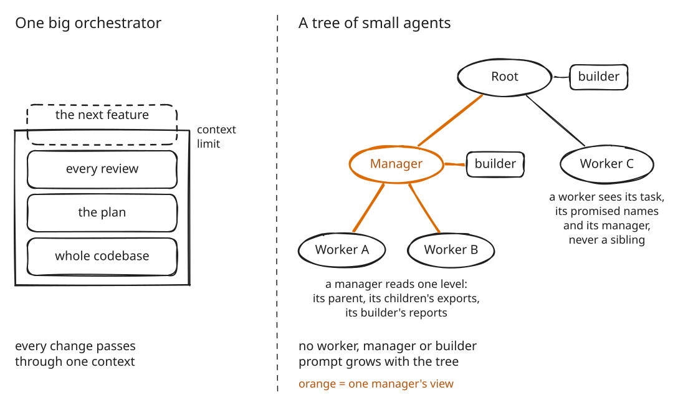
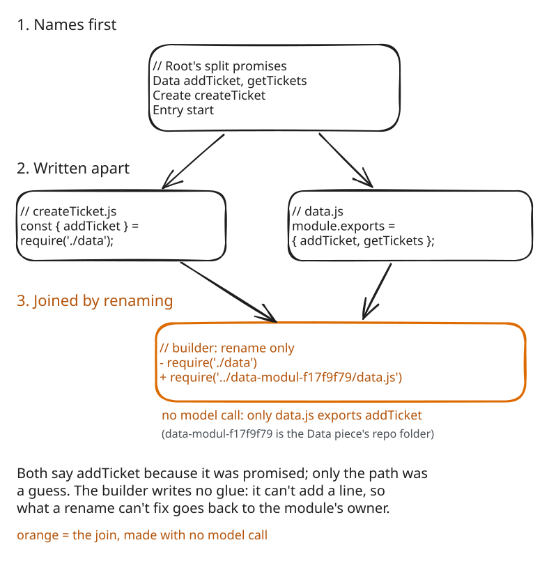
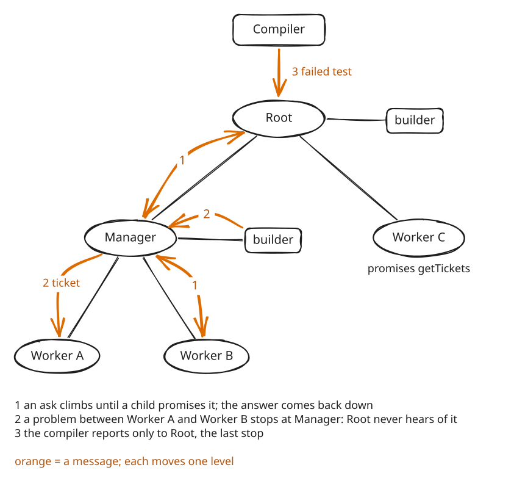

# Recursive Control Plane

**A repeatable process stands in for intelligence.** The model that writes the code, Qwen3-30B-A3B, activates about 3B parameters per token and never holds the plan; the process around it does. Four ideas carry it, one per diagram below.

1. **Many small agents, one level each.** Workers write, managers split, builders join, one compiler runs the app. No worker, manager or builder prompt grows with the project.
2. **Names first, so joining is only renaming.** A manager names the functions each piece will export before handing work down, so pieces written apart already fit, and the builder that joins them may only rename.
3. **One level at a time.** Asks and problems move only between parent and child, and a problem is settled by the lowest manager that owns every party. Root is just the manager at the top: the last stop.
4. **A cheap check after every step.** Clef, a yes/no classifier, gates every split and every scope check; parsing, the promised exports, a rename check and one fixed test check the rest. A failure goes back around the loop, never to a smarter model.

In run9, the linked app loaded and started on every round and each repair round fixed a real bug, but no run has yet finished a fully correct application.

This is an entry for Cloudflare's "build the next GitHub" competition, which asks for a new way for many agents to work on one codebase at the same time. Nothing is merged: every agent commits only to its own Artifacts git repository. Promised names replace agreed interfaces, mechanical checks replace review, and a problem inbox at each manager replaces issues. It all runs on Cloudflare: Workers, Durable Objects, Workers AI (Qwen3-30B-A3B writes, Clef-flash answers yes/no), Artifacts and Containers.

## Many small agents, not one orchestrator

<a href="docs/diagrams/small-agents.svg"><picture>
  <source media="(prefers-color-scheme: dark)" srcset="docs/diagrams/small-agents-dark.svg">
  
</picture></a>

One orchestrator holds the codebase, the plan and every review in one context. Here each agent reads one level of the tree. A worker sees its task, the names it must export and its manager, never a sibling. A manager sees its direct children by their exports; a whole branch below reaches it as a few names. No model call reads the whole application: a failed test becomes a requirement that the managers route by the plan. In run8 and run9, every prompt Root's builder sent was under 4,000 tokens.

## Names first, so joining is only renaming

<a href="docs/diagrams/tape-not-glue.svg"><picture>
  <source media="(prefers-color-scheme: dark)" srcset="docs/diagrams/tape-not-glue-dark.svg">
  
</picture></a>

The builder is tape, not glue: it may rename, never write. Each split promises at most five named functions per piece, so independent agents converge on code that already agrees on almost every name, and a worker imports the name the plan gives it instead of guessing. The builder may change an import path, a name or how an import binds, and nothing else; the runtime checks every edit token by token (line breaks aside) and makes the fixes it can find itself with no model call. What renaming can't fix goes back to the module's owner. In run9, every relink after the first needed no model call.

## One level at a time; Root is the last stop

<a href="docs/diagrams/one-level.svg"><picture>
  <source media="(prefers-color-scheme: dark)" srcset="docs/diagrams/one-level-dark.svg">
  
</picture></a>

A worker asks its manager for every function it needs; the ask climbs one level at a time until a manager's child promises it, and the answer comes back down the same hops. A problem stops at the lowest manager whose branch holds every party, so a mistake inside a branch is settled there. Root runs the same manager code and differs only by position: it has no parent, and the compiler, its one extra child (drawn above it), reports only to Root. In run9, Root answered an ask for `getTickets` from its plan, by name. No live run since v7.14 has had a sub-manager; below Root, tests cover this.

## One loop, checked at every step

<a href="docs/diagrams/the-loop.svg"><picture>
  <source media="(prefers-color-scheme: dark)" srcset="docs/diagrams/the-loop-dark.svg">
  
</picture></a>

Put together, it is one repeatable loop that every piece of work goes through; each step that produces something ends in a check (orange). Whatever fails goes back along the dashed path to the step that can fix it, never to a smarter model, and a manager stops after three rounds in a row without progress. The expensive model only writes code; the loop and its checks carry the plan. In run9, Clef made every split decision.

## Choices the diagrams don't show

- **One Artifacts git repo per agent, one commit per turn:** nothing to merge, nothing to conflict.
- **Prune on discovery:** below Root, a proposed child that another branch already owns is never spawned.
- **The first test stays fixed** for the whole run, so repairs can't move the goalposts, and it is bounded by the plan: the runner asserts only what the goal, the API and the promises state.
- **State lives in Durable Objects,** per room and per manager, so an interrupted turn resumes.

## Run it

Requirements: Node.js 22.13 or newer, Docker running locally, and a Cloudflare account with Workers AI, Artifacts, Durable Objects and Containers (Containers need the Workers Paid plan).

```bash
git clone https://github.com/tyrtop-ai/cloudflare-comp.git
cd cloudflare-comp
npm ci && npm test                  # local checks with fakes; no Cloudflare account needed
npx wrangler login
npm run deploy                      # Docker must be running: this builds the Container image
npx wrangler secret put APP_TOKEN   # any long random string
```

Open the `workers.dev` URL that Wrangler prints, paste the token, and press **Start**. The dashboard draws the run as a tree; select a node to see its inference path in orange. **Download app (.zip)** saves the result. [INSTALL-CLOUDFLARE.md](INSTALL-CLOUDFLARE.md) covers the Artifacts namespace, the API, exports and troubleshooting.

## Status

This is v7.15.13. Run9, the first live run on v7.15, ran out of its flat repair budget (v7.15.1 makes it progress-aware), and in run10 a malformed split answer left Root writing everything alone (v7.15.2 repairs or retries it). Run11 finished in 11 minutes with the runner's test passing, but only after its entry module reimplemented every function itself; v7.15.3 fixes two of the causes, a swapped argument order blamed on the wrong worker and a prune walk that discarded good pieces, and v7.15.4 targets the monolith itself: a piece that writes a function another piece promised is sent back to import it, and an entry that does not reach every operation's piece is sent back before the runner's test. Run12 failed earlier, in the plan: the data piece promised only a factory, so the pieces shared no data, and the entry asked for `goalOperation1` and wired two of four operations. v7.15.5 composes the entry from the plan, checks coverage against the plan, sends a factory back to the splitter, and has each piece's plan name the functions it uses; a replay of run12 through all of it now ends with the runner's test passing. Run13, on v7.15.5, was the first run to work through the plan: clean split, entry composed, linked without a model call, loaded first time, and two repair rounds that fixed real bugs in the right pieces. It then stalled on a failure the compiler could not attribute, which fell to the entry module by default. v7.15.6 makes the repair half mirror the construction half: the compiler reports a requirement and the manager routes it by the plan, exactly as it routes a function request, with the four patches that stood in for that removed; the same plan binds the linker (a promised name links to its owner's module and a stub is left out of the bundle), one contract check replaces five detectors, and the runner's test is bounded by the promises. Run14, on v7.15.6, was the first run to go end to end through the plan: a clean split with a storage piece, uses planned, the entry composed, linked with 11 renames and no model call, loaded first time, coverage 4/4, the runner bounded; it failed on a plan gap: `readTickets` was async and returned an array, its promise said neither, so rounds 1 and 2 took the link path and rounds 3 to 5 carried no provider facts. v7.15.7 makes a promise state its shape: what a call returns, `async` in every surface, and a call to an imported function awaited before any linking; a built-in's member error on a named import's result is a requirement on the caller, never a relink; a ticket routed to a worker by its own promise carries the facts of its planned uses; and an operation no piece promises grows the plan. A replay of run14 through all of it, with its live revisions, now ends with the runner's test passing in one repair round. Run15, on v7.15.6, failed on the next plan gap: `createTicket` promised nothing about returning the ticket, returned nothing, and the test read its id anyway; the failure was then routed by the call on the failing line to View Ticket, five times. v7.15.8 routes a read of a result to its producer, makes a stated return value a contract checked before any linking, and keeps the runner from depending on a result nothing states. **Run16, on v7.15.8, completed in 3.9 minutes in one round: the first live run in which the composed system produced a correct, verified application**, six pieces linked by 11 renames and no model call, two contract send-backs fixed in one revision each, and the runner's first draft passing. Its one cost was the splitter's first turn, two minutes of reasoning with no answer; v7.15.9 reads such an answer as none and retries without thinking. Runs 17 to 20 tried a second, larger goal, a network diagnostics engine with 20 rules behind one stated `analyze(snapshot)` method; run20 got as far as a composed, linked, loading application and a 100-line runner test, then lost five rounds to one caller bug the summary hid. v7.15.13 reads a goal's stated API into the plan, lets the plan's own words outrank Clef's doubt, and routes a parameter error to the caller that built the value. Every run, and the known limitations: [docs/how-it-works.md](docs/how-it-works.md#status).

## More

- [docs/how-it-works.md](docs/how-it-works.md): the full mechanism, the Cloudflare products, every live run, known limitations and the repository layout.
- [INSTALL-CLOUDFLARE.md](INSTALL-CLOUDFLARE.md): deploying, the API and exports.
- [CHANGELOG-v7.15.md](CHANGELOG-v7.15.md), [v7.14](CHANGELOG-v7.14.md), [v7.13](CHANGELOG-v7.13.md): what changed, with the evidence behind each change.
- [docs/history/](docs/history/): earlier changelogs and READMEs.
- [docs/diagrams/](docs/diagrams/): Excalidraw scenes (open at excalidraw.com); after an edit, export light and dark SVGs with fonts embedded.

## License

MIT, see [LICENSE](LICENSE). The vendored Acorn parser is MIT licensed, see [src/vendor/ACORN-LICENSE](src/vendor/ACORN-LICENSE). The fonts embedded in the diagrams are under the SIL Open Font License, see [docs/diagrams/fonts/](docs/diagrams/fonts/).
