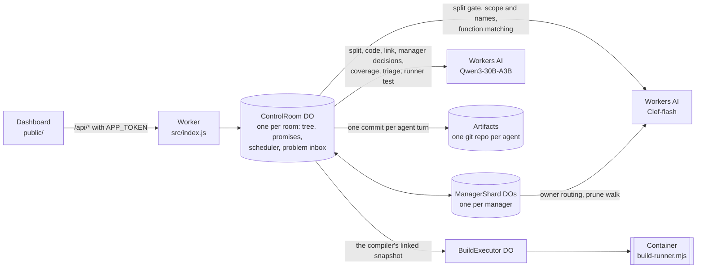
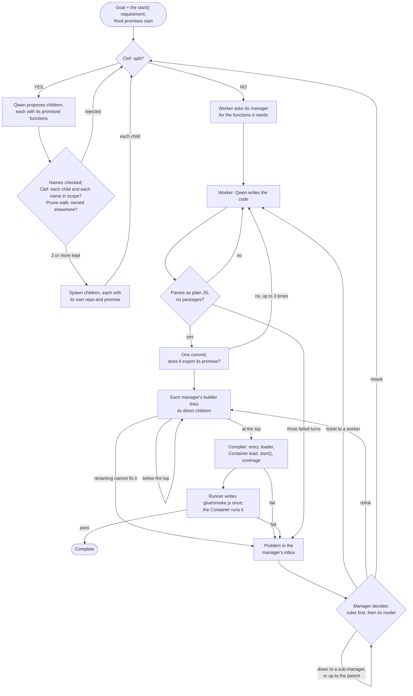

# Recursive Control Plane

A multi-agent code-writing control plane that runs entirely on Cloudflare. You give it a goal, and a tree of small agents:
- splits the work, promising a few named functions for each piece;
- writes the code in parallel;
- links the pieces;
- runs the result in a Container.

Each failure goes to the lowest manager whose branch holds every module involved, and that manager decides who changes what.

This is an entry for Cloudflare's "build the next GitHub" competition, which asks for a new way for multiple agents to work on code changes concurrently. The project rethinks what GitHub is built around (repositories, branches, pull requests, review, merge conflicts) for a world where the authors are many small agents instead of a few people.

> **Status:** this is v7.15.0. The live runs on Cloudflare so far, up to run8, all used v7.13.x. No live run has used v7.14 or v7.15, and no live run has yet finished with a correct, verified application. See [Status](#status) and the changelogs for [v7.15](CHANGELOG-v7.15.md), [v7.14](CHANGELOG-v7.14.md) and [v7.13](CHANGELOG-v7.13.md).

## The idea

The usual multi-agent design puts one large orchestrator in charge. It reads the codebase, plans, hands out work and reviews what comes back. Its context window then limits how large the project can grow, and every change passes through it.

This project makes the opposite bet: **many small agents with small, bounded context beat one big orchestrator agent with limited context.**

- **Bounded context.** No worker's, manager's or builder's model sees the whole project.
  - **Workers.** A worker's model sees its own assignment, which ends with its own promise: the functions it must export, by name. It also sees its own files and memory, its manager's messages, and the answers to its own requests for functions. Its parent appears only as "Manager". It never sees a sibling, another branch's functions or the wider tree.
  - **Splitters.** A node deciding how to split sees its own assignment, its own promise, the goal as a scope boundary, and its last rejected split.
  - **Managers.** A manager's model sees its direct children: a worker by its modules' exports, a sub-manager by its boundary (what its branch offers and still needs), and each child's promised functions.
  - **Builders.** A builder's model sees its manager's direct children in the same way, plus the files it must fix, excerpted when they lie inside a branch built below.
  - **The runner** sees only the goal and the API the application returned.

  The one model call that can read the whole application is the compiler's triage of a failed test that no stack frame attributes. It sees every module in full when they fit the model's context, and otherwise every module by its exports, with the entry in full. See [Known limitations](#known-limitations).
- **Each inference tree works only on its own scope.** Ownership works like functional programming.
  - A subtree owns its assignment and its promise, writes only to its own repositories, and shares no mutable state with its siblings.
  - Two subtrees never write to the same repository, so there is nothing to merge and nothing to conflict.
  - Scope is fixed when work is split. Below Root, a proposed child that another strand already owns is pruned before it is spawned: by its function names first, then by Clef.
- **Minimal tape.** Independent agents with well-scoped pieces of the same goal converge on code that is close enough to join with very little glue, and here the glue is literally minimal.
  - The builder that joins modules **may only rename import paths and identifiers, and change how an import binds its module when the target's exports call for it**. For example, `const { f } = require(p)` becomes `const f = require(p)` when `p` exports the single function `f`.
  - The runtime checks every edit token by token, though line breaks are not checked yet (see [Known limitations](#known-limitations)). [What a builder may change](#what-a-builder-may-change) gives the exact rule.
  - Anything these edits cannot fix becomes a problem that the managers settle, one level at a time.

## Four roles

Every node in the tree has one of four roles:

| Role | Does | Never |
|---|---|---|
| **Worker** | Writes modules, exports the functions it promised, asks its manager for every function it needs, and fixes its own modules when its manager sends it a repair ticket | Decides for others |
| **Manager** (Root included) | Splits its assignment, promising functions for each child; scope-checks and prunes its children; answers function requests from its direct children's promises; solves the problems in its inbox: assign, escalate, retire or retask | Writes code, or reaches below its direct children |
| **Builder** (one per manager, a child of it) | Links the manager's direct children, rename-only plus the runtime's binding fixes, and reports what renaming cannot fix to its manager | Decides who changes what |
| **Compiler** (one per run, a child of Root) | Chooses the entry, writes the runtime loader and package, loads and starts the application in a Container, checks the API it returned, has a separate runner test it, and reports failures to Root | Writes or edits application code |

**A manager owns only its direct children, and problems and requests move one level at a time.**
- A builder reports to its own manager, and the compiler reports to Root.
- A manager either assigns a problem to one of its direct children or escalates it to its parent.
- A problem is solved by the lowest manager whose branch contains every party to it. So a mistake between two modules of one branch is settled inside that branch, without Root.
- A worker's request for a function goes to its manager, which answers from its direct children's promises or passes it up to its own parent.

**Root is the final stop on the train, not a special manager.**
- It splits exactly like every other manager.
- When a run starts, the runtime appends one requirement to the goal:
  > The finished application has one entry module that exports start(); start() takes no arguments and returns an object with one method per operation named above. Modules get what they need from other modules only by importing it. Importing a module does no work at load: no reading process.argv, starting a server or prompting.

  The splitters assign that requirement like any other.
- Root's promise is `start`, the only promise the runtime writes. Root's split gives it to one child, like any promised name.
- The compiler files a missing `start()` with Root as a normal problem.
- Root differs from other managers by position only:
  - It has no parent. Where another manager would escalate, Root closes the problem, and when its repair rounds run out, the run fails. A function request that reaches Root unanswered is answered "no piece promises it".
  - An import that resolves nowhere becomes a problem at Root, not a need on a branch boundary.
  - Its own split is not checked by the prune walk.
  - The compiler hangs under it.

## Promises

A node's **promise** is the functions its parent's split listed for it (Root's is `start`), at most five, each with a name, a one-line description, optional parameter hints, and an operation tag when it performs one of the goal's operations.
- **Names are binding.** The piece must export exactly these names, and other pieces import them by these names. A piece may export more.
- **Promises are checked before any child exists.** A bad name is deleted, never the piece; only a split that does not give each of its parent's promised names to exactly one piece is rejected.
- **Clef vets them in the same step** as the statements of work.
- **They are recorded**: in SQLite, which routing reads, and in each manager's `memory/private/ownership.json`.
- **They route.** A worker asks its manager for every function it needs, and the manager answers from its direct children's promises only, one level at a time.
- **They are checked on return and when linked.** A worker that does not export its promise is sent back, and the builders and the compiler read the plan.

[CHANGELOG-v7.15.md](CHANGELOG-v7.15.md) gives every rule.

## GitHub, rethought

| GitHub | Here |
|---|---|
| A shared repository | Every agent owns a private Cloudflare Artifacts git repository, created when the agent is spawned. Builders and the compiler get one too. |
| Branches and merge conflicts | Agents share no branch. An agent commits only to its own repository, so there is no shared branch to merge into and nothing to conflict. |
| Commits | One Artifacts commit per agent turn. Everything an agent writes in a turn is staged and pushed together, and a worker's messages leave only after its commit. |
| Interfaces agreed up front | Promises. Each split names the few functions each piece exports, and Clef vets them with the pieces' scope. |
| Merge | Each manager has a *builder* that links its direct children's finished modules. A builder may change import paths and identifier names, and how one import binds its module when the target's exports call for it. The runtime compares the Acorn token streams before and after every edit (whitespace and comments are not compared). It rejects any edit that changes another token, unless the result is, token for token, the runtime's own binding fix. It also rejects an edit that would drop a promised function or bind one promised function to another. |
| Pull request review | Mechanical gates replace reviewers. Clef admits each proposed child against the goal and its parent's assignment, and each function name a child adds. The prune walk drops a child another strand already owns. Each worker file must parse before it is committed, and a worker must export what it promised. Builder edits may change no token except an import path, a name, or an import's binding where the target's exports call for it. The compiler requires the linked application to load, to start, to return a method for each operation the goal names (as far as the coverage check can tell), and to pass a test written by a separate runner. |
| Issues and assignment | The problem inbox. A builder or the compiler files what renaming cannot fix with its manager. Each manager places a problem's parties among its own direct children and decides one level at a time. Deterministic rules decide first. The manager's model is asked only for a real choice, and the runtime validates every action it returns. |
| CODEOWNERS and blame | Provenance. A problem names its parties (the module that reads a name, the one that provides it, the line that failed, the piece that promised a function) and the worker that wrote each, through any number of nested builders. A worker hears it with the renames every builder made in its file since it published it, so a builder's rename is not mistaken for the worker's own code. |
| Discussion | Function requests. A worker asks only its manager, for each function it needs. The manager answers from its direct children's promises, by name or with one Clef call, or passes the request to its own parent, and the answer comes back down the same way. |
| CI | The compiler, one node under Root, runs the linked application and the runner's test in a Cloudflare Container. |

## Architecture



## Life of a run



1. **Goal.** The runtime appends the `start()` requirement to the goal text, and writes Root's promise: `start`.
2. **Split gate.** For every agent's assignment, Clef answers one typed YES/NO question: can this code be written as two or more independent modules? Clef returns a probability. At or above the room's threshold (default 0.7), Qwen proposes the children.
   - The splitter prompt is the same at every level. It asks for plain Node.js with built-in modules only: no TypeScript, UI frameworks or JSX, and no servers, frameworks or databases unless the goal asks for them.
   - For each child, the splitter gives a label, a task and its `functions`: at most five that code outside the piece calls. The splitter must give each function its own node promised, unchanged, to exactly one piece.
3. **Names checked.** Before Clef is asked, the runtime checks the names. A piece whose task says it "exports NAME(" carries NAME. A name that is not an identifier, is copied from the prompt's example, is listed by two pieces or comes past the fifth gets one retry in the same call, and is then deleted. Placeholder labels such as "Piece A" also get the retry. Only a split that does not give each promised name to exactly one piece is rejected. The next turn then keeps Clef's YES and gives the splitter its partition back.
4. **Scope check, in the same step.** Two Clef calls run in parallel:
   - one scores every proposed child against both the goal and the parent's assignment, and drops a child below 0.5;
   - one asks, for each name a child adds, whether that child's own assignment writes it, and a NO deletes only that name.

   A child that carries a name its parent promised is in scope by construction, and it takes its parent's description of that name.
5. **Prune walk (below Root).** Each admitted child is walked up the tree.
   - **By name first.** At each level, the promises of that level's other direct children are compared with the names the child adds. A child made only of names that one other branch promises is pruned to that branch, with no Clef call. Otherwise such names are deleted from it.
   - **Then by Clef,** for a child that carries none of its parent's names. At each level, Clef picks the direct child that owns its topic. If the asking branch owns it, the branch keeps the child. If another branch owns it, the child is pruned, and a short note tells the new children to import it from that strand. If no strand up to Root owns it, the child is killed.
   - A split needs at least two distinct children that survive and fit the room's agent and depth limits. A rejected split goes back to Clef and Qwen with the reasons.
6. **Spawn.** Each child gets its own Artifacts repository, and its promise is recorded. The parent becomes a manager permanently: it never writes code.
7. **Workers ask, then write.** When Clef says NO, the agent is a worker.
   - Its assignment ends with its contract: the functions it must export, each with its one-line description.
   - In its first answer, it asks its manager for every function its assignment does not list (what it does, and the name it expects; up to 8 at once), and waits. It writes only files that do not import what it asked for.
   - Its manager answers from its direct children's promises, by the expected name first and otherwise with one Clef call. A miss goes to the manager's parent, one level at a time up to Root, and the answer comes back down the same hops. See [Function requests](#function-requests-one-level-at-a-time).
   - The worker imports each function on its own line, by exactly the name it was given, with the name as the path: `const { loadTickets } = require('./loadTickets');`. The builder links each line to the module that exports that function.
   - The worker gets collaborators only by importing them, never as parameters, factories or a `start(...)` of its own.
8. **Parse check and commit.** Every file must contain executable JavaScript, parse with Acorn as CommonJS or as an ES module, and import no packages. A failure goes back to the same worker in the same turn. The worker's files for the turn are then pushed as one commit.
   - A worker that fails three turns in a row at this gate becomes a `stuck` problem for its manager.
   - A worker rejected for TypeScript, JSX or a package import is retasked once to plain JavaScript.
9. **Return check.** Before its done is accepted, a worker must export each promised function as a named export or a member of the exported object (a class's or instance's methods do not count). If it does not, it is sent back, up to three times. The fourth done is accepted, and a `contract` problem goes to its manager. Then its completion report goes to its manager.
10. **Builder link.** A manager's builder starts when every worker under the manager has finished and no repair is in flight there.
    - **Path fixes.** With no model call, the runtime points each import that resolves nowhere at the one module that clearly provides it. That is the only module exporting every name the file uses from the import; of several, the one whose piece the plan gives those names; or else the only module named like the import path that exports at least one of them. A branch builder accepts only an exact name.
    - **Binding fixes.** The runtime then fixes each import that is bound the wrong way round for its target.
    - **The model.** Files with an unresolved import or a mismatched name go to Qwen. The model reads each sub-manager child by its boundary, and a file inside such a branch as an excerpt.
    - **Checking edits.** The runtime keeps a model edit only if it is a rename or exactly the runtime's own binding fix ([What a builder may change](#what-a-builder-may-change)), and it does not drop or misdirect a promised function. It undoes a model rename that breaks an import that matched before.
    - **Relinks.** The builder relinks up to two times while problems remain that a rename could fix.
    - **Below the top**, it publishes the linked bundle and the branch's boundary, which always offers the modules exporting the manager's promise. An import that points outside the branch is left for the builder above. A function the manager promised that no module of the branch exports is a `contract` problem for the piece below that carries it.
    - **Reports.** Whatever renaming cannot fix inside the branch, it reports to its manager.
11. **Compiler.** Once Root's builder has linked the current source, the compiler takes over.
    - It picks the entry. That is the module that exports `start()`. Of several, it is the one whose `start()` returns an API without reading the command line, listening or prompting, then the one of the piece the plan gives `start`, then the one that imports the most others.
    - It writes a fixed loader (`glue/index.js`) and `package.json`, and sends the snapshot to the Container.
    - The Container parses every file, loads the entry, calls `start()`, and describes the API it returned: member names, kinds and parameter names, never source.
    - `start()` must return something to call, and not a single generic handler.
    - **Coverage.** Before the runner's test is fixed, a Qwen call maps each operation the goal names to the method of `start()`'s API that performs it. An operation with no method is an entry problem. With no usable mapping, the compiler reads the plan instead: `start()` returning fewer methods than the plan has operations is a gap, and otherwise the runner tests the plan's operation functions that `start()` returned.
    - **Runner.** A separate Qwen call, the runner, writes `glue/smoke.js` from the goal and that description alone, plus, when known, the method for each operation. The first test that runs stays fixed for the whole run: the application must satisfy it. When it passes, the room completes.
12. **Problems.** Builders, the compiler and stuck workers file problems. [Problems move one level at a time](#problems-move-one-level-at-a-time) describes how managers settle them.
    - A worker fixes its code; its branch builder relinks, its manager finishes again, and the compiler runs the new bundle.
    - Infrastructure failures blame nobody and wait for **Continue**. A runner that cannot write a valid test in three attempts gets one more round, then waits for **Continue**.

### What a builder may change

A builder's edits are `find`/`replace` text. The runtime decides whether to keep each one by comparing the Acorn token streams of the file before and after the edit (whitespace and comments are not compared). An edit is kept when every token it changes is one of these:

- **An import path:** a relative module path in a `require`, `import` or `from` position. No other string may change.
- **A variable name:** a variable this file declares, renamed at every use, to a name the file does not already use and that some other module defines or uses.
  - Two variables may not be renamed to one name.
  - A variable is not renamed if the file also reads the same name where that variable is not in scope (a global of the same name), or if the file uses `with` or `eval`.
  - A function or class is not renamed if the file reads its name back (`.name`) and also writes it as a string.
- **A member or key name:** renamed to a name some other module defines or uses.
  - A member this file defines changes at its definition and at every use together, and never onto a key its object or class already has. Definitions include an object key, a class member, and `x.m = …` on `this`, on the exports or on a variable of the file.
  - It cannot be renamed if the file uses `with` or `eval`, or names it as a string key: `x['m']`, `'m' in x`, `Object.defineProperty(x, 'm', …)` or `hasOwnProperty('m')`.
  - Nor can it be renamed if the file reaches an object that can hold it by a key decided at run time: a computed read such as `handlers[op]`, a computed destructuring, `in`, `for…in`, or `Object.keys`, `values` or `entries`. A plain write `x[k] = v` and a count `Object.keys(x).length` do not count.
  - To find which objects can hold the member, the runtime follows the file's variables, members, `this`, `module.exports`, calls to its own functions and their results, `Object.assign`, `Object.freeze`, spreads and `extends`.

Built-in names such as `require`, `eval` or `Math` are never renamed, and neither is a built-in method call such as `.push` that no module defines. The edited file must still parse.

An edit that renames an imported name `{ a }` to `{ b }` without the file's uses of it is kept as the alias `{ b: a }` (`import { b as a }`). This requires that the import still names the same module, and that the module exports `b` and not `a`. It also works when the file declares its own `b`, which made the plain rename fail to parse.

In a room with promises, the plan adds four refusals. An edit may not:
- remove a function the plan gives the module's piece;
- bind one planned function to another piece's planned function (`createTicket` to `saveTickets`);
- bind a name that its piece was told no piece promises to a planned function (`addTicket` to `saveTickets`);
- point a planned function at a module whose piece neither carries nor exports it.

The one change that is not a rename is how a single import binds its module. It is allowed only in these forms, and only when the target's exports call for it:

| The worker wrote | Becomes | Only when |
|---|---|---|
| `const { f } = require(p)` | `const f = require(p)` | `p`'s `module.exports` is a single function or class named `f`, nothing in `p` gives it a member `f`, and the file reads nothing off `f` except a class's static methods |
| `const f = require(p)` | `const { f } = require(p)` | `p` exports an object holding a function `f`, and the file only calls `f` |
| `const x = require(p)` | `const { m: x } = require(p)` (`const { x }` when `m` is `x`) | `p` exports exactly one member `m`, a function or class, and the file uses `x` only as a function: it calls or tests it, or keeps it in a variable or in a handler table read only by key |
| `const f = require(p)` | `const { f } = require(p)` | `p` exports an object holding `f` (a function, class or re-export, never the module's own data), and the file never calls or reads `f`, only passes it on as a value: an object property, array element, argument, return value or export |
| `import { f } from p` | `import f from p` | `p`'s only export is a default function or class named `f`, under the same conditions as the first row |
| `import f from p` | `import { f } from p` | `p` is an ES module with no default export, it exports a function `f`, and the file only calls `f` |
| `import x from p` | `import { m as x } from p` | `p` is an ES module with no default export whose only export is the function or class `m`, and the file uses `x` only as a function |
| `import f from p` | `import { f } from p` | `p` is an ES module with no default export that exports `f`, and the file only passes `f` on as a value |

The runtime makes these fixes itself, before the model is called and again after the model's edits. A model edit that changes how an import binds is kept only if, apart from renames, its result is exactly the runtime's own fix, compared token for token. Anything else goes to the builder's manager as a problem: several names destructured from a module that exports a single function, for example, or one import line that reads several promised functions living in different modules.

### Problems move one level at a time

A builder or the compiler files what it cannot fix with its manager, as rows in that manager's inbox. A worker that the code gate keeps rejecting, or whose accepted done still lacks a promised function, is filed by the runtime. Each problem has:
- **a kind:** `unresolved`, `mismatch`, `binding`, `entry`, `load`, `run`, `stuck` or `contract`;
- **parties:** the reader of a name, its provider, the line that failed, or the subject, each with the worker that wrote it.

Every manager runs the same steps on its inbox.

**1. Place the parties.** Each party falls under one of the manager's direct children, or outside its branch. The manager is the *lowest common manager* when the parties fall under two or more of its children, or under one child that is a worker.

**2. Apply the deterministic rules,** first match wins:
- **Hop limit.** A problem that has had `2 × depth + 2` decisions is closed.
- **Stuck worker.** A worker stuck on TypeScript, JSX or a package import is retasked once to plain JavaScript. Any other stuck child is the model's choice; by default it goes up as this manager's own problem.
- **Relay.** A decision from the parent travels as a side ("the reader changes"), never as a node below the child. The manager hands it to the child that holds that side.
- **Escalate.** A party lies outside the branch and nobody above has decided, or no party lies under this manager. The problem goes to the parent; at Root, a problem with no party under it is closed.
- **Relink.** An interface error between this manager's children, or one this manager's builder's own edit caused, goes to its builder to relink. This happens once per error and source.
- **Delegate.** Every party lies in one sub-manager's branch, so that sub-manager decides.
- **Assign.** Every party lies in one worker, so that worker gets it. In a two-sided mismatch, the reader changes by default.
- **The reader rule.** In a room with promises, a reader that expects a name the provider's piece never promised, while that piece exports what it did promise, changes, with no model call. The provider is never asked to add the name. A promised function read through a path to the wrong module is the reader's too: it imports the function on its own line by its name.

**3. Ask the manager's model, only for a real choice.** The cases are:
- nobody wrote what a module calls;
- several modules agree on names their provider lacks;
- a builder's note blames the provider;
- the same child had the problem twice, or returned its files unchanged;
- a child is stuck;
- a child escalated the problem;
- no party lies in the branch;
- two children disagree and neither side is anchored.

The model gets one call per turn on the largest cluster of related problems.
- It reads the manager's direct children with their promised functions, the problems with their parties and defaults, and the decisions it must keep.
- It returns these actions:
  - **assign**, with instructions and facts from named children;
  - **escalate**;
  - **retask** a child, with a new task that Clef must score in scope, and optionally new promised functions;
  - **retire** a child that nothing else imports.
- The runtime validates every action. Every function a manager promised must stay on exactly one child, so a retire or retask that would leave one with no piece is refused. What the model leaves out keeps its default, the rules' decision. Out of model calls, turn budget or repair rounds, the defaults decide.

**4. Apply it.** Each application is one synchronous block, and a row moves only if it is still as it was read.
- A worker gets one `[build:repair]` ticket per turn, holding all of its problems in its own file paths, with its manager's decision and what the other side provides.
- A worker that answers a ticket "done" without changing a file gets the problem back once, with "NOTHING CHANGED IN YOUR FILES". By default, a second unchanged answer closes it unfixed, so a branch that cannot be fixed fails visibly instead of idling.
- **Retiring** a child removes its branch and its code from the bundle above.
- **Retasking** a worker reruns it with the new task. Retasking a sub-manager retires its whole branch, and it splits again as a new child, which must give its promise to its new pieces.

**Bounds:**

| Limit | Value |
|---|---|
| Relinks per manager per source | 2 |
| Repair rounds per manager | 6 |
| Repair rounds per run | 8 plus 2 per manager, at most 40 |
| Manager model calls per manager | 8 |
| Unchanged repairs per problem | 2 |
| Decisions per problem | 2 × depth + 2 |
| Returns for a missing promised function | 3 |
| Function requests sent at once | 8 |

When Root runs out of rounds, the run fails. A lower manager that runs out tells its parent it cannot finish its branch. Infrastructure failures, and three failed turns a manager cannot settle, pause until you press **Continue**.

### Function requests, one level at a time

In every live room started on v7.15, Root promises `start`, and a worker's request to its manager is a function request.
- **The worker asks** with what it needs and the name it expects. A worker asking for one of its own promised functions is told at once to write it.
- **Its manager answers from its direct children's promises only**, minus the branch the request came from:
  1. the expected name, when exactly one child's promise holds it, with no model call (a generic name such as `create` or `get` is never matched this way);
  2. otherwise one Clef call over those children's functions (`name(params): does`), and the best match at or above 0.6.
- **A hit** replies with the function's name, its parameters and description, and the label of the piece that exports it. The worker imports exactly that name.
- **A miss** goes to the manager's parent, one level at a time, up to Root. The answer comes back down the same hops.
- **When no piece up to Root promises it**, the worker's own manager asks Clef whether the function is part of the worker's assignment. If it is, the worker writes it. If not, the worker imports it by the name it expects, and the gap reaches Root as a problem when the application is linked.
- **Names that a lower split adds stay internal to that branch**, and are never an answer outside it.
- **A worker waits for its answers.** It cannot finish while a request is open, and only its last answer wakes it. Every answer is final.
- **Routing state is durable.** Each manager records the next hop in its ManagerShard Durable Object, so a reply retraces the path. A crash between sending a request up and recording the hop is repaired on the manager's next turn.

**Plain questions and older rooms.** A message ending in `?`, or a `[knowledge:key]` value the worker has not itself published, still takes v7.14's path:
- the manager looks in public knowledge and published source;
- then it picks one direct child by keyword match, with Clef when that is ambiguous;
- it forwards the question to that child and relays the answer.

This path never goes to the manager's parent. Rooms without promises (`MOCK_AI`, and rooms started on v7.14) keep v7.14's request routing as well, and their workers keep v7.14's advice to proceed on an explicit assumption rather than wait.

Throughout:
- **No global directory.** An agent is shown at most its parent, its direct siblings and its direct children, never their descendants. A worker is shown none of them except its manager, as "Manager".
- **Messages go to the manager only.** A live worker can message only its manager, and the runtime refuses messages that would reveal a hidden descendant's ID.
- **Advertisement.** Each manager republishes its direct children's public files under aliases of its own, and their `assumed_*` knowledge under scoped keys, in its own Artifacts repository.

### Builders are the bottleneck, so every manager has one

Linking is the one place where independent work meets, which makes it the natural bottleneck. So every manager gets its own builder.
- A builder starts as soon as its manager's subtree has finished and no repair is in flight there, even while other branches are still working.
- It links only what crosses between its own direct children. A sub-manager child is represented by its builder's linked bundle, and the model reads it through the boundary that builder published.
- A builder makes no model call when, after the runtime's own path and binding fixes, every import resolves, every imported name exists in its target, and no earlier error names a module. One import line per function, named after it, links by the plan with no model call, even across a sub-manager's branch.
- Problems a builder finds stay with its manager, so a mismatch inside one branch is settled there, without Root.
- Running the application is the compiler's job, at the top, once.

## The dashboard

The page served from `public/` shows the run as an ownership tree of circles. It is observer-only: no agent reads it.

- **Colour is the role.** Managers are blue, workers are ink, and the compiler is grey.
  - A builder is not drawn separately. Its manager's circle splits in half, manager and builder (purple), while the builder is at work on the branch, and a light band sweeps across it.
  - A circle with a light fill is working, and a solid one is done. A pulse means it is running inference. A faded circle is retired, and a red one has failed.
- **Green marks finished branches.** The lines under a manager turn green once everything below it is done and its builder has yet to link. When the builder has linked the branch, the manager's circle gets a green ring.
- **Details.** Hover a circle for its name. Click it to see, below the tree, its task, a `promises:` line with the functions it promised (when it has any), its repository and summary, and, for a manager, its builder.
- **Colours.** They come from the tyrtop.com palette. Dark mode follows the system setting; `html[a="dark"]` or `html[a="light"]` forces either one.

Around the tree, the dashboard shows:
- **the run controls.** **Start** begins a run and becomes **Stop** while it runs (then **Stopping** while the running turns finish). **Continue** resumes a paused run. **Export observation JSON** downloads the room's record, and **Download app (.zip)** downloads the application. **Push to GitHub** is hidden in the dashboard for now; the `POST /api/export/github` route stays available;
- a status strip;
- the **Container build** panel with the latest Container report;
- the agent traffic, newest first (the latest 300 events);
- the files the room has recorded, which you can click to read.

The default problem statement is just the product: "Build a small issue tracker that lets someone create, view, update, and delete tickets." The runtime appends the `start()` requirement itself.

## Cloudflare products used

| Product | What it does here | Why |
|---|---|---|
| Workers and Static Assets | Serves the dashboard from `public/` and the `/api/*` routes, which require the `APP_TOKEN` bearer token. | One deployable unit for the UI and the API. |
| Durable Objects (SQLite) | `ControlRoom`, one per room: the agent tree and promises, scheduler, message queues, the problem inbox, staged writes and the event log. `ManagerShard`, one per manager per run: route hops, inbox, lifecycle decisions and Clef owner selection. `BuildExecutor`, one per run: drives the Container for the compiler. | Consistent, durable state per room and per manager. An interrupted turn resumes from its saved position instead of calling the model again, and a manager's decision is applied in one synchronous block. |
| Workers AI | Qwen3-30B-A3B (default) proposes splits with their promised functions, and writes code, link edits, managers' decisions, the API coverage mapping, failure triage and runner tests. Llama 3.2 1B and Qwen 3.8 27B can be selected instead. Clef-flash (or Clef) answers typed YES/NO questions as probabilities: split, scope, the names a split adds, owner and prune decisions, function matching for requests, and a retask's scope. | Fast, inexpensive models for each agent: Qwen3-30B-A3B activates about 3B parameters per token. Clef returns a probability rather than prose, so every gate is a threshold and needs no output parsing. |
| Artifacts | One git repository per agent, written with isomorphic-git (clone, commit, push) using short-lived write tokens. | Real git history per agent, with no shared branch. |
| Containers | A Node 22 image runs `container/build-runner.mjs` as an unprivileged user under a 240-second timeout. | Generated code runs isolated from the control plane. |

Per-room settings in the dashboard: generative model, Clef model, split threshold, concurrent agents, total agents, recursion depth and turn budget.

## Quick start

You deploy to your own Cloudflare account. Requirements: Node.js 22.13 or newer, Docker running locally, and a Cloudflare account with Workers AI, Artifacts, Durable Objects and Containers.

```bash
git clone https://github.com/tyrtop-ai/cloudflare-comp.git
cd cloudflare-comp
npm ci
npx wrangler login
docker info                                     # must succeed; deploy builds the Container image
npm run deploy
npx wrangler secret put APP_TOKEN               # any long random string
```

Open the `workers.dev` URL Wrangler prints, paste the token, and press **Start**. [INSTALL-CLOUDFLARE.md](INSTALL-CLOUDFLARE.md) covers each step in detail, along with the Artifacts namespace, checking the Container, starting runs from the API, exporting runs and troubleshooting.

### Getting the code out

Once Root's builder has linked the application and the compiler has written its loader, **Download app (.zip)** in the dashboard saves it. The export holds the linked modules, the compiler's runtime loader and the runner's test, and a README that says whether the last Container run passed for exactly these files, or that they are UNVERIFIED. It runs with plain Node.js, with nothing to install: `node glue/smoke.js`. When Clef left the whole goal atomic, Root wrote the code itself, and the export is Root's own files.

`POST /api/export/github` pushes the same files to a new branch of a repository you name and opens a pull request. It needs a `GITHUB_TOKEN` secret, and its dashboard button is hidden for now. [INSTALL-CLOUDFLARE.md](INSTALL-CLOUDFLARE.md#getting-the-code-out) gives the token's permissions and the API routes (`/api/app`, `/api/app.zip`, `/api/export/github`).

### Local checks

```bash
npm ci
npm run check   # node --check on every .js/.mjs/.cjs file in src/, public/, container/ and test/
npm test        # node --test test/*.test.js
```

The tests use a fake Workers AI, an in-memory Artifacts store and Node's built-in SQLite, so they need no Cloudflare account. The room tests for builders, the compiler, the problem inbox and promises (`test/helpers/room.js`) run the real `container/build-runner.mjs` in Node. Module loading, `start()`, the API description and the runner's test all actually execute. CI ([.github/workflows/ci.yml](.github/workflows/ci.yml)) runs the same three commands on every push and pull request.

## Status

- **Version.** This is v7.15.0. The full local suite passes with `npm test`, and `npm run check` passes.
  - [CHANGELOG-v7.15.md](CHANGELOG-v7.15.md): predicted interfaces, the promises, function requests, and what the linker and the compiler read from the plan.
  - [CHANGELOG-v7.14.md](CHANGELOG-v7.14.md): the four roles, the problem inbox and the managers' decisions.
  - [CHANGELOG-v7.13.md](CHANGELOG-v7.13.md): v7.13.0, the hotfixes v7.13.1 to v7.13.4, and the export connector.
- **Live.** Every live run so far used the issue-tracker goal, Qwen3-30B-A3B for the splitter and the workers, and Clef-flash for the gates. Up to run8, they all ran on v7.13.x or earlier. **No live run has used v7.14 or v7.15, and no live run has yet finished with a correct, verified application.**

| Run | Room | Version | Outcome | Fixed in |
|---|---|---|---|---|
| v7.11 one-commit | 5f85e12b | v7.11 | paused after 80 seconds | v7.12 |
| v7.11 large | e89dba35 | v7.11 | did not complete: deep nesting, binding-shape mismatches, a guessed entry | v7.12 |
| run3, run3b | 11cbd6ef | v7.12 | paused: scope leaks, a React worker, the capacity cap; `start()` returned `{}` | v7.13.0 |
| run4 | 26fadbdb | v7.13.0 | did not complete: the entry child killed by the scope check, a runner test that changed every round, "Piece A" labels | v7.13.1 |
| run5 | f73243d3 | v7.13.1 | looping after 8.5 minutes: three wiring styles that renaming cannot reconcile | v7.13.2 |
| run6 | 9642ff74 | v7.13.1 | "complete" in 3 minutes, but false: `start()` returned only `{ getTickets }` | v7.13.3 |
| run7 | 4203fa2a | v7.13.3 | did not complete in 38 minutes: an immediately invoked store read as exporting nothing, whole modules bound as values, unreadable runner and coverage output | v7.13.4 |
| run8 | 48a10b1d | v7.13.4 | paused after 9.6 minutes and 5 repair rounds: one import line for two modules, reader and provider confused, a repair answered "fixed" with no file | v7.15 |

The changelogs give each run's evidence, and the local replays of its files, which run through the real Container runner script with scripted models.

### Known limitations

- **Line breaks.** The rename check compares tokens, not the line breaks between them. An edit that changes no token but adds or moves a line break, such as splitting `return m.value` after `return`, is accepted. Through automatic semicolon insertion, it can change what the code does.
- **A path edit to the wrong module.** A model path edit that points an import at the wrong module is kept if the path resolves, unless it points a promised function at a module whose piece neither carries nor exports it. A branch builder can likewise pick the wrong module inside its branch, for an import that really belongs to another branch. When the picked module does not fit, its reader's worker hears the problem against that module, with the builder's path change listed beside it.
- **Breaking renames the static check cannot see.** A model rename that breaks an import that matched before is undone only when the static name check can see the break. A member read off a value that a factory returns is not visible to it. The undo restores the whole file to its text from before the model, so a good rename in the same file must be proposed again on the next relink.
- **Members reached by key.** The check for a member reached by a key decided at run time follows values through one file only, and not through arrays or callbacks.
- **Promises are names, not behavior.** The return check, the branch check and the coverage fallback look at exported names and method counts, never at parameters, return shapes or what a function does. A file whose exports the parser cannot list is given the doubt.
- **Function requests.** Clef can match a request to a function that does something else, and the gap then shows only when the application runs. A worker that needs anything outside its contract takes at least two model turns. A function that a split below a branch's top adds is internal to that branch: a worker elsewhere that needs it writes its own copy, or the gap reaches Root.
- **A Root that does not split.** A Root that Clef does not split writes the application itself, with no builder and no compiler. Its code goes through the Container's build check, but the runner writes no test for it.
- **Context.** Linker input at one level is not split when it exceeds the model's context; the builder logs a `link_oversize` event instead. A builder's request grows with its direct children and their boundaries, not with the whole tree. The compiler's triage of a test failure that no stack frame attributes is the one call that can read the whole application.
- **Plain JavaScript only.** Workers write `.js`, `.mjs` or `.cjs` using Node built-ins: no npm packages, TypeScript or JSX.
- **Duplicated work.** Scope is checked when work is split, not afterwards:
  - the splitter is asked for non-overlapping pieces, and no function name may be on two pieces;
  - Clef checks each child against the goal and its parent's assignment;
  - a split with two identical tasks is refused;
  - below Root, the prune walk drops a child whose names another branch already promises, then asks each level above whether another strand already owns it.

  Nothing compares the code that siblings write. In the larger v7.11 run, two sibling workers each wrote an almost identical `TicketRepository` class. Two sibling splits that run at the same time can each promise the same new name. A manager's model can retire a duplicate only when nothing else imports it.
- **`MOCK_AI=true`** still uses the older builder path, without promises. It exists for the regression tests and is not a demo mode.
- **Repositories are never deleted.** Each run creates one Artifacts repository per agent (see [cleanup](INSTALL-CLOUDFLARE.md#costs-and-cleanup)).

## Repository layout

| Path | Contents |
|---|---|
| `src/index.js` | Worker entry and the `ControlRoom` Durable Object: agent tree and promises, scheduler, agent turns, function requests and routing, the prune walk, builders, the compiler, the problem inbox, managers' decisions, retire and retask, getting the code out |
| `src/interfaces.js` | The functions a split promises: cleaning, the checks before admission, the repairs that delete a bad name, and matching a request by name |
| `src/problems.js` | The managers' rules, as a pure module: limits, placement and the lowest common manager, the deterministic rules, when the model is asked, clusters, the validator of the model's actions (promises included), and a worker's repair text |
| `src/linker.js` | Acorn-based export surfaces, unresolved-import and name-mismatch checks, `autoLink` and import binding fixes, verification of builder edits (renames and binding fixes only), boundaries and excerpts, the return check's export test, entry choice and the runtime loader |
| `src/api-coverage.js` | The API coverage check: the goal's operations against the methods `start()` returned, the plan's fallback, and which mapped methods a runner test calls |
| `src/model.js` | Workers AI calls and prompts: Clef gates and matches, and the Qwen splitter, worker, linker, manager, coverage, triage and runner |
| `src/manager-shard.js` | `ManagerShard` Durable Object: per-manager route hops, inbox, lifecycle, alias planning, Clef owner selection |
| `src/artifact-store.js`, `src/memory-fs.js` | Artifacts adapter: isomorphic-git over an in-memory filesystem, one commit per call |
| `src/build-executor.js`, `src/build-verification.js` | `BuildExecutor` Container driver; snapshot hashing, attestation and repair addressing |
| `src/code-work.js`, `src/assembly.js`, `src/assembly-gate.js` | Worker output rules and a worker's contract text, `components/...` bundle paths and metadata files, source and builder-file gates |
| `src/baseline-linker.js` | Diagnostic linker from the v7.7–v7.10 builder; builders since v7.11 do not use it |
| `src/knowledge.js`, `src/protocol.js` | Public and private knowledge files, action and request parsing, reading model output, contact rules |
| `src/zip.js`, `src/github-export.js` | Getting the code out: a store-only ZIP writer, and the push of the linked application to a new GitHub branch and pull request |
| `src/vendor/acorn.mjs` | Vendored Acorn parser (MIT, see `src/vendor/ACORN-LICENSE`) |
| `container/` | Container image (`Dockerfile`) and `build-runner.mjs` |
| `public/` | Dashboard |
| `test/` | `node --test` suite with fake Workers AI and Artifacts; `test/helpers/room.js` holds the room fixtures that run the real Container runner script |
| `scripts/check.mjs` | Syntax check behind `npm run check` |
| `CHANGELOG-v7.15.md`, `CHANGELOG-v7.14.md`, `CHANGELOG-v7.13.md` | What changed in this release and the two it builds on, with the live-run evidence and replays behind each change |
| `docs/history/` | Changelogs for each earlier version, plus the earlier README and install guide |
| `wrangler.jsonc` | Worker name, bindings (AI, Artifacts, Durable Objects, Container, static assets) and the `MOCK_AI` switch. Rooms do not read its `MODEL_NAME` variable: the model is chosen per room, in the dashboard or with `settings.model` in the API |

## History

The design reached this shape over many versions:
- routers with a single Root builder;
- since v7.11, per-manager builders that may only rename;
- since v7.12, builders that may also fix how an import binds its module;
- in v7.13, prune on discovery, builders that read their children's boundaries, and the hotfixes from four live runs;
- in v7.14, four uniform roles, with Root as the final stop;
- in v7.15, promised functions: each split names them, a worker asks its manager for what it needs, and the linker and the compiler read the plan.

[CHANGELOG-v7.15.md](CHANGELOG-v7.15.md), [CHANGELOG-v7.14.md](CHANGELOG-v7.14.md) and [CHANGELOG-v7.13.md](CHANGELOG-v7.13.md) cover what changed since v7.12. [docs/history/CHANGELOG-v7.12.md](docs/history/CHANGELOG-v7.12.md) documents the release before them. Earlier changelogs, and the version notes that used to make up this README, are in [docs/history/](docs/history/).

## License

MIT, see [LICENSE](LICENSE). The vendored Acorn parser is MIT licensed, see [src/vendor/ACORN-LICENSE](src/vendor/ACORN-LICENSE).
