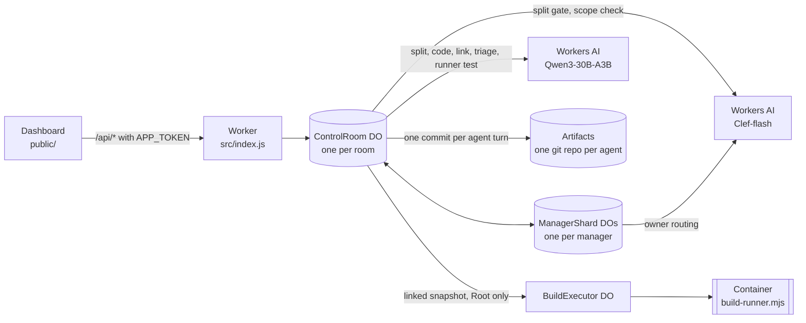
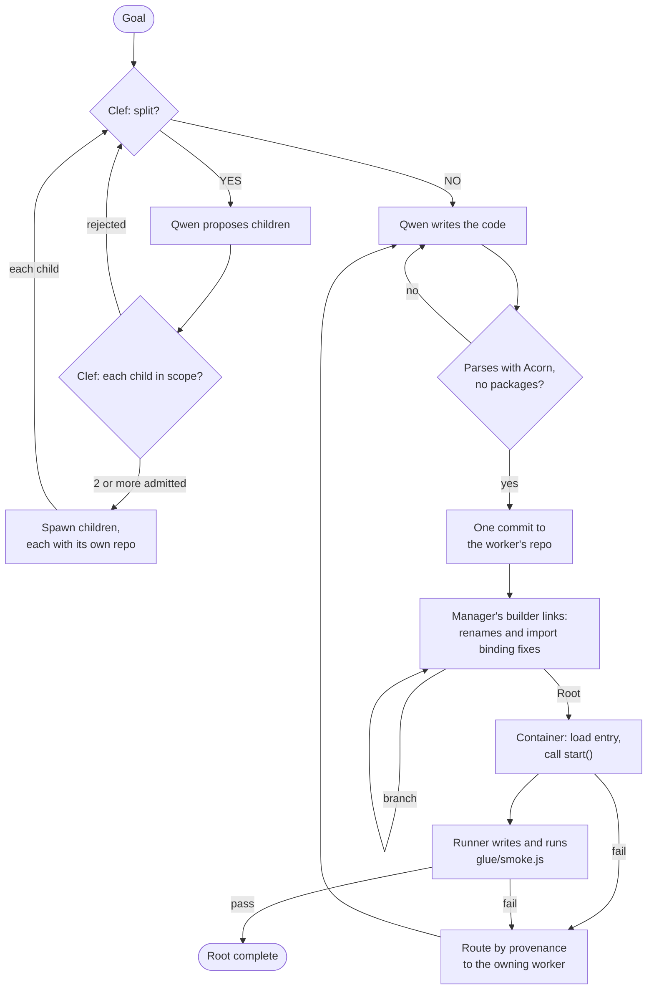

# Recursive Control Plane

A multi-agent code-writing control plane that runs entirely on Cloudflare. You give it a goal. A tree of small agents splits the work, writes the code in parallel, links the pieces, runs the result in a Container, and sends each failure back to the agent that wrote the code.

This is an entry for Cloudflare's "build the next GitHub" competition, which asks for a new way for multiple agents to work on code changes concurrently. The project rethinks what GitHub is built around (repositories, branches, pull requests, review, merge conflicts) for a world where the authors are many small agents instead of a few people.

> **Status:** this is v7.12, and the full local test suite passes. Live end-to-end runs on Cloudflare are still being verified, and no live run has yet finished with a passing application test. The v7.12 fixes answer what stopped the two live v7.11 runs, and so far they have been checked only locally. See [Status](#status) and [CHANGELOG-v7.12.md](CHANGELOG-v7.12.md).

## The idea

The usual multi-agent design puts one large orchestrator in charge. It reads the codebase, plans, hands out work and reviews what comes back. Its context window then limits how large the project can grow, and every change passes through it.

This project makes the opposite bet: **many small agents with small, bounded context beat one big orchestrator agent with limited context.**

- **Bounded context.** On the turn Clef makes an agent a worker, the worker writes its code seeing its own assignment, its parent's assignment, its direct siblings' assignments and published file names, and the recent public knowledge of its parent and siblings, never their descendants or the wider tree. On later turns, such as retries and repairs, its parent appears only as "Manager" and it sees no other agent's assignment or knowledge. A manager sees its direct children, never their descendants. No worker or manager holds the whole project. The exception is Root's builder. When an import still needs a rename at Root, or no module exports `start()`, one model call gets every module of the application, most of them only as export names. That call is the remaining limit on project size (see [Known limitations](#known-limitations)).
- **Each inference tree works only on its own scope.** Ownership works like functional programming. A subtree owns its assignment, writes only to its own repositories and shares no mutable state with its siblings. Two subtrees never write to the same repository, so there is nothing to merge and nothing to conflict. Scope is fixed when work is split, which is meant to keep pieces from overlapping; the runtime itself does not deduplicate work (see [Known limitations](#known-limitations)).
- **Minimal tape.** Independent agents with well-scoped pieces of the same goal converge on code that is close enough to join with very little glue, and here the glue is literally minimal. The builder that joins modules **may only rename import paths and identifiers, and change how an import binds its module when the target's exports call for it** (for example `const { f } = require(p)` becomes `const f = require(p)` when `p` exports the single function `f`). The runtime checks every edit token by token (line breaks are not checked yet; see [Known limitations](#known-limitations)). [What a builder may change](#what-a-builder-may-change) gives the exact rule. If two modules disagree in a way these edits cannot fix, the problem goes back to the agent that owns the code.

## GitHub, rethought

| GitHub | Here |
|---|---|
| A shared repository | Every agent owns a private Cloudflare Artifacts git repository, created when the agent is spawned. Builders get one too. |
| Branches and merge conflicts | Agents share no branch. An agent commits only to its own repository, so there is no shared branch to merge into and nothing to conflict. |
| Commits | One Artifacts commit per agent turn. Everything an agent writes in a turn is staged and pushed together, and a worker's messages leave only after its commit. |
| Merge | Each manager has a *builder* that links its children's finished modules. A builder may change import paths and identifier names, and how one import binds its module when the target's exports call for it. The runtime compares the Acorn token streams before and after every edit (whitespace and comments are not compared). It rejects any edit that changes another token, unless the result is, token for token, the runtime's own binding fix. |
| Pull request review | Mechanical gates replace reviewers. Clef admits each proposed child against the Root goal and its parent's assignment. Each worker file must parse before it is committed. Builder edits may change no token except an import path, a name, or an import's binding where the target's exports call for it. At Root, the linked application must load, start and pass a test written by a separate runner. |
| CODEOWNERS and blame | Provenance. Every linked file records which worker wrote it, through any number of nested builders, and a failure is routed back to that worker one hop at a time. The problem carries the renames every builder made in that file since the worker published it, so a builder's rename is not mistaken for the worker's own code. |
| Issues and discussion | Ownership routing. A worker asks only its manager. A manager answers from public Artifacts knowledge, confirms which branch owns the behavior, or forwards the question up to its own parent or, for a plain question, down to the direct child that owns it. |
| CI | At Root, a Cloudflare Container runs the linked application and the runner's test. |

## Architecture



## Life of a run



1. **Split gate.** For every agent's assignment, Clef answers one typed YES/NO question: can this code be written as two or more independent modules? Clef returns a probability. At or above the room's threshold (default 0.5), Qwen proposes the children.
2. **Scope check.** Before any child exists, Clef scores every proposed child against both the Root goal and the parent's assignment, and drops children below 0.5. A split needs at least two distinct admitted children that fit the room's agent and depth limits. A rejected split goes back to Clef and Qwen with the reasons. Root's splitter is asked for exactly one child that owns the application entry module, which exports `start()`.
3. **Spawn.** Each admitted child gets its own Artifacts repository. The parent becomes a manager permanently: it never writes code, and its turns are routing work with an occasional Clef call, never generative inference.
4. **Workers write.** When Clef says NO, the agent is a worker and Qwen writes its code in the same turn. A worker imports code it does not own by the relative path and name it expects, for example `require('./ticketStore')`, and is asked to publish that expectation as `assumed_*` knowledge. Only Node built-ins are allowed; third-party packages are rejected.
5. **Parse check.** Every file must contain executable code, parse with Acorn as CommonJS or as an ES module, and import no packages before it is committed. A failure goes back to the same worker in the same turn with the parser message.
6. **Commit.** The worker's files for the turn are pushed as one commit, and then its completion report goes to its manager.
7. **Builder link.** When every agent under a manager is done, that manager's builder starts. First, with no model call, the runtime points each import that resolves nowhere at the one module that clearly provides it. It picks the only module exporting every name the file uses from the import. When no module exports them all, it picks the only module whose file or class name matches the import path and that exports at least one of them (a branch builder accepts only an exact name). When these rules disagree or match several modules, the import is left for the model. The runtime then fixes the binding of each resolved import that is bound the wrong way round for its target. Files that still have unresolved imports or mismatched names go to Qwen in full; every other module is shown only by its export names. Qwen returns `find`/`replace` edits. The runtime keeps an edit only if it changes nothing but import paths and identifier names, or if its result is exactly the runtime's own binding fix ([What a builder may change](#what-a-builder-may-change)). It undoes a model rename that breaks an import that matched before, together with any use the model renamed to match it. A branch builder hands its linked bundle to the builder above and leaves imports it cannot match for that builder.
8. **Container check at Root.** Root's builder picks the entry module: the one module that exports `start()`, or, if several do, the one the model named, else the one that imports the most others. When no module exports `start()`, Root asks the model to name the entry even if every import resolves, and keeps an entry it named on an earlier attempt. If no attempt names one, a "No application entry" problem goes to the worker of a module that no other module imports (if there is one): one whose file name marks it as the application, else the one that imports the most others. Root's builder writes a fixed loader (`glue/index.js`) and `package.json`, and sends the snapshot to the Container. The Container parses every file, loads the entry module graph, calls `start()`, and describes the API it returned: member names, kinds and parameter names, never source.
9. **Runner test.** A separate Qwen call writes `glue/smoke.js` from the Root goal and that API description alone. The Container runs it. When it passes, Root completes.
10. **Repair routing.** Anything the builder cannot fix goes back to the worker that owns it, following provenance through nested builders one manager at a time. The worker fixes its code; its branch builder relinks, its manager finishes again, and Root relinks and reruns. Path and name errors first get up to two relinks. Each relink edits the previous attempt's linked files, so renames it accepted are kept, and a relink can also undo one. A problem sent back carries the renames the builders made in the worker's file since it was published, and the names they renamed in the module a name mismatch reads from. When the runner's own test is wrong, the runner rewrites the test instead of blaming a worker.

Repairs are bounded. Root fails after eight rounds of problems sent back to workers, and an agent that fails three turns in a row pauses until you press **Continue**.

### What a builder may change

A builder's edits are `find`/`replace` text. The runtime decides whether to keep each one by comparing the Acorn token streams of the file before and after the edit (whitespace and comments are not compared). An edit is kept when every token it changes is one of these:

- **An import path:** a relative module path in a `require`, `import` or `from` position. No other string may change.
- **A variable name:** a variable this file declares, renamed at every use, to a name the file does not already use and that some other module defines or uses. Two variables may not be renamed to one name. A variable is not renamed if the file also reads the same name where that variable is not in scope (a global of the same name), if the file uses `with` or `eval`, or if it is a function or class whose name the file reads back (`.name`) and also writes as a string.
- **A member or key name:** renamed to a name some other module defines or uses. A member this file defines (an object key, a class member, or `x.m = …` on `this`, the exports or a variable of the file) changes at its definition and at every use together, and never onto a key its object or class already has. It cannot be renamed if the file uses `with` or `eval`, names it as a string key (`x['m']`, `'m' in x`, `Object.defineProperty(x, 'm', …)`, `hasOwnProperty('m')`), or reaches an object that can hold it by a key decided at run time: a computed read such as `handlers[op]`, a computed destructuring, `in`, `for…in` or `Object.keys`, `values` or `entries` (a plain write `x[k] = v` and a count `Object.keys(x).length` do not count). Which objects can hold it is found by following the file's variables, members, `this`, `module.exports`, calls to its own functions and their results, `Object.assign`, `Object.freeze`, spreads and `extends`.

Built-in names such as `require`, `eval` or `Math` are never renamed, and neither is a built-in method call such as `.push` that no module defines. The edited file must still parse.

The one change that is not a rename is how a single import binds its module. It is allowed only for these four forms, and only when the target's exports call for it:

| The worker wrote | Becomes | Only when |
|---|---|---|
| `const { f } = require(p)` | `const f = require(p)` | `p`'s `module.exports` is a single function or class named `f`, nothing in `p` gives it a member `f`, and the file reads nothing off `f` except a class's static methods |
| `const f = require(p)` | `const { f } = require(p)` | `p` exports an object holding a function `f`, and the file only calls `f` |
| `import { f } from p` | `import f from p` | `p`'s only export is a default function or class named `f`, under the same conditions as the first row |
| `import f from p` | `import { f } from p` | `p` is an ES module with no default export, it exports a function `f`, and the file only calls `f` |

The runtime makes these fixes itself, before the model is called and again after the model's edits. A model edit that changes how an import binds is kept only if, apart from renames, its result is exactly the runtime's own fix, compared token for token. Anything else, such as several names destructured from a module that exports a single function, goes back to the worker.

### Ownership routing

The author describes this as BGP-like route discovery. In the code it works like this:

- **No global directory.** An agent is shown at most its parent, its direct siblings and its direct children (their assignments, published file names and recent public knowledge), never their descendants. A worker gets that view only on the turn Clef makes it a worker; on later turns it sees no other agent's assignment or knowledge. A live worker can message only its manager, and the runtime refuses messages that would reveal a hidden descendant's ID.
- **Advertisement.** Each manager republishes its direct children's public files under aliases of its own, and their `assumed_*` knowledge under scoped keys, in its own Artifacts repository. A parent sees what a subtree offers without learning which agent inside it wrote it, much like route aggregation.
- **Discovery.** A worker blocked on an outside interface asks its manager, using an opaque request ID. The manager checks, in order: its own public knowledge, its children's public knowledge, its children's published source, HTTP routes recognized in that source, and then a keyword match, with Clef when that is ambiguous, to pick the owning direct child. If nothing fits, it forwards the request to its own parent and records the next hop in its ManagerShard Durable Object. Answers retrace the recorded hops, and each manager on the way caches them as public knowledge.
- **Plain questions go down, not up.** The worker prompts use the opaque request. A worker can also message its manager directly, and a message ending in `?`, or a `[knowledge:key]` value the worker has not itself published, takes a shorter path: after public knowledge and published source, the manager picks one direct child by keyword match, with Clef when that is ambiguous (a sole candidate is picked without asking), forwards the question to it and relays the answer. This path never goes to the manager's parent.
- **Knowing the owner is enough.** When a manager finds the branch that owns a behavior, it tells the worker to proceed with its assumed interface; the builder will rename later. Non-blocking questions are dropped and the worker keeps its assumption. An explicitly named owner that does not exist stops the worker as out of scope, while a low-confidence route waits rather than failing.
- **Repairs use the same paths.** A `[build:repair]` ticket travels from Root down the tree, one direct child at a time, to the owning worker.

### Builders are the bottleneck, so every manager has one

Linking is the one place where independent work meets, which makes it the natural bottleneck. Every manager gets its own builder, which starts as soon as that manager's subtree has finished and no repair is in flight there, even while other branches are still working. A builder links only what crosses between its own children, and a child manager is represented by its builder's linked output. When, after the runtime's own path and binding fixes, every import resolves, every imported name exists in its target and no earlier error names a module, a builder makes no model call to link. At Root, some module must also export `start()`. Root's builder works on bundles that lower builders have already linked.

## Cloudflare products used

| Product | What it does here | Why |
|---|---|---|
| Workers and Static Assets | Serves the dashboard from `public/` and the `/api/*` routes, which require the `APP_TOKEN` bearer token. | One deployable unit for the UI and the API. |
| Durable Objects (SQLite) | `ControlRoom`, one per room: the agent tree, scheduler, message queues, staged writes and event log. `ManagerShard`, one per manager per run: route hops, inbox, lifecycle decisions and Clef owner selection. `BuildExecutor`, one per run: drives the Container. | Consistent, durable state per room and per manager. An interrupted turn resumes from its saved position instead of calling the model again. |
| Workers AI | Qwen3-30B-A3B (default) proposes splits and writes code, link edits, failure triage and runner tests. Llama 3.2 1B and Qwen 3.8 27B can be selected instead. Clef-flash (or Clef) answers typed YES/NO questions as probabilities for split, scope and owner decisions. | Fast, inexpensive models for each agent: Qwen3-30B-A3B activates about 3B parameters per token. Clef returns a probability rather than prose, so every gate is a threshold and needs no output parsing. |
| Artifacts | One git repository per agent, written with isomorphic-git (clone, commit, push) using short-lived write tokens. | Real git history per agent, with no shared branch. |
| Containers | A Node 22 image runs `container/build-runner.mjs` as an unprivileged user under a 240-second timeout. | Generated code runs isolated from the control plane. |

Per-room settings in the dashboard: generative model, Clef model, split threshold, concurrent agents, total agents, recursion depth and turn budget.

## Quick start

You deploy to your own Cloudflare account. Requirements: Node.js 22.13 or newer, Docker running locally, and a Cloudflare account with Workers AI, Artifacts, Durable Objects and Containers.

```bash
git clone https://github.com/tyrtop-ai/cloudflare-comp.git
cd cloudflare-comp
npm ci
npx wrangler login
docker info                                     # must succeed; deploy builds the Container image
npm run deploy
npx wrangler secret put APP_TOKEN               # any long random string
```

Open the `workers.dev` URL Wrangler prints, paste the token, and press **Start new experiment**. [INSTALL-CLOUDFLARE.md](INSTALL-CLOUDFLARE.md) covers each step in detail, along with the Artifacts namespace, checking the Container, starting runs from the API, exporting runs and troubleshooting.

### Getting the code out

Once Root's builder has linked the application and the compiler has written its loader, **Download app (.zip)** in the dashboard saves it, and **Push to GitHub** pushes it to a new branch of a repository you name and opens a pull request (this needs a `GITHUB_TOKEN` secret). The export holds the linked modules, the compiler's runtime loader and the runner's test, and a README that says whether the last Container run passed for exactly these files, or that they are UNVERIFIED. It runs with plain Node.js, with nothing to install: `node glue/smoke.js`. When Clef left the whole goal atomic, Root wrote the code itself, and the export is Root's own files. [INSTALL-CLOUDFLARE.md](INSTALL-CLOUDFLARE.md#getting-the-code-out) gives the token's permissions and the API routes (`/api/app`, `/api/app.zip`, `/api/export/github`).

### Local checks

```bash
npm ci
npm run check   # node --check on every .js/.mjs/.cjs file in src/, public/, container/ and test/
npm test        # node --test test/*.test.js
```

The tests use a fake Workers AI, an in-memory Artifacts store and Node's built-in SQLite, so they need no Cloudflare account. `test/v711-builder.test.js` runs the real `container/build-runner.mjs` in Node, so module loading, `start()`, the API description and the runner's test all actually execute. CI ([.github/workflows/ci.yml](.github/workflows/ci.yml)) runs the same three commands on every push and pull request.

## Status

- **Local:** the full suite passes with `npm test`. This is v7.12. [CHANGELOG-v7.12.md](CHANGELOG-v7.12.md) lists what changed since v7.11 and the live-run evidence behind each fix.
- **Live:** two v7.11 runs on a real account (Qwen3-30B-A3B and Clef-flash, issue-tracker goal). Neither completed, and both predate v7.12.
  - The larger run (e89dba35) used an earlier v7.11 build that committed every file separately. It exercised the split gate, scope checks, recursive decomposition (28 workers and managers plus 7 builders, four levels deep), per-manager builders applying verified renames, and repair tickets routed down to the owning workers. Its Root builder lost many of its edits on form: in one attempt ten path edits were rejected because they were written without their quotes, and binding fixes such as `const { isStatusMatch } = require(...)` to `const isStatusMatch = require(...)` were rejected as adding or removing code. On one link no module exported `start()`, and the builder took a filter combinator as the application entry. v7.12 reads quote-less path edits as the import paths they name, makes the binding fixes itself when the target's exports call for them, and asks the model for the entry instead of guessing.
  - The only run with one commit per agent turn (5f85e12b) paused after 80 seconds. Root's builder did not manage to link one of the entry module's imports in three attempts, although renames alone would have fixed it: the path needed `../` where the builder wrote `./`, and the entry used `ticketService.view` and `ticketService.delete` where the service exports `read` and `del`. Each relink started again from the workers' original files, so the `view` to `read` rename accepted in the first attempt was lost. The builder sent the import back to the entry worker, whose only file is that module, and Artifacts rejected the worker's repair commit three times as not a fast-forward. v7.12 addresses all three causes:
    - Relinks edit the previous attempt's linked files, so accepted renames are kept, and a relink can undo one.
    - The import now resolves with no model call, because `ticketService.js` is the only module named like it. A path the builder writes from the wrong directory is also rewritten to the one module it names.
    - The Artifacts store asks the repository whether `main` exists before it clones or starts a new history.

  A test in the suite feeds that run's three worker files to Root's builder, with a scripted model. The path resolves without the model, and one model call renames `view` and `delete` to `read` and `del`. The linked application then loads and passes a scripted runner test in the real Container runner script, run locally in Node. Neither live run reached the Root Container check or the runner test, and no live run has verified the v7.12 fixes yet. Earlier versions did run the Container live, and the failures seen there shaped v7.11.

### Known limitations

- The rename check compares tokens, not the line breaks between them. An edit that changes no token but adds or moves a line break, such as splitting `return m.value` after `return`, is accepted, and through automatic semicolon insertion it can change what the code does.
- A model path edit that points an import at the wrong module is kept if the path resolves. A branch builder can likewise pick the wrong module inside its branch for an import that really belongs to another branch. Root does not re-examine an import that already resolves unless the static name check or a runtime error points at it. When the picked module does not fit, the worker hears the problem against that module, with the builder's path change listed beside it.
- A model rename that breaks an import that matched before is undone only when the static name check can see the break. A member read off a value that a factory returns is not visible to it, so such a break shows up only when the application runs; the worker then gets the error along with the builder's renames in its file. The undo restores the whole file to its text from before the model, so a good rename in the same file must be proposed again on the next relink.
- The check for a member reached by a key decided at run time follows values through one file only, and not through arrays or callbacks. A holder put in an array, or passed to a callback or another module that reads it by key, is not seen, so a rename of its member can still break that read.
- Root's splitter asks one child to own the entry module, but the runtime does not record which child that is. When no module exports `start()` and the model names no entry on any attempt, the "No application entry" problem goes to a module that no other module imports (if there is one): one whose file name marks it as the application (a whole name such as `app.js`, or a final `App`), nearest Root first, else the one that imports the most others.
- Linker input at one level is not split when it exceeds the model's context. The builder logs a `link_oversize` event instead. Root's builder gets every module of the application in that call, most only as export names, so this is where project size is limited.
- Workers write plain JavaScript (`.js`, `.mjs`, `.cjs`) using Node built-ins: no npm packages, TypeScript or JSX.
- The runtime does not deduplicate work across sibling subtrees. Scope is meant to be fixed when work is split: the splitter is asked for non-overlapping pieces, Clef checks each child against the goal and its parent's assignment, and a split with two identical tasks is refused. Nothing else compares siblings, and in the larger live run two sibling workers each wrote an almost identical `TicketRepository` class, which the builders carried side by side up to Root.
- `MOCK_AI=true` still uses the older builder path. It exists for the regression tests and is not a demo mode.
- The app never deletes Artifacts repositories. Each run creates one per agent (see [cleanup](INSTALL-CLOUDFLARE.md#costs-and-cleanup)).

## Repository layout

| Path | Contents |
|---|---|
| `src/index.js` | Worker entry and the `ControlRoom` Durable Object: agent tree, scheduler, agent turns, routing, builders, runner and repair routing |
| `src/linker.js` | Acorn-based export surfaces, unresolved-import and name-mismatch checks, `autoLink` and import binding fixes, verification of builder edits (renames and binding fixes only), entry choice and loader |
| `src/model.js` | Workers AI calls and prompts: Clef gates, and the Qwen splitter, worker, linker, triage and runner |
| `src/manager-shard.js` | `ManagerShard` Durable Object: per-manager route hops, inbox, lifecycle, alias planning, Clef owner selection |
| `src/artifact-store.js`, `src/memory-fs.js` | Artifacts adapter: isomorphic-git over an in-memory filesystem, one commit per call |
| `src/build-executor.js`, `src/build-verification.js` | `BuildExecutor` Container driver; snapshot hashing, attestation and repair addressing |
| `src/code-work.js`, `src/assembly.js`, `src/assembly-gate.js` | Worker output rules, `components/...` bundle paths, source and builder-file gates |
| `src/baseline-linker.js` | Diagnostic linker from the v7.7–v7.10 builder; builders since v7.11 do not use it |
| `src/knowledge.js`, `src/protocol.js` | Public and private knowledge files, action parsing, contact rules |
| `src/zip.js`, `src/github-export.js` | Getting the code out: a store-only ZIP writer, and the push of the linked application to a new GitHub branch and pull request |
| `src/vendor/acorn.mjs` | Vendored Acorn parser (MIT, see `src/vendor/ACORN-LICENSE`) |
| `container/` | Container image (`Dockerfile`) and `build-runner.mjs` |
| `public/` | Dashboard |
| `test/` | `node --test` suite with fake Workers AI and Artifacts |
| `scripts/check.mjs` | Syntax check behind `npm run check` |
| `CHANGELOG-v7.12.md` | What changed in this release, with the live-run evidence for each fix |
| `docs/history/` | Changelogs for each earlier version, plus the earlier README and install guide |
| `wrangler.jsonc` | Worker name, bindings (AI, Artifacts, Durable Objects, Container, static assets) and the `MOCK_AI` switch. Rooms do not read its `MODEL_NAME` variable: the model is chosen per room, in the dashboard or with `settings.model` in the API |

## History

The design reached this shape over many versions, from routers with a single Root builder to per-manager builders that may only rename, plus, since v7.12, fix how an import binds its module. [docs/history/CHANGELOG-v7.11.md](docs/history/CHANGELOG-v7.11.md) documents the v7.11 design this release builds on, and [CHANGELOG-v7.12.md](CHANGELOG-v7.12.md) what changed since. Earlier changelogs, and the version notes that used to make up this README, are in [docs/history/](docs/history/).

## License

MIT, see [LICENSE](LICENSE). The vendored Acorn parser is MIT licensed, see [src/vendor/ACORN-LICENSE](src/vendor/ACORN-LICENSE).
