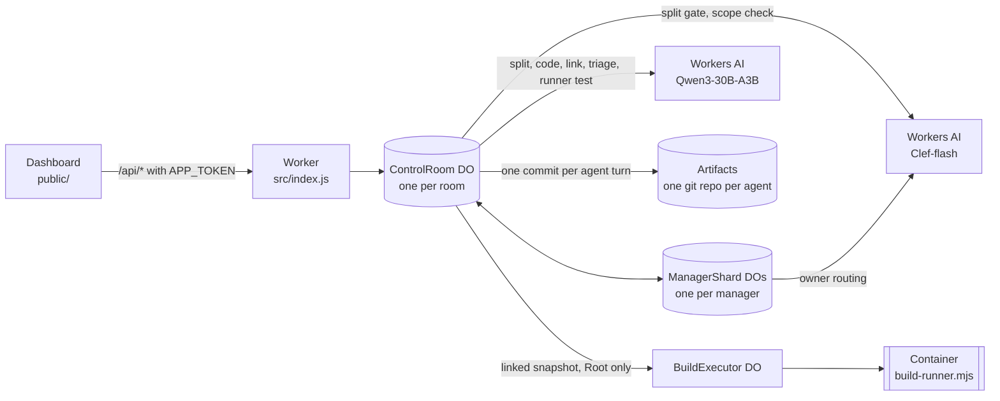
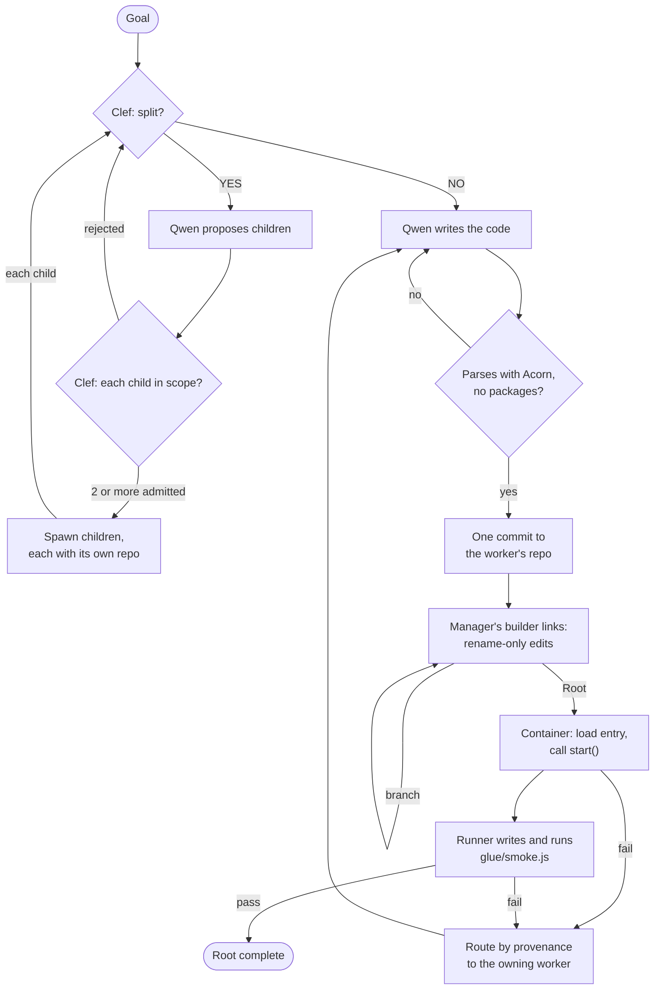

# Recursive Control Plane

A multi-agent code-writing control plane that runs entirely on Cloudflare. You give it a goal. A tree of small agents splits the work, writes the code in parallel, links the pieces, runs the result in a Container, and sends each failure back to the agent that wrote the code.

This is an entry for Cloudflare's "build the next GitHub" competition, which asks for a new way for multiple agents to work on code changes concurrently. The project rethinks what GitHub is built around (repositories, branches, pull requests, review, merge conflicts) for a world where the authors are many small agents instead of a few people.

> **Status:** the local suite (184 tests) passes. Live end-to-end runs on Cloudflare are still being verified, and no live run has yet finished with a passing application test. See [Status](#status).

## The idea

The usual multi-agent design puts one large orchestrator in charge. It reads the codebase, plans, hands out work and reviews what comes back. Its context window then limits how large the project can grow, and every change passes through it.

This project makes the opposite bet: **many small agents with small, bounded context beat one big orchestrator agent with limited context.**

- **Bounded context.** An agent sees its own assignment, its own repository and messages from its direct manager. No agent holds the whole project, so no single context window caps the size of the project.
- **Each inference tree works only on its own scope.** Ownership works like functional programming. A subtree owns its assignment, writes only to its own repositories and shares no mutable state with its siblings. Two subtrees never edit the same file, so there is nowhere for duplicate or conflicting work to land.
- **Minimal tape.** Independent agents with well-scoped pieces of the same goal converge on code that is close enough to join with very little glue, and here the glue is literally minimal. The builder that joins modules **can only rename import paths and identifiers**. If two modules disagree in a way a rename cannot fix, the problem goes back to the agent that owns the code.

## GitHub, rethought

| GitHub | Here |
|---|---|
| A shared repository | Every agent owns a private Cloudflare Artifacts git repository, created when the agent is spawned. Builders get one too. |
| Branches and merge conflicts | Agents share no branch. An agent commits only to its own repository, so there is no shared branch to merge into and nothing to conflict. |
| Commits | One Artifacts commit per agent turn. Everything an agent writes in a turn is staged and pushed together, and a worker's messages leave only after its commit. |
| Merge | Each manager has a *builder* that links its children's finished modules. A builder may change only import paths and identifier names. The runtime compares the Acorn token streams before and after every edit and rejects any edit that changes something else. |
| Pull request review | Mechanical gates replace reviewers. Clef admits each proposed child against the Root goal and its parent's assignment. Each worker file must parse before it is committed. Builder edits must be pure renames. At Root, the linked application must load, start and pass a test written by a separate runner. |
| CODEOWNERS and blame | Provenance. Every linked file records which worker wrote it, through any number of nested builders, and a failure is routed back to that worker one hop at a time. |
| Issues and discussion | Ownership routing. A worker asks only its manager. A manager answers from public Artifacts knowledge or routes the question to the branch that owns the answer. |
| CI | At Root, a Cloudflare Container runs the linked application and the runner's test. |

## Architecture



## Life of a run



1. **Split gate.** For every agent's assignment, Clef answers one typed YES/NO question: can this code be written as two or more independent modules? Clef returns a probability. At or above the room's threshold (default 0.5), Qwen proposes the children.
2. **Scope check.** Before any child exists, Clef scores every proposed child against both the Root goal and the parent's assignment, and drops children below 0.5. A split needs at least two distinct admitted children that fit the room's agent and depth limits. A rejected split goes back to Clef and Qwen with the reasons. Root's splitter is asked for exactly one child that owns the application entry module, which exports `start()`.
3. **Spawn.** Each admitted child gets its own Artifacts repository. The parent becomes a manager permanently: it never writes code, and its turns are routing work with an occasional Clef call, never generative inference.
4. **Workers write.** When Clef says NO, the agent is a worker and Qwen writes its code in the same turn. A worker imports code it does not own by the relative path and name it expects, for example `require('./ticketStore')`, and publishes that expectation as `assumed_*` knowledge. Only Node built-ins are allowed; third-party packages are rejected.
5. **Parse check.** Every file must contain executable code, parse with Acorn as CommonJS or as an ES module, and import no packages before it is committed. A failure goes back to the same worker in the same turn with the parser message.
6. **Commit.** The worker's files for the turn are pushed as one commit, and then its completion report goes to its manager.
7. **Builder link.** When every agent under a manager is done, that manager's builder starts. First, with no model call, it points each import that resolves nowhere at the one module that clearly provides it. Files that still have unresolved imports or mismatched names go to Qwen in full; every other module is shown only by its export names. Qwen returns `find`/`replace` edits, and the runtime keeps only pure renames. A branch builder hands its linked bundle to the builder above and leaves imports it cannot match for that builder.
8. **Container check at Root.** Root's builder picks the entry module, writes a fixed loader (`glue/index.js`) and `package.json`, and sends the snapshot to the Container. The Container parses every file, loads the entry module graph, calls `start()`, and describes the API it returned: member names, kinds and parameter names, never source.
9. **Runner test.** A separate Qwen call writes `glue/smoke.js` from the Root goal and that API description alone. The Container runs it. When it passes, Root completes.
10. **Repair routing.** Anything renaming cannot fix goes back to the worker that owns it, following provenance through nested builders one manager at a time. The worker fixes its code; its branch builder relinks, its manager finishes again, and Root relinks and reruns. Path and name errors first get up to two relinks. When the runner's own test is wrong, the runner rewrites the test instead of blaming a worker.

Repairs are bounded. Root fails after eight rounds of problems sent back to workers, and an agent that fails three turns in a row pauses until you press **Continue**.

### Ownership routing

The author describes this as BGP-like route discovery. In the code it works like this:

- **No global directory.** An agent knows its parent and its direct children. A live worker can message only its manager, and the runtime refuses messages that would reveal a hidden descendant's ID.
- **Advertisement.** Each manager republishes its direct children's public files under aliases of its own, and their `assumed_*` knowledge under scoped keys, in its own Artifacts repository. A parent sees what a subtree offers without learning which agent inside it wrote it, much like route aggregation.
- **Discovery.** A worker blocked on an outside interface asks its manager, using an opaque request ID. The manager checks, in order: its own public knowledge, its children's public knowledge, its children's published source, HTTP routes recognized in that source, and then Clef to pick the owning direct child. If nothing fits, it forwards the request to its own parent and records the next hop in its ManagerShard Durable Object. Answers retrace the recorded hops, and each manager on the way caches them as public knowledge.
- **Knowing the owner is enough.** When a manager finds the branch that owns a behavior, it tells the worker to proceed with its assumed interface; the builder will rename later. Non-blocking questions are dropped and the worker keeps its assumption. An explicitly named owner that does not exist stops the worker as out of scope, while a low-confidence route waits rather than failing.
- **Repairs use the same paths.** A `[build:repair]` ticket travels from Root down the tree, one direct child at a time, to the owning worker.

### Builders are the bottleneck, so every manager has one

Linking is the one place where independent work meets, which makes it the natural bottleneck. Every manager gets its own builder, which starts as soon as that manager's subtree has finished and no repair is in flight there, even while other branches are still working. A builder links only what crosses between its own children, and a child manager is represented by its builder's linked output. When every import already resolves, a builder makes no model call to link. Root's builder works on bundles that lower builders have already linked.

## Cloudflare products used

| Product | What it does here | Why |
|---|---|---|
| Workers and Static Assets | Serves the dashboard from `public/` and the `/api/*` routes, which require the `APP_TOKEN` bearer token. | One deployable unit for the UI and the API. |
| Durable Objects (SQLite) | `ControlRoom`, one per room: the agent tree, scheduler, message queues, staged writes and event log. `ManagerShard`, one per manager per run: route hops, inbox, lifecycle decisions and Clef owner selection. `BuildExecutor`, one per run: drives the Container. | Consistent, durable state per room and per manager. An interrupted turn resumes from its saved position instead of calling the model again. |
| Workers AI | Qwen3-30B-A3B (default) proposes splits and writes code, link edits, failure triage and runner tests. Llama 3.2 1B and Qwen 3.8 27B can be selected instead. Clef-flash (or Clef) answers typed YES/NO questions as probabilities for split, scope and owner decisions. | Fast, inexpensive models for each agent: Qwen3-30B-A3B activates about 3B parameters per token. Clef returns a probability rather than prose, so every gate is a threshold and needs no output parsing. |
| Artifacts | One git repository per agent, written with isomorphic-git (clone, commit, push) using short-lived write tokens. | Real git history per agent, with no shared branch. |
| Containers | A Node 22 image runs `container/build-runner.mjs` as an unprivileged user under a 240-second timeout. | Generated code runs isolated from the control plane. |

Per-room settings in the dashboard: generative model, Clef model, split threshold, concurrent agents, total agents, recursion depth and turn budget.

## Quick start

You deploy to your own Cloudflare account. Requirements: Node.js 22.13 or newer, Docker running locally, and a Cloudflare account with Workers AI, Artifacts, Durable Objects and Containers.

```bash
git clone https://github.com/tyrtop-ai/cloudflare-comp.git
cd cloudflare-comp
npm ci
npx wrangler login
npx wrangler artifacts namespaces get default   # the ARTIFACTS binding uses namespace "default"
docker info                                     # must succeed; deploy builds the Container image
npm run deploy
npx wrangler secret put APP_TOKEN               # any long random string
```

Open the `workers.dev` URL Wrangler prints, paste the token, and press **Start new experiment**. [INSTALL-CLOUDFLARE.md](INSTALL-CLOUDFLARE.md) covers each step in detail, along with the Artifacts namespace, checking the Container, starting runs from the API, exporting runs and troubleshooting.

### Local checks

```bash
npm ci
npm run check   # node --check on every .js/.mjs file in src/, public/, container/ and test/
npm test        # node --test test/*.test.js
```

The tests use a fake Workers AI, an in-memory Artifacts store and Node's built-in SQLite, so they need no Cloudflare account. `test/v711-builder.test.js` runs the real `container/build-runner.mjs` in Node, so module loading, `start()`, the API description and the runner's test all actually execute. CI ([.github/workflows/ci.yml](.github/workflows/ci.yml)) runs the same three commands on every push and pull request.

## Status

- **Local:** 184 of 184 tests pass with `npm test`.
- **Live:** v7.11 runs on a real account (Qwen3-30B-A3B and Clef-flash, issue-tracker goal) have exercised the split gate, scope checks, recursive decomposition (28 workers and managers plus 7 builders, four levels deep, in one run), per-manager builders applying verified renames, and repair tickets routed down to the owning workers. No v7.11 live run has completed yet. None has reached the Root Container check or the runner test; both are covered only by the local tests so far. Earlier versions did run the Container live, and the failures seen there shaped v7.11.

Known limitations:

- A branch builder can pick the wrong module inside its branch for an import that really belongs to another branch. Root does not re-examine an import that already resolves unless the static name check or a runtime error points at it.
- Linker input at one level is not split when it exceeds the model's context. The builder logs a `link_oversize` event instead.
- Workers write plain JavaScript (`.js`, `.mjs`, `.cjs`) using Node built-ins: no npm packages, TypeScript or JSX.
- The runtime does not deduplicate work across sibling subtrees. This is by design: scope is enforced when work is split. The splitter is asked for non-overlapping pieces, and Clef checks each child against the goal and its parent's assignment.
- `MOCK_AI=true` still uses the older builder path. It exists for the regression tests and is not a demo mode.
- The app never deletes Artifacts repositories. Each run creates one per agent (see [cleanup](INSTALL-CLOUDFLARE.md#costs-and-cleanup)).

## Repository layout

| Path | Contents |
|---|---|
| `src/index.js` | Worker entry and the `ControlRoom` Durable Object: agent tree, scheduler, agent turns, routing, builders, runner and repair routing |
| `src/linker.js` | Acorn-based export surfaces, unresolved-import and name-mismatch checks, `autoLink`, rename-only edit verification, entry choice and loader |
| `src/model.js` | Workers AI calls and prompts: Clef gates, and the Qwen splitter, worker, linker, triage and runner |
| `src/manager-shard.js` | `ManagerShard` Durable Object: per-manager route hops, inbox, lifecycle, alias planning, Clef owner selection |
| `src/artifact-store.js`, `src/memory-fs.js` | Artifacts adapter: isomorphic-git over an in-memory filesystem, one commit per call |
| `src/build-executor.js`, `src/build-verification.js` | `BuildExecutor` Container driver; snapshot hashing, attestation and repair addressing |
| `src/code-work.js`, `src/assembly.js`, `src/assembly-gate.js` | Worker output rules, `components/...` bundle paths, source and builder-file gates |
| `src/baseline-linker.js` | Diagnostic linker from the v7.7–v7.10 builder; the v7.11 builder does not use it |
| `src/knowledge.js`, `src/protocol.js` | Public and private knowledge files, action parsing, contact rules |
| `src/vendor/acorn.mjs` | Vendored Acorn parser (MIT, see `src/vendor/ACORN-LICENSE`) |
| `container/` | Container image (`Dockerfile`) and `build-runner.mjs` |
| `public/` | Dashboard |
| `test/` | `node --test` suite with fake Workers AI and Artifacts |
| `scripts/check.mjs` | Syntax check behind `npm run check` |
| `docs/history/` | Changelogs for each version, plus the earlier README and install guide |
| `wrangler.jsonc` | Worker name, bindings (AI, Artifacts, Durable Objects, Container, static assets) and model variable |

## History

The design reached this shape over many versions, from routers with a single Root builder to per-manager, rename-only builders. [docs/history/CHANGELOG-v7.11.md](docs/history/CHANGELOG-v7.11.md) documents the current design in detail. Earlier changelogs, and the version notes that used to make up this README, are in [docs/history/](docs/history/).

## License

MIT, see [LICENSE](LICENSE). The vendored Acorn parser is MIT licensed, see [src/vendor/ACORN-LICENSE](src/vendor/ACORN-LICENSE).
