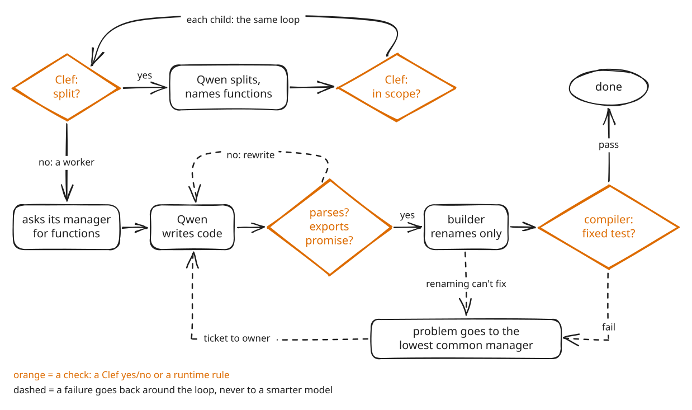

# Recursive Control Plane

One big orchestrator agent runs out of context as a project grows, and every change has to pass through it. This project goes the other way: many small agents with bounded scope, joined by one process that repeats the same few steps at every node of a tree. Before a manager hands work down, it names the functions each piece will export, so workers that never see each other write code that already almost fits, and the builder that joins them is only allowed to rename. A cheap yes/no classifier, not the writing model, decides every split and every scope, and matches what names alone don't. Problems move one level at a time to the lowest manager that owns every party, and Root is just the manager at the top: the last stop. The model that writes the code activates about 3B parameters per token. **The plan lives in the process, not in the model: a repeatable loop with a check after every step stands in for intelligence.**

This is an entry for Cloudflare's "build the next GitHub" competition, which asks for a new way for many agents to work on one codebase at the same time. Nothing is merged: every agent commits only to its own Artifacts git repository. Promised names replace agreed interfaces, mechanical checks replace review, and a problem inbox at each manager replaces issues. It all runs on Cloudflare: Workers, Durable Objects, Workers AI (Qwen3-30B-A3B writes, Clef-flash answers yes/no), Artifacts and Containers.

## Many small agents, not one orchestrator

<picture>
  <source media="(prefers-color-scheme: dark)" srcset="docs/diagrams/small-agents-dark.svg">
  
</picture>

One orchestrator holds the codebase, the plan and every review in one context. Here every worker, manager and builder reads one level of the tree. A worker sees its task, the names it must export and its manager; a manager sees its direct children by their exports, and a whole branch below reaches it as a boundary of a few names. In run8 (room 48a10b1d, 15 agents on two levels), every prompt Root's builder sent was under 4,000 tokens; in run9 it was about 2,400 (the builder's own estimates).

## One loop, checked at every step

<picture>
  <source media="(prefers-color-scheme: dark)" srcset="docs/diagrams/the-loop-dark.svg">
  
</picture>

Every node runs the same loop, and every step ends in a check (orange): a Clef yes/no, a parse, the promised exports, a token-by-token rename check, or the compiler's fixed test. Whatever fails goes back around the dashed path to the step that can fix it, never to a smarter model. In run9 (room 92cc686b), Clef made all seven split decisions (Root yes at p = 0.847, each of the six pieces no), and every relink after the first needed no model call. The linked app loaded and started on every round, and each of Root's six repair rounds fixed one real bug, until Root's flat budget of six rounds ran out; since v7.15.1, a round counts against that budget only when it makes no progress.

## One level at a time; Root is the last stop

<picture>
  <source media="(prefers-color-scheme: dark)" srcset="docs/diagrams/one-level-dark.svg">
  
</picture>

Nothing jumps a level: a worker asks only its manager, an ask climbs until some manager's children promise the function, and the answer comes back down the same hops. A problem stops at the lowest manager whose branch holds every party, so a mistake inside a branch is settled there; Root is an ordinary manager with no parent, and the compiler above it reports only to Root. In run9 the View worker asked its manager, Root, for `getTickets`, and 2.1 s later Root answered "in Data Module's promise; matched by name", with no model call. Below Root this is covered by tests; no live run on v7.14 or later has had a sub-manager yet.

## Tape, not glue

<picture>
  <source media="(prefers-color-scheme: dark)" srcset="docs/diagrams/tape-not-glue-dark.svg">
  
</picture>

Because the names were promised before the work went down, modules written apart already agree on almost everything. The builder may change an import path, a name, or how an import binds, and nothing else: the runtime compares tokens before and after every edit, and makes the path and binding fixes it can itself, with no model call. Anything renaming can't fix becomes a problem for the module's owner. In run9, `require('./data')` became `require('../data-modul-f17f9f79/data.js')` without the model ("only module exporting addTicket"); `updateTicket.js` read `updateTicket` from `data.js`, which never promised it, so the manager's rules sent its reader a ticket, and the reader changed its own code.

The diagrams are drawn in Excalidraw. Their sources, [`docs/diagrams/*.excalidraw`](docs/diagrams/), open and edit at excalidraw.com.

## Architectural choices

- **Four roles, one job each.** Workers write. Managers split and decide, and never write code. Builders join by renaming. One compiler runs the app. → Each model call has one narrow job.
- **Bounded context.** A worker sees its task, its promise and "Manager"; a manager sees its direct children, with a branch below reduced to its boundary. → No worker's, manager's or builder's prompt grows with the whole tree, so the writing model can stay small.
- **Names before work.** Each split promises at most five named functions per piece, binding and checked before any child exists. A name two pieces list is placed on one of them, by label, by task or with one Clef call. → Workers don't freestyle interfaces, so integration becomes name matching.
- **Clef answers the yes/no questions:** split (p ≥ 0.7), scope (≥ 0.5) and the names a child adds, ownership and pruning, and function matching (≥ 0.6). → Each decision is a probability against a threshold: no parsing, and cheap enough to run at every node.
- **Prune on discovery.** A proposed child that another branch already promises is pruned, by name first and then by Clef, up the tree. → No two branches build the same thing.
- **One Artifacts git repo per agent, one commit per turn.** → No shared branch, so nothing to merge, nothing to conflict, and real git history for every agent.
- **Workers ask their manager for every function.** The manager answers from its children's promises or asks one level up; a promised function left as an empty placeholder is sent back with the answer from the plan. → No worker guesses another module's API, and no agent needs a global directory.
- **Rename-only builders, one per manager.** → Joining cannot invent behaviour, and each branch links as soon as it finishes.
- **Problems go to the lowest common manager.** Deterministic rules decide first; the manager's model is asked only for a real choice. → Fixes stay local.
- **Root is just a manager.** The runtime adds one `start()` requirement to the goal, and Root promises `start` like any other name. → No special orchestrator code path.
- **One compiler, one fixed test.** The compiler loads the app in a Container, checks that `start()` returns a method for each operation the goal names, and runs the runner's test; the first test that runs stays fixed for the whole run. → Repairs can't move the goalposts.
- **Bounded repair on durable state.** A manager stops after three repair rounds in a row without progress, and a run after min(40, 16 + 4 × managers) rounds. Each room and each manager keeps its state in a Durable Object, so an interrupted turn resumes where it was. → The loop ends: it converges or fails visibly.

## Run it

Requirements: Node.js 22.13 or newer, Docker running locally, and a Cloudflare account with Workers AI, Artifacts, Durable Objects and Containers (Containers need the Workers Paid plan).

```bash
git clone https://github.com/tyrtop-ai/cloudflare-comp.git
cd cloudflare-comp
npm ci && npm test                  # local checks with fakes; no Cloudflare account needed
npx wrangler login
npm run deploy                      # Docker must be running: this builds the Container image
npx wrangler secret put APP_TOKEN   # any long random string
```

Open the `workers.dev` URL that Wrangler prints, paste the token, and press **Start**. The dashboard draws the run as a tree; select a node to see its inference path in orange. **Download app (.zip)** saves the result. [INSTALL-CLOUDFLARE.md](INSTALL-CLOUDFLARE.md) covers the Artifacts namespace check, starting runs from the API (`POST /api/run`), exports and troubleshooting.

## Status

This is v7.15.1; `npm test` and `npm run check` pass. Every live run so far used the issue-tracker goal with Qwen3-30B-A3B and Clef-flash. Run9 (92cc686b), the first on v7.15, linked, loaded and started the app on every round, and was still fixing one real bug per round when its flat repair budget ran out at 6.5 minutes. v7.15.1 makes that budget progress-aware and fixes the two gaps the run ended on: names that two pieces both listed were deleted from both, so no piece promised update or delete, and `start()` returned empty placeholder functions. **No live run has yet finished with a correct, verified application.** Every run, and the known limitations: [docs/how-it-works.md](docs/how-it-works.md#status).

## More

- [docs/how-it-works.md](docs/how-it-works.md): the full mechanism (roles, promises, the life of a run, what a builder may change, problems, function requests, bounds, the dashboard), Cloudflare products and why each, live runs, known limitations and the repository layout.
- [INSTALL-CLOUDFLARE.md](INSTALL-CLOUDFLARE.md): deploying, the API and exports.
- [CHANGELOG-v7.15.md](CHANGELOG-v7.15.md), [v7.14](CHANGELOG-v7.14.md), [v7.13](CHANGELOG-v7.13.md): what changed, with the live-run evidence and replays behind each change.
- [docs/history/](docs/history/): earlier changelogs, and the README and install guide from earlier versions.

## License

MIT, see [LICENSE](LICENSE). The vendored Acorn parser is MIT licensed, see [src/vendor/ACORN-LICENSE](src/vendor/ACORN-LICENSE). The fonts embedded in the diagrams are under the SIL Open Font License, see [docs/diagrams/fonts/](docs/diagrams/fonts/).
