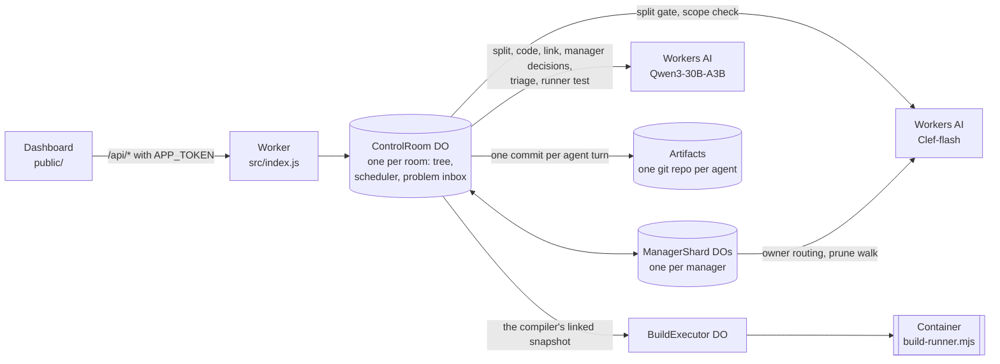
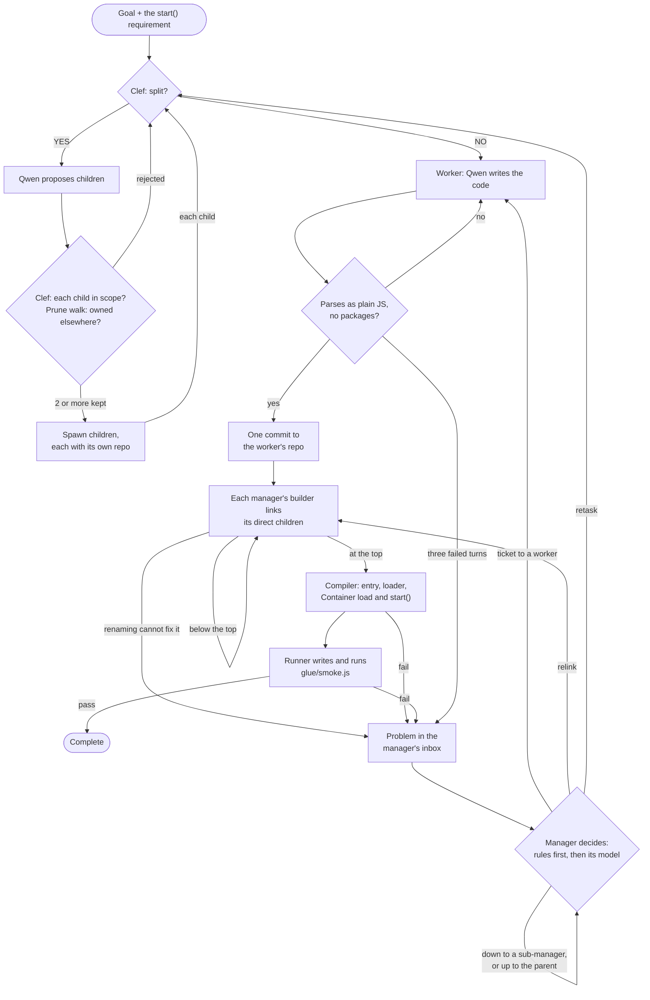

# Recursive Control Plane

A multi-agent code-writing control plane that runs entirely on Cloudflare. You give it a goal, and a tree of small agents:
- splits the work;
- writes the code in parallel;
- links the pieces;
- runs the result in a Container.

Each failure goes to the lowest manager whose branch holds every module involved, and that manager decides who changes what.

This is an entry for Cloudflare's "build the next GitHub" competition, which asks for a new way for multiple agents to work on code changes concurrently. The project rethinks what GitHub is built around (repositories, branches, pull requests, review, merge conflicts) for a world where the authors are many small agents instead of a few people.

> **Status:** this is v7.14, and the full local test suite passes. No live run on Cloudflare has used v7.14 or completed on v7.13. The live runs behind both releases, and what replays of their real files show, are under [Status](#status), [CHANGELOG-v7.14.md](CHANGELOG-v7.14.md) and [CHANGELOG-v7.13.md](CHANGELOG-v7.13.md).

## The idea

The usual multi-agent design puts one large orchestrator in charge. It reads the codebase, plans, hands out work and reviews what comes back. Its context window then limits how large the project can grow, and every change passes through it.

This project makes the opposite bet: **many small agents with small, bounded context beat one big orchestrator agent with limited context.**

- **Bounded context.** No worker's, manager's or builder's model sees the whole project.
  - **Workers.** On the turn Clef makes an agent a worker, it writes its code seeing:
    - its own assignment and its parent's assignment;
    - its direct siblings' assignments and published file names;
    - the recent public knowledge of its parent and siblings.

    It never sees their descendants or the wider tree. On later turns, such as repairs, its parent appears only as "Manager".
  - **Managers.** A manager's model sees its direct children: a worker by its modules' exports, a sub-manager by its boundary (what its branch offers and still needs).
  - **Builders.** A builder's model sees its manager's direct children in the same way, plus the files it must fix, excerpted when they lie inside a branch built below.
  - **The runner** sees only the goal and the API the application returned.

  The one model call that can read the whole application is the compiler's triage of a failed test that no stack frame attributes. It sees every module in full when they fit the model's context, and otherwise every module by its exports, with the entry in full. See [Known limitations](#known-limitations).
- **Each inference tree works only on its own scope.** Ownership works like functional programming.
  - A subtree owns its assignment, writes only to its own repositories, and shares no mutable state with its siblings.
  - Two subtrees never write to the same repository, so there is nothing to merge and nothing to conflict.
  - Scope is fixed when work is split. Below Root, a proposed child that another strand already owns is pruned before it is spawned.
- **Minimal tape.** Independent agents with well-scoped pieces of the same goal converge on code that is close enough to join with very little glue, and here the glue is literally minimal.
  - The builder that joins modules **may only rename import paths and identifiers, and change how an import binds its module when the target's exports call for it**. For example, `const { f } = require(p)` becomes `const f = require(p)` when `p` exports the single function `f`.
  - The runtime checks every edit token by token, though line breaks are not checked yet (see [Known limitations](#known-limitations)). [What a builder may change](#what-a-builder-may-change) gives the exact rule.
  - Anything these edits cannot fix becomes a problem that the managers settle, one level at a time.

## Four roles

Every node in the tree has one of four roles:

| Role | Does | Never |
|---|---|---|
| **Worker** | Writes modules, and fixes its own modules when its manager sends it a repair ticket | Decides for others |
| **Manager** (Root included) | Splits its assignment, scope-checks and prunes its children, and solves the problems in its inbox: assign, escalate, retire or retask | Writes code, or reaches below its direct children |
| **Builder** (one per manager, a child of it) | Links the manager's direct children, rename-only plus the runtime's binding fixes, and reports what renaming cannot fix to its manager | Decides who changes what |
| **Compiler** (one per run, a child of Root) | Chooses the entry, writes the runtime loader and package, loads and starts the application in a Container, has a separate runner test it, and reports failures to Root | Writes or edits application code |

**A manager owns only its direct children, and problems move one level at a time.**
- A builder reports to its own manager, and the compiler reports to Root.
- A manager either assigns a problem to one of its direct children or escalates it to its parent.
- A problem is solved by the lowest manager whose branch contains every party to it. So a mistake between two modules of one branch is settled inside that branch, without Root.

**Root is the final stop on the train, not a special manager.**
- It splits exactly like every other manager.
- When a run starts, the runtime appends one requirement to the goal: *the application exports `start()` from one entry module, `start()` returns an object whose methods perform the operations the goal requests, and importing a module does no work at load.* The splitters assign that requirement like any other.
- The compiler files a missing `start()` with Root as a normal problem.
- Root differs from other managers by position only:
  - It has no parent. Where another manager would escalate, Root closes the problem, and when its repair rounds run out, the run fails.
  - An import that resolves nowhere becomes a problem at Root, not a need on a branch boundary.
  - Its own split is not checked by the prune walk.
  - The compiler hangs under it.

## GitHub, rethought

| GitHub | Here |
|---|---|
| A shared repository | Every agent owns a private Cloudflare Artifacts git repository, created when the agent is spawned. Builders and the compiler get one too. |
| Branches and merge conflicts | Agents share no branch. An agent commits only to its own repository, so there is no shared branch to merge into and nothing to conflict. |
| Commits | One Artifacts commit per agent turn. Everything an agent writes in a turn is staged and pushed together, and a worker's messages leave only after its commit. |
| Merge | Each manager has a *builder* that links its direct children's finished modules. A builder may change import paths and identifier names, and how one import binds its module when the target's exports call for it. The runtime compares the Acorn token streams before and after every edit (whitespace and comments are not compared). It rejects any edit that changes another token, unless the result is, token for token, the runtime's own binding fix. |
| Pull request review | Mechanical gates replace reviewers. Clef admits each proposed child against the goal and its parent's assignment, and the prune walk drops a child another strand already owns. Each worker file must parse before it is committed. Builder edits may change no token except an import path, a name, or an import's binding where the target's exports call for it. The compiler requires the linked application to load, to start, to return an API, and to pass a test written by a separate runner. |
| Issues and assignment | The problem inbox. A builder or the compiler files what renaming cannot fix with its manager. Each manager places a problem's parties among its own direct children and decides one level at a time. Deterministic rules decide first. The manager's model is asked only for a real choice, and the runtime validates every action it returns. |
| CODEOWNERS and blame | Provenance. A problem names its parties (the module that reads a name, the one that provides it, the line that failed) and the worker that wrote each, through any number of nested builders. A worker hears it with the renames every builder made in its file since it published it, so a builder's rename is not mistaken for the worker's own code. |
| Discussion | Ownership routing. A worker asks only its manager. A manager answers from public Artifacts knowledge, confirms which branch owns the behavior, or forwards the question up to its own parent or, for a plain question, down to the direct child that owns it. |
| CI | The compiler, one node under Root, runs the linked application and the runner's test in a Cloudflare Container. |

## Architecture



## Life of a run



1. **Goal.** The runtime appends the `start()` requirement to the goal text.
2. **Split gate.** For every agent's assignment, Clef answers one typed YES/NO question: can this code be written as two or more independent modules? Clef returns a probability. At or above the room's threshold (default 0.7), Qwen proposes the children. The splitter prompt is the same at every level. It asks for plain Node.js with built-in modules only: no TypeScript, UI frameworks or JSX, and no servers, frameworks or databases unless the goal asks for them.
3. **Scope check.** Before any child exists, Clef scores every proposed child against both the goal and the parent's assignment, and drops children below 0.5.
4. **Prune walk (below Root).** Each admitted child's topic is walked up the tree. At each level, Clef picks the direct child that owns it.
   - If the asking branch owns it, the branch keeps the child.
   - If another branch owns it, the child is pruned, and a short note tells the new children to import it from that strand.
   - If no strand up to Root owns it, the child is killed.
   - A split needs at least two distinct children that survive and fit the room's agent and depth limits. A rejected split goes back to Clef and Qwen with the reasons.
5. **Spawn.** Each child gets its own Artifacts repository. The parent becomes a manager permanently: it never writes code.
6. **Workers write.** When Clef says NO, the agent is a worker, and Qwen writes its code in the same turn. A worker imports code it does not own by the relative path and name it expects, for example `require('./ticketStore')`, and publishes that expectation as `assumed_*` knowledge.
7. **Parse check and commit.** Every file must contain executable JavaScript, parse with Acorn as CommonJS or as an ES module, and import no packages. A failure goes back to the same worker in the same turn. The worker's files for the turn are then pushed as one commit, and its completion report goes to its manager.
   - A worker that fails three turns in a row at this gate becomes a `stuck` problem for its manager.
   - A worker rejected for TypeScript, JSX or a package import is retasked once to plain JavaScript.
8. **Builder link.** A manager's builder starts when every worker under the manager has finished and no repair is in flight there.
   - **Path fixes.** With no model call, the runtime points each import that resolves nowhere at the one module that clearly provides it. That is the only module exporting every name the file uses from the import, or else the only module named like the import path that exports at least one of them. A branch builder accepts only an exact name.
   - **Binding fixes.** The runtime then fixes each import that is bound the wrong way round for its target.
   - **The model.** Files with an unresolved import or a mismatched name go to Qwen. The model reads each sub-manager child by its boundary, and a file inside such a branch as an excerpt.
   - **Checking edits.** The runtime keeps a model edit only if it is a rename or exactly the runtime's own binding fix ([What a builder may change](#what-a-builder-may-change)). It undoes a model rename that breaks an import that matched before.
   - **Relinks.** The builder relinks up to two times while problems remain.
   - **Below the top**, it publishes the linked bundle and the branch's boundary, and an import that points outside the branch is left for the builder above.
   - **Reports.** Whatever renaming cannot fix inside the branch, it reports to its manager.
9. **Compiler.** Once Root's builder has linked the current source, the compiler takes over.
   - It picks the entry. That is the module that exports `start()`; of several, the one whose `start()` returns an API without reading the command line, listening or prompting.
   - It writes a fixed loader (`glue/index.js`) and `package.json`, and sends the snapshot to the Container.
   - The Container parses every file, loads the entry, calls `start()`, and describes the API it returned: member names, kinds and parameter names, never source.
   - `start()` must return something to call.
   - A separate Qwen call, the runner, writes `glue/smoke.js` from the goal and that description alone, and the Container runs it. When it passes, the room completes.
10. **Problems.** Builders, the compiler and stuck workers file problems; [Problems move one level at a time](#problems-move-one-level-at-a-time) describes how managers settle them.
    - A worker fixes its code; its branch builder relinks, its manager finishes again, and the compiler runs the new bundle.
    - Infrastructure failures, and a runner that cannot write a valid test, blame nobody and wait for **Continue**.

### What a builder may change

A builder's edits are `find`/`replace` text. The runtime decides whether to keep each one by comparing the Acorn token streams of the file before and after the edit (whitespace and comments are not compared). An edit is kept when every token it changes is one of these:

- **An import path:** a relative module path in a `require`, `import` or `from` position. No other string may change.
- **A variable name:** a variable this file declares, renamed at every use, to a name the file does not already use and that some other module defines or uses.
  - Two variables may not be renamed to one name.
  - A variable is not renamed if the file also reads the same name where that variable is not in scope (a global of the same name), or if the file uses `with` or `eval`.
  - A function or class is not renamed if the file reads its name back (`.name`) and also writes it as a string.
- **A member or key name:** renamed to a name some other module defines or uses.
  - A member this file defines changes at its definition and at every use together, and never onto a key its object or class already has. Definitions include an object key, a class member, and `x.m = …` on `this`, on the exports or on a variable of the file.
  - It cannot be renamed if the file uses `with` or `eval`, or names it as a string key: `x['m']`, `'m' in x`, `Object.defineProperty(x, 'm', …)` or `hasOwnProperty('m')`.
  - Nor can it be renamed if the file reaches an object that can hold it by a key decided at run time: a computed read such as `handlers[op]`, a computed destructuring, `in`, `for…in`, or `Object.keys`, `values` or `entries`. A plain write `x[k] = v` and a count `Object.keys(x).length` do not count.
  - To find which objects can hold the member, the runtime follows the file's variables, members, `this`, `module.exports`, calls to its own functions and their results, `Object.assign`, `Object.freeze`, spreads and `extends`.

Built-in names such as `require`, `eval` or `Math` are never renamed, and neither is a built-in method call such as `.push` that no module defines. The edited file must still parse.

An edit that renames an imported name `{ a }` to `{ b }` without the file's uses of it is kept as the alias `{ b: a }` (`import { b as a }`). This requires that the import still names the same module, and that the module exports `b` and not `a`.

The one change that is not a rename is how a single import binds its module. It is allowed only in these forms, and only when the target's exports call for it:

| The worker wrote | Becomes | Only when |
|---|---|---|
| `const { f } = require(p)` | `const f = require(p)` | `p`'s `module.exports` is a single function or class named `f`, nothing in `p` gives it a member `f`, and the file reads nothing off `f` except a class's static methods |
| `const f = require(p)` | `const { f } = require(p)` | `p` exports an object holding a function `f`, and the file only calls `f` |
| `const x = require(p)` | `const { m: x } = require(p)` (`const { x }` when `m` is `x`) | `p` exports exactly one member `m`, a function or class, and the file uses `x` only as a function: it calls or tests it, or keeps it in a variable or in a handler table read only by key |
| `import { f } from p` | `import f from p` | `p`'s only export is a default function or class named `f`, under the same conditions as the first row |
| `import f from p` | `import { f } from p` | `p` is an ES module with no default export, it exports a function `f`, and the file only calls `f` |
| `import x from p` | `import { m as x } from p` | `p` is an ES module with no default export whose only export is the function or class `m`, and the file uses `x` only as a function |

The runtime makes these fixes itself, before the model is called and again after the model's edits. A model edit that changes how an import binds is kept only if, apart from renames, its result is exactly the runtime's own fix, compared token for token. Anything else goes to the builder's manager as a problem: several names destructured from a module that exports a single function, for example.

### Problems move one level at a time

A builder or the compiler files what it cannot fix with its manager, as rows in that manager's inbox. A worker that the code gate keeps rejecting is filed by the runtime. Each problem has:
- **a kind:** `unresolved`, `mismatch`, `binding`, `entry`, `load`, `run` or `stuck`;
- **parties:** the reader of a name, its provider, the line that failed, or the subject, each with the worker that wrote it.

Every manager runs the same steps on its inbox.

**1. Place the parties.** Each party falls under one of the manager's direct children, or outside its branch. The manager is the *lowest common manager* when the parties fall under two or more of its children, or under one child that is a worker.

**2. Apply the deterministic rules,** first match wins:
- **Hop limit.** A problem that has had `2 × depth + 2` decisions is closed.
- **Stuck worker.** A worker stuck on TypeScript, JSX or a package import is retasked once to plain JavaScript. Any other stuck child is the model's choice; by default it goes up as this manager's own problem.
- **Relay.** A decision from the parent travels as a side ("the reader changes"), never as a node below the child. The manager hands it to the child that holds that side.
- **Escalate.** A party lies outside the branch and nobody above has decided, or no party lies under this manager. The problem goes to the parent; at Root, a problem with no party under it is closed.
- **Relink.** An interface error between this manager's children, or one this manager's builder's own edit caused, goes to its builder to relink. This happens once per error and source.
- **Delegate.** Every party lies in one sub-manager's branch, so that sub-manager decides.
- **Assign.** Every party lies in one worker, so that worker gets it. In a two-sided mismatch, the reader changes by default.

**3. Ask the manager's model, only for a real choice.** The cases are:
- nobody wrote what a module calls;
- several modules agree on names their provider lacks;
- a builder's note blames the provider;
- the same child had the problem twice, or returned its files unchanged;
- a child is stuck;
- a child escalated the problem;
- no party lies in the branch;
- two children disagree and neither side is anchored.

The model gets one call per turn on the largest cluster of related problems.
- It reads the manager's direct children, the problems with their parties and defaults, and the decisions it must keep.
- It returns these actions:
  - **assign**, with instructions and facts from named children;
  - **escalate**;
  - **retask** a child, with a new task that Clef must score in scope;
  - **retire** a child that nothing else imports.
- The runtime validates every action. What the model leaves out keeps its default, the rules' decision. Out of model calls, turn budget or repair rounds, the defaults decide.

**4. Apply it.** Each application is one synchronous block, and a row moves only if it is still as it was read.
- A worker gets one `[build:repair]` ticket per turn, holding all of its problems in its own file paths, with its manager's decision and what the other side provides.
- **Retiring** a child removes its branch and its code from the bundle above.
- **Retasking** a worker reruns it with the new task. Retasking a sub-manager retires its whole branch, and it splits again as a new child.

**Bounds:**

| Limit | Value |
|---|---|
| Relinks per manager per source | 2 |
| Repair rounds per manager | 6 |
| Repair rounds per run | 8 plus 2 per manager, at most 40 |
| Manager model calls per manager | 8 |
| Unchanged repairs per problem | 2 |
| Decisions per problem | 2 × depth + 2 |

When Root runs out of rounds, the run fails. A lower manager that runs out tells its parent it cannot finish its branch. Infrastructure failures, and three failed turns a manager cannot settle, pause until you press **Continue**.

### Ownership routing

The author describes this as BGP-like route discovery. In the code it works like this:

- **No global directory.** An agent is shown at most its parent, its direct siblings and its direct children (their assignments, published file names and recent public knowledge), never their descendants. A worker gets that view only on the turn Clef makes it a worker; on later turns it sees no other agent's assignment or knowledge. A live worker can message only its manager, and the runtime refuses messages that would reveal a hidden descendant's ID.
- **Advertisement.** Each manager republishes its direct children's public files under aliases of its own, and their `assumed_*` knowledge under scoped keys, in its own Artifacts repository. A parent sees what a subtree offers without learning which agent inside it wrote it, much like route aggregation.
- **Discovery.** A worker blocked on an outside interface asks its manager, using an opaque request ID. The manager checks these, in order:
  1. its own public knowledge;
  2. its children's public knowledge;
  3. its children's published source;
  4. HTTP routes recognized in that source;
  5. a keyword match, with Clef when that is ambiguous, to pick the owning direct child.

  If nothing fits, it forwards the request to its own parent and records the next hop in its ManagerShard Durable Object. Answers retrace the recorded hops, and each manager on the way caches them as public knowledge.
- **Plain questions go down, not up.** The worker prompts use the opaque request. A worker can also message its manager directly. A message ending in `?`, or a `[knowledge:key]` value the worker has not itself published, takes a shorter path:
  - after public knowledge and published source, the manager picks one direct child by keyword match, with Clef when that is ambiguous;
  - a sole candidate is picked without asking;
  - the manager forwards the question to that child and relays the answer.

  This path never goes to the manager's parent.
- **Knowing the owner is enough.** When a manager finds the branch that owns a behavior, it tells the worker to proceed with its assumed interface; the builder will rename later. Non-blocking questions are dropped and the worker keeps its assumption. An explicitly named owner that does not exist stops the worker as out of scope, while a low-confidence route waits rather than failing.
- **The prune walk uses the same routing.** Clef's strict owner routing, inside each manager's ManagerShard, decides at each level whether another strand already owns a proposed child.
- **Repairs follow ownership too.** A problem moves one level at a time, and only a worker's own manager ever sends it a ticket.

### Builders are the bottleneck, so every manager has one

Linking is the one place where independent work meets, which makes it the natural bottleneck. So every manager gets its own builder.
- A builder starts as soon as its manager's subtree has finished and no repair is in flight there, even while other branches are still working.
- It links only what crosses between its own direct children. A sub-manager child is represented by its builder's linked bundle, and the model reads it through the boundary that builder published.
- A builder makes no model call when, after the runtime's own path and binding fixes, every import resolves, every imported name exists in its target, and no earlier error names a module.
- Problems a builder finds stay with its manager, so a mismatch inside one branch is settled there, without Root.
- Running the application is the compiler's job, at the top, once.

## The dashboard

The page served from `public/` shows the run as an ownership tree of circles. It is observer-only: no agent reads it.

- **Colour is the role.** Managers are blue, workers are ink, and the compiler is grey.
  - A builder is not drawn separately. Its manager's circle splits in half, manager and builder (purple), while the builder is at work on the branch.
  - A circle with a light fill is working, and a solid one is done. A pulse means it is running inference. A faded circle is retired, and a red one has failed.
- **Green marks finished branches.** The lines under a manager turn green once everything below it is done and its builder has yet to link. When the builder has linked the branch, the manager's circle gets a green ring.
- **Details.** Hover a circle for its name, and click it for its task, repository, summary and, for a manager, its builder.
- **Colours.** They come from the tyrtop.com palette. Dark mode follows the system setting; `html[a="dark"]` or `html[a="light"]` forces either one.

Around the tree, the dashboard shows:
- the run controls;
- a status strip;
- the **Container build** panel with the latest Container report;
- the agent traffic (the latest 300 events);
- the files the room has recorded, which you can click to read.

## Cloudflare products used

| Product | What it does here | Why |
|---|---|---|
| Workers and Static Assets | Serves the dashboard from `public/` and the `/api/*` routes, which require the `APP_TOKEN` bearer token. | One deployable unit for the UI and the API. |
| Durable Objects (SQLite) | `ControlRoom`, one per room: the agent tree, scheduler, message queues, the problem inbox, staged writes and the event log. `ManagerShard`, one per manager per run: route hops, inbox, lifecycle decisions and Clef owner selection. `BuildExecutor`, one per run: drives the Container for the compiler. | Consistent, durable state per room and per manager. An interrupted turn resumes from its saved position instead of calling the model again, and a manager's decision is applied in one synchronous block. |
| Workers AI | Qwen3-30B-A3B (default) proposes splits and writes code, link edits, managers' decisions, failure triage and runner tests. Llama 3.2 1B and Qwen 3.8 27B can be selected instead. Clef-flash (or Clef) answers typed YES/NO questions as probabilities for split, scope, owner and prune decisions, and for a retask's scope. | Fast, inexpensive models for each agent: Qwen3-30B-A3B activates about 3B parameters per token. Clef returns a probability rather than prose, so every gate is a threshold and needs no output parsing. |
| Artifacts | One git repository per agent, written with isomorphic-git (clone, commit, push) using short-lived write tokens. | Real git history per agent, with no shared branch. |
| Containers | A Node 22 image runs `container/build-runner.mjs` as an unprivileged user under a 240-second timeout. | Generated code runs isolated from the control plane. |

Per-room settings in the dashboard: generative model, Clef model, split threshold, concurrent agents, total agents, recursion depth and turn budget.

## Quick start

You deploy to your own Cloudflare account. Requirements: Node.js 22.13 or newer, Docker running locally, and a Cloudflare account with Workers AI, Artifacts, Durable Objects and Containers.

```bash
git clone https://github.com/tyrtop-ai/cloudflare-comp.git
cd cloudflare-comp
npm ci
npx wrangler login
docker info                                     # must succeed; deploy builds the Container image
npm run deploy
npx wrangler secret put APP_TOKEN               # any long random string
```

Open the `workers.dev` URL Wrangler prints, paste the token, and press **Start new experiment**. [INSTALL-CLOUDFLARE.md](INSTALL-CLOUDFLARE.md) covers each step in detail, along with the Artifacts namespace, checking the Container, starting runs from the API, exporting runs and troubleshooting.

### Local checks

```bash
npm ci
npm run check   # node --check on every .js/.mjs/.cjs file in src/, public/, container/ and test/
npm test        # node --test test/*.test.js
```

The tests use a fake Workers AI, an in-memory Artifacts store and Node's built-in SQLite, so they need no Cloudflare account. The room tests for builders, the compiler and the problem inbox (`test/helpers/room.js`) run the real `container/build-runner.mjs` in Node. Module loading, `start()`, the API description and the runner's test all actually execute. CI ([.github/workflows/ci.yml](.github/workflows/ci.yml)) runs the same three commands on every push and pull request.

## Status

- **Local:** the full suite passes with `npm test`, and `npm run check` passes. This is v7.14.
  - [CHANGELOG-v7.14.md](CHANGELOG-v7.14.md) describes the four roles and the problem inbox.
  - [CHANGELOG-v7.13.md](CHANGELOG-v7.13.md) describes the release v7.14 builds on: prune on discovery, the entry checks, the 0.7 threshold, the plain-Node splitter, the third binding fix, builders that read their children's boundaries, and the dashboard.
- **Live:** no live run has used v7.14 yet, and the one live run on v7.13 did not complete. Four live runs shaped v7.13 and v7.14. All four used Qwen3-30B-A3B and Clef-flash on an issue-tracker goal:
  - **e89dba35 (v7.11, threshold 0.5).** The tree was four levels deep. Root's builder sent 12 problems back twice, mostly about code inside one branch whose manager never saw them.
  - **Run 3 (v7.12, threshold 0.5).** It grew to 70 agents and hit the agent cap. Subtrees rebuilt modules that other strands owned. A React worker failed the parse gate three times and paused the room.
  - **Run 3b (v7.12, threshold 0.7).** It split into 9 flat workers. Root's builder sent 12 problems, then 1, then 6. The final entry module exported nothing, so `start()` returned an empty object. The runner failed three times, and no worker was told why.
  - **26fadbdb (v7.13, threshold 0.7).** Clef's scope check rejected Root's proposed entry child, because the goal never mentioned an entry. The run kept looping through repair rounds without completing.

  The changelogs replay these runs' real files through the real Container runner script, with scripted models.
  - **Run 3b's final files.** In v7.14, the compiler files the missing `start()` with Root, which assigns it to the entry module's worker in one round. That one worker's fix completes the run: 2 Container runs and 1 runner call.
  - **Run 3b's first round.** One manager model call settles the handlers' naming convention. That saves 3 of v7.13's 6 linker calls, one worker turn and one repair round.
  - **Run 3's React worker.** It is retasked to plain JavaScript with no model call, and the run completes instead of pausing.

  None of this has been verified on Cloudflare yet. Earlier versions did run the Container live, and the failures seen there shaped v7.11 and v7.12.

### Known limitations

- **Line breaks.** The rename check compares tokens, not the line breaks between them. An edit that changes no token but adds or moves a line break, such as splitting `return m.value` after `return`, is accepted. Through automatic semicolon insertion, it can change what the code does.
- **A path edit to the wrong module.** A model path edit that points an import at the wrong module is kept if the path resolves. A branch builder can likewise pick the wrong module inside its branch, for an import that really belongs to another branch. When the picked module does not fit, its reader's worker hears the problem against that module, with the builder's path change listed beside it.
- **Breaking renames the static check cannot see.** A model rename that breaks an import that matched before is undone only when the static name check can see the break. A member read off a value that a factory returns is not visible to it. The undo restores the whole file to its text from before the model, so a good rename in the same file must be proposed again on the next relink.
- **Members reached by key.** The check for a member reached by a key decided at run time follows values through one file only, and not through arrays or callbacks.
- **The runner rewrites its test.** The runner writes a new test every time the compiler runs, so across repair rounds a worker can chase a moving target.
- **The entry check before the runner** accepts a `start()` whose only member is a single generic handler.
- **Placeholder labels.** A split whose children are placeholders ("Piece A" to "Piece E") is not turned back. In live run 26fadbdb, the prune walk killed four of five such children.
- **Long goals.** The goal is clipped to 1,746 characters before the `start()` requirement is appended. The API accepts up to 1,800, so the end of a longer goal is lost.
- **A Root that does not split.** A Root that Clef does not split writes the application itself, with no builder and no compiler. Its code goes through the Container's build check, but the runner writes no test for it.
- **Context.** Linker input at one level is not split when it exceeds the model's context; the builder logs a `link_oversize` event instead. A builder's request grows with its direct children and their boundaries, not with the whole tree. The compiler's triage of a test failure that no stack frame attributes is the one call that can read the whole application.
- **Plain JavaScript only.** Workers write `.js`, `.mjs` or `.cjs` using Node built-ins: no npm packages, TypeScript or JSX.
- **Duplicated work.** Scope is checked when work is split, not afterwards:
  - the splitter is asked for non-overlapping pieces;
  - Clef checks each child against the goal and its parent's assignment;
  - a split with two identical tasks is refused;
  - below Root, the prune walk asks each level above whether another strand already owns a proposed child.

  Nothing compares the code that siblings write. In the larger v7.11 run, two sibling workers each wrote an almost identical `TicketRepository` class. A manager's model can retire a duplicate only when nothing else imports it.
- **`MOCK_AI=true`** still uses the older builder path. It exists for the regression tests and is not a demo mode.
- **Repositories are never deleted.** Each run creates one Artifacts repository per agent (see [cleanup](INSTALL-CLOUDFLARE.md#costs-and-cleanup)).

## Repository layout

| Path | Contents |
|---|---|
| `src/index.js` | Worker entry and the `ControlRoom` Durable Object: agent tree, scheduler, agent turns, routing, the prune walk, builders, the compiler, the problem inbox, managers' decisions, retire and retask |
| `src/problems.js` | The managers' rules, as a pure module: limits, placement and the lowest common manager, the deterministic rules, when the model is asked, clusters, the validator of the model's actions, and a worker's repair text |
| `src/linker.js` | Acorn-based export surfaces, unresolved-import and name-mismatch checks, `autoLink` and import binding fixes, verification of builder edits (renames and binding fixes only), boundaries and excerpts, entry choice and the runtime loader |
| `src/model.js` | Workers AI calls and prompts: Clef gates, and the Qwen splitter, worker, linker, manager, triage and runner |
| `src/manager-shard.js` | `ManagerShard` Durable Object: per-manager route hops, inbox, lifecycle, alias planning, Clef owner selection |
| `src/artifact-store.js`, `src/memory-fs.js` | Artifacts adapter: isomorphic-git over an in-memory filesystem, one commit per call |
| `src/build-executor.js`, `src/build-verification.js` | `BuildExecutor` Container driver; snapshot hashing, attestation and repair addressing |
| `src/code-work.js`, `src/assembly.js`, `src/assembly-gate.js` | Worker output rules, `components/...` bundle paths and metadata files, source and builder-file gates |
| `src/baseline-linker.js` | Diagnostic linker from the v7.7–v7.10 builder; builders since v7.11 do not use it |
| `src/knowledge.js`, `src/protocol.js` | Public and private knowledge files, action parsing, contact rules |
| `src/vendor/acorn.mjs` | Vendored Acorn parser (MIT, see `src/vendor/ACORN-LICENSE`) |
| `container/` | Container image (`Dockerfile`) and `build-runner.mjs` |
| `public/` | Dashboard |
| `test/` | `node --test` suite with fake Workers AI and Artifacts; `test/helpers/room.js` holds the room fixtures that run the real Container runner script |
| `scripts/check.mjs` | Syntax check behind `npm run check` |
| `CHANGELOG-v7.14.md`, `CHANGELOG-v7.13.md` | What changed in this release and the one it builds on, with the live-run evidence and replays behind each change |
| `docs/history/` | Changelogs for each earlier version, plus the earlier README and install guide |
| `wrangler.jsonc` | Worker name, bindings (AI, Artifacts, Durable Objects, Container, static assets) and the `MOCK_AI` switch. Rooms do not read its `MODEL_NAME` variable: the model is chosen per room, in the dashboard or with `settings.model` in the API |

## History

The design reached this shape over many versions:
- routers with a single Root builder;
- since v7.11, per-manager builders that may only rename;
- since v7.12, builders that may also fix how an import binds its module;
- in v7.14, four uniform roles, with Root as the final stop.

[docs/history/CHANGELOG-v7.12.md](docs/history/CHANGELOG-v7.12.md) documents the release before these two. [CHANGELOG-v7.13.md](CHANGELOG-v7.13.md) and [CHANGELOG-v7.14.md](CHANGELOG-v7.14.md) cover what changed since. Earlier changelogs, and the version notes that used to make up this README, are in [docs/history/](docs/history/).

## License

MIT, see [LICENSE](LICENSE). The vendored Acorn parser is MIT licensed, see [src/vendor/ACORN-LICENSE](src/vendor/ACORN-LICENSE).
