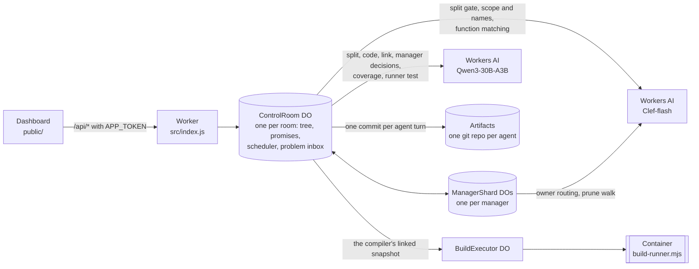
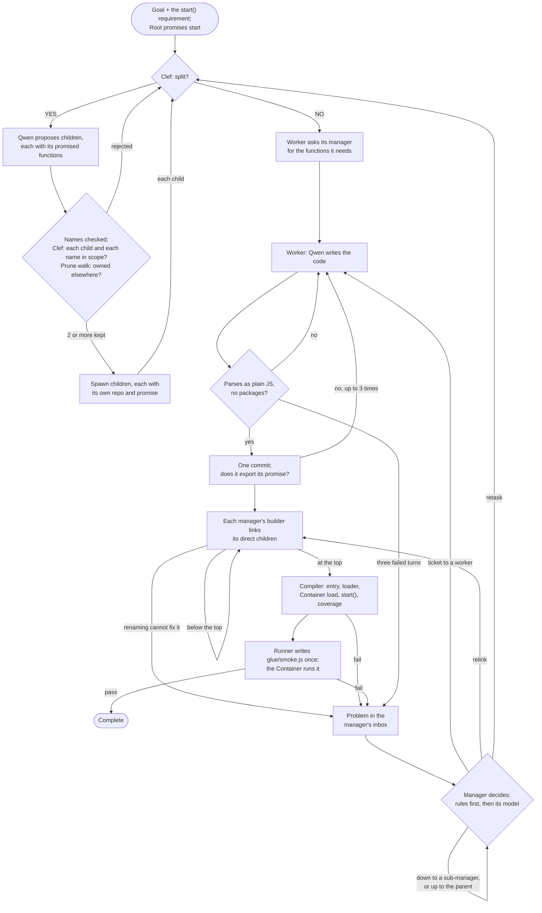

# Recursive Control Plane: how it works

> The detailed companion to the short [README](../README.md), for v7.15.14 and the experimental v8 pipeline. The [v7.15 changelog](../CHANGELOG-v7.15.md) gives the details of what changed after each live run since run9. [v8 (experimental)](#v8-experimental) and the [v8 changelog](../CHANGELOG-v8.md) cover v8.

A multi-agent code-writing control plane that runs entirely on Cloudflare. You give it a goal, and a tree of small agents:
- splits the work, promising a few named functions for each piece;
- writes the code in parallel;
- links the pieces;
- runs the result in a Container.

Each failure goes to the lowest manager whose branch holds every module involved, and that manager decides who changes what.

This is an entry for Cloudflare's "build the next GitHub" competition, which asks for a new way for multiple agents to work on code changes concurrently. The project rethinks what GitHub is built around (repositories, branches, pull requests, review, merge conflicts) for a world where the authors are many small agents instead of a few people.

> **Status:** this is v7.15.14. Every live run up to run8 used v7.13.x or earlier; run9 to run23 used v7.15. Run16, on v7.15.8, is the first live run in which the composed system produced a correct, verified application: complete in 3.9 minutes, in one round, with the runner's test passing. See [Status](#status) and the changelogs for [v7.15](../CHANGELOG-v7.15.md), [v7.14](../CHANGELOG-v7.14.md) and [v7.13](../CHANGELOG-v7.13.md).
>
> **v8** is a second pipeline, chosen per room: the goal becomes a project card of deliverables and checks, workers write any text file in Node or Python, and the Container runs the checks. It is built and tested offline with scripted models and has not had a live run yet. v7 is still the default. See [v8 (experimental)](#v8-experimental).

## The idea

The usual multi-agent design puts one large orchestrator in charge. It reads the codebase, plans, hands out work and reviews what comes back. Its context window then limits how large the project can grow, and every change passes through it.

This project makes the opposite bet: **many small agents with small, bounded context beat one big orchestrator agent with limited context.**

- **Bounded context.** No worker's, manager's or builder's model sees the whole project.
  - **Workers.** A worker's model sees its own assignment, which ends with its own promise: the functions it must export, by name. It also sees its own files and memory, its manager's messages, and the answers to its own requests for functions. Its parent appears only as "Manager". It never sees a sibling, another branch's functions or the wider tree.
  - **Splitters.** A node deciding how to split sees its own assignment, its own promise, the goal as a scope boundary, and its last rejected split.
  - **Managers.** A manager's model sees its direct children: a worker by its modules' exports, a sub-manager by its boundary (what its branch offers and still needs), and each child's promised functions.
  - **Builders.** A builder's model sees its manager's direct children in the same way, plus the files it must fix, excerpted when they lie inside a branch built below.
  - **The runner** sees only the goal, the API the application returned and, for each of its methods, what the plan promises it does.

  No model call reads the whole application. A failed test becomes a requirement, and the manager that owns both sides routes it by the plan, the same way it routes a function request.
- **Each inference tree works only on its own scope.** Ownership works like functional programming.
  - A subtree owns its assignment and its promise, writes only to its own repositories, and shares no mutable state with its siblings.
  - Two subtrees never write to the same repository, so there is nothing to merge and nothing to conflict.
  - Scope is fixed when work is split. Below Root, a proposed child that another strand already owns is pruned before it is spawned: by its function names first, then by Clef.
- **Minimal tape.** Independent agents with well-scoped pieces of the same goal converge on code that is close enough to join with very little glue, and here the glue is literally minimal.
  - The builder that joins modules **may only rename import paths and identifiers, and change how an import binds its module when the target's exports call for it**. For example, `const { f } = require(p)` becomes `const f = require(p)` when `p` exports the single function `f`.
  - The runtime checks every edit token by token, though line breaks are not checked yet (see [Known limitations](#known-limitations)). [What a builder may change](#what-a-builder-may-change) gives the exact rule.
  - Anything these edits cannot fix becomes a problem that the managers settle, one level at a time.
- **The repair half mirrors the construction half.** The split is the forward map: a goal becomes promises, each promise becomes a piece. A problem is an unmet promise, so it is routed by reading that map backwards, through the same hops a function request takes. The same map binds the code (a promised name links to its owner) and bounds the test (the runner asserts only what promises state). Every repair rule is the mirror of a construction step; a rule with no construction twin is a patch, and v7.15.6 removed four (the entry module as the default site of an unattributed failure, the "nothing changed" punishment, a model's triage over the source, and a stack heuristic for swapped arguments). Workers stay bounded throughout: a worker changes only its own files, within its promise, and never judges whose problem it is.

## Four roles

Every node in the tree has one of four roles:

| Role | Does | Never |
|---|---|---|
| **Worker** | Writes modules, exports the functions it promised, asks its manager for every function it needs, and fixes its own modules when its manager sends it a repair ticket | Decides for others |
| **Manager** (Root included) | Splits its assignment, promising functions for each child; scope-checks and prunes its children; answers function requests from its direct children's promises; solves the problems in its inbox: assign, escalate, retire or retask | Writes code, or reaches below its direct children |
| **Builder** (one per manager, a child of it) | Links the manager's direct children, rename-only plus the runtime's binding fixes, and reports what renaming cannot fix to its manager | Decides who changes what |
| **Compiler** (one per run: Root's one extra child, drawn above it on the dashboard) | Chooses the entry, writes the runtime loader and package, loads and starts the application in a Container, checks the API it returned, has a separate runner test it, and reports failures to Root | Writes or edits application code |

**A manager owns only its direct children, and problems and requests move one level at a time.**
- A builder reports to its own manager, and the compiler reports to Root.
- A manager either assigns a problem to one of its direct children or escalates it to its parent.
- A problem is solved by the lowest manager whose branch contains every party to it. So a mistake between two modules of one branch is settled inside that branch, without Root.
- A worker's request for a function goes to its manager, which answers from its direct children's promises or passes it up to its own parent.

**Root is the final stop on the train, not a special manager.**
- It splits exactly like every other manager.
- When a run starts, the runtime appends one requirement to the goal:
  > The finished application has one entry module that exports start(); start() takes no arguments and returns an object with one method per operation named above. Modules get what they need from other modules only by importing it. Importing a module does no work at load: no reading process.argv, starting a server or prompting.

  The splitters assign that requirement like any other.
- Root's promise is `start`, the only promise the runtime writes. Root's split gives it to one child, like any promised name.
- The compiler files a missing `start()` with Root as a normal problem.
- Root differs from other managers by position only:
  - It has no parent. Where another manager would escalate, Root closes the problem, and when its repair rounds run out, the run fails. A function request that reaches Root unanswered is answered "no piece promises it".
  - An import that resolves nowhere becomes a problem at Root, not a need on a branch boundary.
  - Its own split is not checked by the prune walk.
  - The compiler is its child, drawn above it on the dashboard.

## Promises

A node's **promise** is the functions its parent's split listed for it (Root's is `start`), at most five, each with a name, a one-line description, optional parameter hints, what a call returns (since v7.15.7: one short line, "the array of ticket objects", "the created ticket", "nothing"), and an operation tag when it performs one of the goal's operations.
- **Names are binding.** The piece must export exactly these names, and other pieces import them by these names. A piece may export more.
- **A promise states its shape.** Every promise says what a call returns, beside what it does, and every promised function may be async: a caller awaits every call to one and is async itself where it does. The contract check enforces it before any linking: a result read without `await` is sent back with the shape in hand ("`readTickets()` may be async and returns the array of ticket objects: write `const tickets = await readTickets();` inside an async function."), and every surface a manager, a builder or a ticket reads shows `async` (`exports.readTickets = async function readTickets()`). One renderer shows a promise the same way everywhere it is read, in a worker's assignment, a manager's answer, a ticket's facts and Clef's views: `readTickets(): reads all tickets from storage; returns the array of ticket objects`. In run14 the storage piece's `readTickets` was async and returned an array, its promise said neither, and Create ticket read a Promise as a JSON string for five rounds. A promise that states a return value must return one: a function whose body returns nothing against a stated `returns` is sent back before any linking ("`createTicket(data)` is promised to return the created ticket, but returns nothing: return it."); "nothing", "void", "N/A" and a promise that resolves to no value all mean no value. In run15 `createTicket` returned nothing, the fixed test read `createResult.id`, and nothing caught it before the Container.
- **Promises are checked before any child exists.** A bad name is deleted, never the piece; only a split that does not give each of its parent's promised names to exactly one piece is rejected.
- **Clef vets them in the same step** as the statements of work.
- **They are recorded**: in SQLite, which routing reads, and in each manager's `memory/private/ownership.json`.
- **They route.** A worker asks its manager for every function it needs, and the manager answers from its direct children's promises only, one level at a time.
- **They are checked on return and when linked.** A worker that does not export its promise, or reads a promised function's result without `await`, is sent back, and the builders and the compiler read the plan.

[CHANGELOG-v7.15.md](../CHANGELOG-v7.15.md) gives every rule.

## GitHub, rethought

| GitHub | Here |
|---|---|
| A shared repository | Every agent owns a private Cloudflare Artifacts git repository, created when the agent is spawned. Builders and the compiler get one too. |
| Branches and merge conflicts | Agents share no branch. An agent commits only to its own repository, so there is no shared branch to merge into and nothing to conflict. |
| Commits | One Artifacts commit per agent turn. Everything an agent writes in a turn is staged and pushed together, and a worker's messages leave only after its commit. |
| Interfaces agreed up front | Promises. Each split names the few functions each piece exports, and Clef vets them with the pieces' scope. |
| Merge | Each manager has a *builder* that links its direct children's finished modules. A builder may change import paths and identifier names, and how one import binds its module when the target's exports call for it. The runtime compares the Acorn token streams before and after every edit (whitespace and comments are not compared). It rejects any edit that changes another token, unless the result is, token for token, the runtime's own binding fix. It also rejects an edit that would drop a promised function or bind one promised function to another. |
| Pull request review | Mechanical gates replace reviewers. Clef admits each proposed child against the goal and its parent's assignment, and each function name a child adds. The prune walk drops a child another strand already owns. Each worker file must parse before it is committed, and a worker must export what it promised. Builder edits may change no token except an import path, a name, or an import's binding where the target's exports call for it. The compiler requires the linked application to load, to start, to return a method for each operation the goal names (as far as the coverage check can tell), and to pass a test written by a separate runner. |
| Issues and assignment | The problem inbox. A builder or the compiler files what renaming cannot fix with its manager. Each manager places a problem's parties among its own direct children and decides one level at a time. Deterministic rules decide first. The manager's model is asked only for a real choice, and the runtime validates every action it returns. |
| CODEOWNERS and blame | Provenance. A problem names its parties (the module that reads a name, the one that provides it, the line that failed, the piece that promised a function) and the worker that wrote each, through any number of nested builders. A worker hears it with the renames every builder made in its file since it published it, so a builder's rename is not mistaken for the worker's own code. |
| Discussion | Function requests. A worker asks only its manager, for each function it needs. The manager answers from its direct children's promises, by name or with one Clef call, or passes the request to its own parent, and the answer comes back down the same way. |
| CI | The compiler, Root's one extra child, runs the linked application and the runner's test in a Cloudflare Container. |

## Architecture



## Life of a run



1. **Goal.** The runtime appends the `start()` requirement to the goal text, and writes Root's promise: `start`.
2. **Split gate.** For every agent's assignment, Clef answers one typed YES/NO question: can this code be written as two or more independent modules? Clef returns a probability. At or above the room's threshold (default 0.7), Qwen proposes the children.
   - The splitter prompt is the same at every level. It asks for plain Node.js with built-in modules only: no TypeScript, UI frameworks or JSX, and no servers, frameworks or databases unless the goal asks for them.
   - For each child, the splitter gives a label, a task and its `functions`: at most five that code outside the piece calls. The splitter must give each function its own node promised, unchanged, to exactly one piece.
3. **Names checked.** Before Clef is asked, the runtime checks the names. A piece whose task says it "exports NAME(" carries NAME. A name that is not an identifier, is copied from the prompt's example, or comes past the fifth gets one retry in the same call, and is then deleted. A new name that two pieces list also gets the retry, and is then placed on one of them: the one piece whose task says it exports it, else the one piece whose label is the name's words ("Update Ticket Module" for `updateTicket`), else the piece Clef picks at 0.6 or above. Only when none fits is it deleted from all of them. Placeholder labels such as "Piece A" also get the retry. Only a split that does not give each promised name to exactly one piece is rejected. The next turn then keeps Clef's YES and gives the splitter its partition back.
4. **Scope check, in the same step.** Two Clef calls run in parallel:
   - one scores every proposed child against both the goal and the parent's assignment, and drops a child below 0.5;
   - one asks, for each name a child adds, whether that child's own assignment writes it, and a NO deletes only that name.

   A child that carries a name its parent promised is in scope by construction, and it takes its parent's description of that name.
5. **Prune walk (below Root).** Each admitted child is walked up the tree.
   - **By name first.** At each level, the promises of that level's other direct children are compared with the names the child adds. A child made only of names that one other branch promises is pruned to that branch, with no Clef call. Otherwise such names are deleted from it.
   - **Then by Clef,** for a child that carries none of its parent's names. At each level, Clef picks the direct child that owns its topic. If the asking branch owns it, the branch keeps the child. If another branch owns it, the child is pruned, and a short note tells the new children to import it from that strand. If no level names an owner at Clef's bar (0.6), the child is pruned to the other branch Clef ranks first at 0.35 or more; otherwise, or if Clef fails on the way, it stays in the splitting strand. Only the scope check (step 4) drops a child as out of scope.
   - A split needs at least two distinct children that survive and fit the room's agent and depth limits. A rejected split goes back to Clef and Qwen with the reasons.
6. **Spawn.** Each child gets its own Artifacts repository, and its promise is recorded. The parent becomes a manager permanently: it never writes code.
7. **Workers ask, then write.** When Clef says NO, the agent is a worker.
   - Its assignment ends with its contract: the functions it must export, each with its one-line description and what a call returns, and the functions its plan says it uses, each with its owner and what it returns.
   - In its first answer, it asks its manager for every function its assignment does not list (what it does, and the name it expects; up to 8 at once), and waits. It writes only files that do not import what it asked for.
   - Its manager answers from its direct children's promises, by the expected name first and otherwise with one Clef call. A miss goes to the manager's parent, one level at a time up to Root, and the answer comes back down the same hops. See [Function requests](#function-requests-one-level-at-a-time).
   - The worker imports each function on its own line, by exactly the name it was given, with the name as the path: `const { loadTickets } = require('./loadTickets');`. The builder links each line to the module that exports that function.
   - The worker gets collaborators only by importing them, never as parameters, factories or a `start(...)` of its own. Any imported function may be async: it awaits every call to one and makes its own functions async where it does.
8. **Parse check and commit.** Every file must contain executable JavaScript, parse with Acorn as CommonJS or as an ES module, and import no packages. A failure goes back to the same worker in the same turn. The worker's files for the turn are then pushed as one commit.
   - A worker that fails three turns in a row at this gate becomes a `stuck` problem for its manager.
   - A worker rejected for TypeScript, JSX or a package import is retasked once to plain JavaScript.
9. **Contract check.** Before its done is accepted, a worker's modules are read against its whole contract in one pass: they export each promised function as a named export or a member of the exported object (a class's or instance's methods do not count); none of them is an empty placeholder (no statements, only returning nothing, or only throwing a not-implemented error), nor is any operation `start()` returns; the piece that carries `start` returns every function that performs one of the goal's operations; no module declares a function another piece promised (a wrapper that calls the import is fine; a stub file is told the file action, since a worker cannot delete a file); the functions its plan says it uses are imported and called, with no data of its own beside a use of the store; an ES module calls no `require`; a call passes a used function's arguments in their promised order; and no call to a promised function of another piece reads its result without `await` (a result bound to a variable is followed to its uses; one returned as it is, `.then`-ed, given to `Promise.all` or unused passes; the send-back states the shape the promise gives and the line as it should read, the bound form for a result passed to another call). One message names every violation, with the import line where one applies, up to three times; an empty operation is answered with what the plan offers for it, found the way a function request is answered, or, when no piece promises it, the operation grows the plan at the manager (step 12's growth) and the carrier imports it; only when no piece up to Root covers it is the carrier told to write it here. The fourth done is accepted, and a function still missing, or still written for another piece, goes to its manager as a `contract` problem, unless the builder leaves that module out of the bundle as a stub. Then its completion report goes to its manager.
10. **Builder link.** A manager's builder starts when every worker under the manager has finished and no repair is in flight there.
    - **Ownership.** A module whose every export declares a function the plan gives another piece is a stub: it is left out of the bundle before linking (a facade that re-exports or wraps the owner's import stays). With no model call, an import of promised names is then bound to the module their owner exports, whether or not its path resolves now, and a non-owner's export of a promised name is no link target; a carrier whose one module the parser cannot read is still the owner. A generic name (`get`, `set`) is never bound this way.
    - **Path fixes.** For unpromised names, the runtime points each import that resolves nowhere at the one module that clearly provides it. That is the only module exporting every name the file uses from the import; of several, the one whose piece the plan gives those names; or else the only module named like the import path that exports at least one of them. A branch builder accepts only an exact name.
    - **Binding fixes.** The runtime then fixes each import that is bound the wrong way round for its target.
    - **The model.** Files with an unresolved import or a mismatched name go to Qwen. The model reads each sub-manager child by its boundary, and a file inside such a branch as an excerpt.
    - **Checking edits.** The runtime keeps a model edit only if it is a rename or exactly the runtime's own binding fix ([What a builder may change](#what-a-builder-may-change)), and it does not drop or misdirect a promised function. It undoes a model rename that breaks an import that matched before.
    - **Relinks.** The builder relinks up to two times while problems remain that a rename could fix.
    - **Below the top**, it publishes the linked bundle and the branch's boundary, which always offers the modules exporting the manager's promise. An import that points outside the branch is left for the builder above. A function the manager promised that no module of the branch exports is a `contract` problem for the piece below that carries it.
    - **Reports.** Whatever renaming cannot fix inside the branch, it reports to its manager.
11. **Compiler.** Once Root's builder has linked the current source, the compiler takes over.
    - It picks the entry. That is the module that exports `start()`. Of several, it is the one whose `start()` returns an API without reading the command line, listening or prompting, then the one of the piece the plan gives `start`, then the one that imports the most others.
    - It writes a fixed loader (`glue/index.js`) and `package.json`, and sends the snapshot to the Container.
    - The Container parses every file, loads the entry, calls `start()`, and describes the API it returned: member names, kinds and parameter names, never source.
    - `start()` must return something to call, and not a single generic handler.
    - **Coverage.** Before the runner's test is fixed, a Qwen call maps each operation the goal names to the method of `start()`'s API that performs it. An operation with no method is an entry problem. With no usable mapping, the compiler reads the plan instead: `start()` returning fewer methods than the plan has operations is a gap, and otherwise the runner tests the plan's operation functions that `start()` returned.
    - **Runner.** A separate Qwen call, the runner, writes `glue/smoke.js` from the goal and that description alone, plus, when known, the method for each operation and what the plan promises each method does and returns. A draft that asserts an error message, a return value or a required throw that neither the goal, the API nor a promise states is turned back with the accepting form, up to three drafts; the third is accepted as it asserts. The first test that runs stays fixed for the whole run: the application must satisfy it, and a failure on an assertion the plan never stated says so in the ticket. When it passes, the room completes.
12. **Problems.** Builders, the compiler and stuck workers file problems. [Problems move one level at a time](#problems-move-one-level-at-a-time) describes how managers settle them.
    - A worker fixes its code; its branch builder relinks, its manager finishes again, and the compiler runs the new bundle.
    - Infrastructure failures blame nobody and wait for **Continue**. A runner that cannot write a valid test in three attempts gets one more round, then waits for **Continue**.

### What a builder may change

A builder's edits are `find`/`replace` text. The runtime decides whether to keep each one by comparing the Acorn token streams of the file before and after the edit (whitespace and comments are not compared). An edit is kept when every token it changes is one of these:

- **An import path:** a relative module path in a `require`, `import` or `from` position. No other string may change.
- **A variable name:** a variable this file declares, renamed at every use, to a name the file does not already use and that some other module defines or uses.
  - Two variables may not be renamed to one name.
  - A variable is not renamed if the file also reads the same name where that variable is not in scope (a global of the same name), or if the file uses `with` or `eval`.
  - A function or class is not renamed if the file reads its name back (`.name`) and also writes it as a string.
- **A member or key name:** renamed to a name some other module defines or uses.
  - A member this file defines changes at its definition and at every use together, and never onto a key its object or class already has. Definitions include an object key, a class member, and `x.m = …` on `this`, on the exports or on a variable of the file.
  - It cannot be renamed if the file uses `with` or `eval`, or names it as a string key: `x['m']`, `'m' in x`, `Object.defineProperty(x, 'm', …)` or `hasOwnProperty('m')`.
  - Nor can it be renamed if the file reaches an object that can hold it by a key decided at run time: a computed read such as `handlers[op]`, a computed destructuring, `in`, `for…in`, or `Object.keys`, `values` or `entries`. A plain write `x[k] = v` and a count `Object.keys(x).length` do not count.
  - To find which objects can hold the member, the runtime follows the file's variables, members, `this`, `module.exports`, calls to its own functions and their results, `Object.assign`, `Object.freeze`, spreads and `extends`.

Built-in names such as `require`, `eval` or `Math` are never renamed, and neither is a built-in method call such as `.push` that no module defines. The edited file must still parse.

An edit that renames an imported name `{ a }` to `{ b }` without the file's uses of it is kept as the alias `{ b: a }` (`import { b as a }`). This requires that the import still names the same module, and that the module exports `b` and not `a`. It also works when the file declares its own `b`, which made the plain rename fail to parse.

In a room with promises, the plan adds four refusals. An edit may not:
- remove a function the plan gives the module's piece;
- bind one planned function to another piece's planned function (`createTicket` to `saveTickets`);
- bind a name that its piece was told no piece promises to a planned function (`addTicket` to `saveTickets`);
- point a planned function at a module whose piece neither carries nor exports it.

The one change that is not a rename is how a single import binds its module. It is allowed only in these forms, and only when the target's exports call for it:

| The worker wrote | Becomes | Only when |
|---|---|---|
| `const { f } = require(p)` | `const f = require(p)` | `p`'s `module.exports` is a single function or class named `f`, nothing in `p` gives it a member `f`, and the file reads nothing off `f` except a class's static methods |
| `const f = require(p)` | `const { f } = require(p)` | `p` exports an object holding a function `f`, and the file only calls `f` |
| `const x = require(p)` | `const { m: x } = require(p)` (`const { x }` when `m` is `x`) | `p` exports exactly one member `m`, a function or class, and the file uses `x` only as a function: it calls or tests it, or keeps it in a variable or in a handler table read only by key |
| `const f = require(p)` | `const { f } = require(p)` | `p` exports an object holding `f` (a function, class or re-export, never the module's own data), and the file never calls or reads `f`, only passes it on as a value: an object property, array element, argument, return value or export |
| `import { f } from p` | `import f from p` | `p`'s only export is a default function or class named `f`, under the same conditions as the first row |
| `import f from p` | `import { f } from p` | `p` is an ES module with no default export, it exports a function `f`, and the file only calls `f` |
| `import x from p` | `import { m as x } from p` | `p` is an ES module with no default export whose only export is the function or class `m`, and the file uses `x` only as a function |
| `import f from p` | `import { f } from p` | `p` is an ES module with no default export that exports `f`, and the file only passes `f` on as a value |

The runtime makes these fixes itself, before the model is called and again after the model's edits. A model edit that changes how an import binds is kept only if, apart from renames, its result is exactly the runtime's own fix, compared token for token. Anything else goes to the builder's manager as a problem: several names destructured from a module that exports a single function, for example, or one import line that reads several promised functions living in different modules.

### Problems move one level at a time

A builder or the compiler files what it cannot fix with its manager, as rows in that manager's inbox. A worker whose accepted done breaks its contract is filed by the runtime. Each problem has:
- **a kind:** `unresolved`, `mismatch`, `binding`, `entry`, `load`, `run`, `stuck`, `contract` or `argorder`;
- **parties:** the reader of a name, its provider, the line that failed, or the subject, each with the worker that wrote it;
- for a failed run, **a requirement:** what must hold, the `start()` method the test was exercising, the functions the failure names, the test line, and the component stack frames, as facts. The compiler picks no culprit.

Every manager runs the same steps on its inbox.

**1. Place the parties.** Each party falls under one of the manager's direct children, or outside its branch. The manager is the *lowest common manager* when the parties fall under two or more of its children, or under one child that is a worker.

**2. Route a requirement as a function request is routed,** among the direct children, with no model call until the last step:
1. the innermost component frame's child takes it, by the function it promises there, else by the module its branch wrote; a manager child routes it down the same way, one level at a time;
2. otherwise the method under test: the child that promises it, else the piece the plan says performs it, is the site, and the other functions the failure names are its provider parties, the next candidates after a decline (a method `start()` lacks names the start carrier, as the site);
3. otherwise one Clef call ranks the children's promises against the requirement, never the start carrier, which only composes; below Root a miss goes up one level; at Root the manager's model decides once, and after that the run fails stating the requirement.

When two promised functions are named and no method is under test, Clef ranks them. A generic name (`get`, `list`) names no child, as a function request by it reaches none. A property read on a test binding is a requirement on the binding's producer, not on the call on that line: `Cannot read properties of undefined (reading 'id')` at `app.viewTicket(createResult.id)` goes to the method that produced `createResult`, and the ticket says what was read and what to return ("Your `createTicket(data)` must return the ticket it created and saved (an object with id): test line 13 reads `createResult.id`, and `createResult` is what `app.createTicket(createData)` returned on line 10."). Run15 sent that failure to View Ticket five times.

**3. Apply the deterministic rules for load and link failures,** first match wins:
- **Hop limit.** A problem that has had `2 × depth + 2` decisions, a route's declines not counted, goes up declined below Root and is closed at Root.
- **Stuck worker.** A worker stuck on TypeScript, JSX or a package import is retasked once to plain JavaScript. Any other stuck child is the model's choice; by default it goes up as this manager's own problem.
- **Relay.** A decision from the parent travels as a side ("the reader changes"), never as a node below the child. The manager hands it to the child that holds that side.
- **Escalate.** A party lies outside the branch and nobody above has decided, or no party lies under this manager. The problem goes to the parent; at Root, a problem with no party under it is closed.
- **Relink.** An interface error between this manager's children (an import that does not resolve, a name the module does not export, a binding of the wrong shape, a method of a factory bound whole that another module exports under another name), or one this manager's builder's own edit caused, goes to its builder to relink. A built-in or invented member on the result of a named import's call (`tickets.push`, `store.add` on `readTickets()`'s result) is a requirement on the caller, never a relink: nothing the builder can rename. This happens once per error and source.
- **Delegate.** Every party lies in one sub-manager's branch, so that sub-manager decides.
- **Assign.** Every party lies in one worker, so that worker gets it.
- **Grow the plan.** A reader that imports a function no piece promises, or a requirement that names one, is the mirror of a split that left it out: the lowest common manager asks Clef which direct child's assignment covers it, adds the function to that child's promise and retasks the child; a manager child gets it relayed down; none at this level goes up a level; none at Root means the function is outside the application, and only then does the reader change its reads. The same growth has a second trigger: an empty operation of `start()` whose performer no piece promises (run9's `update() {}` and `del() {}`), or a method the fixed test calls on the application that no piece promises (`app.listTickets`). The carrier's contract check files it with its manager, which asks Clef which direct child's assignment covers it, adds the operation to that child's promise and retasks it; the carrier imports the operation by its name and returns it, never writes it, and a grown name is the plan's for the linker whatever its name. Only at Root with nobody is the operation the carrier's own to write.

**4. A ticket is a requirement on the worker's own promised function:** "Your `viewTicket(id)` (returns the ticket with the given ID) must satisfy: … Test line 50: `await app.viewTicket(createdTicket.id)` inside a try expecting a throw whose catch checks: …" When the runner's third draft kept an assertion the plan does not state, the ticket leads, once, with the sentence that says the fixed test requires it anyway. If the manager cannot phrase a ticket that way, the route is wrong, not the worker. When the frames name no other piece, the ticket's facts are the plan's uses edge: one line per function the worker's plan says it uses, as its owner promised it, with `async` from the module's surface and what it returns, then the owner's module surface ("What the other side provides: `async readTickets(): reads all tickets from storage; returns the array of ticket objects` | … | `ticketStorage.js exports: exports.readTickets = async function readTickets(); …`"); a start carrier hears its performers the same way. The facts take the room the body leaves, cut at a boundary, never mid-word. In run14 the tickets of rounds 3 to 5 carried no facts, since the only frame was the caller's own, so the worker never heard that `readTickets()` returns an array and is async.

**5. No change is a routing signal.** A worker that answers a ticket without changing a file is not punished: the problem returns to its manager with that child declined, and the manager routes it to the next candidate (the next party, the next frame's owner, Clef's next rank, up a level). A child that declined a failure declines it again when the next report fails the same way, so a new wave routes past it without a ticket. In run11 the write worker, blamed by a stack frame for its caller's swapped arguments, now declines once and the caller gets the ticket.

**6. Ask the manager's model, only for a real choice:** a requirement every candidate declined, or routed to the same child a third time, a stuck child, a child that escalated, no party in the branch, or two children that disagree with neither side anchored. The model gets one call per turn on the largest cluster of related problems. It reads the manager's direct children with their promised functions, the problems with their parties and defaults, and the decisions it must keep, and returns **assign** (with instructions and facts from named children), **escalate**, **retask** (a new task that Clef must score in scope, optionally with new promised functions) or **retire** (a child that nothing else imports). The runtime validates every action: every function a manager promised must stay on exactly one child, a declined child is not assigned again, and the start carrier never takes a run requirement, only one about `start()`'s own API. What the model leaves out keeps the rules' decision.

**7. Apply it.** Each application is one synchronous block, and a row moves only if it is still as it was read. A worker gets one `[build:repair]` ticket per turn, holding all of its problems in its own file paths. **Retiring** a child removes its branch and its code from the bundle above. **Retasking** a worker reruns it with the new task; retasking a sub-manager retires its whole branch, and it splits again as a new child, which must give its promise to its new pieces.

**The same map binds the code and bounds the test.**
- **One contract check** runs when a worker reports done: its modules export every function it promised and none that another piece promised (a wrapper that calls the import is fine), import and call the functions its plan says it uses, keep no data of their own beside a use of the store, call a used function with its promised parameters in order, read a promised function's result only after `await`, and use one module system. One message names every violation with its import line, and after three returns the done is accepted and what is still missing, or still written for another piece, goes to the manager, unless the builder leaves that module out of the bundle as a stub. A name the plan's growth or an answered request gave the worker counts as one more of its owner's storage functions and is never asked for on its own.
- **The linker binds by ownership.** An import of a promised name goes to the module its owner exports, whatever else exports that name; a carrier whose one module the parser cannot read is still the owner. A module that declares another piece's promise and nothing of its own is left out of the bundle; a facade that re-exports or wraps the owner's import stays, and a generic name (`get`, `set`) is never bound by the plan. Run13's stub `deleteTicket.js` in the entry's repository can no longer capture the entry's import.
- **The runner's test is bounded by the plan.** The runner sees each `start()` method's promised description and what it returns, and a draft that asserts an error message, a return value or a required throw that neither the goal, the API nor a promise states is sent back with the accepting form (`let gone; try { gone = await app.viewTicket(id); } catch (e) { gone = null; } assert.ok(gone == null)`). The third draft is accepted as it is, and a failure on an invented assertion says so in the ticket. A draft may not depend on a result its description states none for either (reading `createResult.id` of a create that states no return), with the same bound; when the API offers no other way to the value (no method lists or searches, and every other method takes an id), the dependence is accepted on the first draft as the plan gap it is, and a failure on it says so in the ticket.

**Bounds:**

| Limit | Value |
|---|---|
| Relinks per manager per source | 2 |
| Repair rounds per manager | 3 in a row without progress; a round with progress resets the count |
| Repair rounds per run | min(40, 16 + 4 × managers), progress or not |
| Manager model calls per manager | 8 |
| Declines per problem | each candidate once, then up a level |
| Decisions per problem | 2 × depth + 2 |
| Contract returns per worker | 3 |
| Runner drafts | 3; the third is accepted as it asserts |
| Function requests sent at once | 8 |

A round makes progress when its report no longer fails the way the manager's last round from the same source did, and fails like none of its last three rounds from that source, so ping-pong between two failures is not progress. For a load or run failure, progress compares the error line, the line of the runner's fixed test where it stopped, and the file it is blamed on or, for a requirement, which blames no file, the child it was routed to; such a failure recurs for the model (M4) by that failure too. When Root runs out of rounds, the run fails. A lower manager that runs out tells its parent it cannot finish its branch. Infrastructure failures, and three failed turns a manager cannot settle, pause until you press **Continue**.

### Function requests, one level at a time

In every live room started on v7.15, Root promises `start`, and a worker's request to its manager is a function request.
- **The worker asks** with what it needs and the name it expects. A worker asking for one of its own promised functions is told at once to write it.
- **Its manager answers from its direct children's promises only**, minus the branch the request came from:
  1. the expected name, when exactly one child's promise holds it, with no model call (a generic name such as `create` or `get` is never matched this way);
  2. otherwise one Clef call over those children's functions (`name(params): does`), and the best match at or above 0.6.
- **A hit** replies with the function's name, its parameters and description, and the label of the piece that exports it. The worker imports exactly that name.
- **A miss** goes to the manager's parent, one level at a time, up to Root. The answer comes back down the same hops.
- **When no piece up to Root promises it**, the worker's own manager asks Clef whether the function is part of the worker's assignment. If it is, the worker writes it. If not, the worker imports it by the name it expects, and the gap reaches Root as a problem when the application is linked.
- **Names that a lower split adds stay internal to that branch**, and are never an answer outside it.
- **A worker waits for its answers.** It cannot finish while a request is open, and only its last answer wakes it. Every answer is final.
- **Routing state is durable.** Each manager records the next hop in its ManagerShard Durable Object, so a reply retraces the path. A crash between sending a request up and recording the hop is repaired on the manager's next turn.

**Plain questions and older rooms.** A message ending in `?`, or a `[knowledge:key]` value the worker has not itself published, still takes v7.14's path:
- the manager looks in public knowledge and published source;
- then it picks one direct child by keyword match, with Clef when that is ambiguous;
- it forwards the question to that child and relays the answer.

This path never goes to the manager's parent. Rooms without promises (`MOCK_AI`, and rooms started on v7.14) keep v7.14's request routing as well, and their workers keep v7.14's advice to proceed on an explicit assumption rather than wait.

Throughout:
- **No global directory.** An agent is shown at most its parent, its direct siblings and its direct children, never their descendants. A worker is shown none of them except its manager, as "Manager".
- **Messages go to the manager only.** A live worker can message only its manager, and the runtime refuses messages that would reveal a hidden descendant's ID.
- **Advertisement.** Each manager republishes its direct children's public files under aliases of its own, and their `assumed_*` knowledge under scoped keys, in its own Artifacts repository.

### Builders are the bottleneck, so every manager has one

Linking is the one place where independent work meets, which makes it the natural bottleneck. So every manager gets its own builder.
- A builder starts as soon as its manager's subtree has finished and no repair is in flight there, even while other branches are still working.
- It links only what crosses between its own direct children. A sub-manager child is represented by its builder's linked bundle, and the model reads it through the boundary that builder published.
- A builder makes no model call when, after the runtime's own path and binding fixes, every import resolves, every imported name exists in its target, and no earlier error names a module. One import line per function, named after it, links by the plan with no model call, even across a sub-manager's branch.
- Problems a builder finds stay with its manager, so a mismatch inside one branch is settled there, without Root.
- Running the application is the compiler's job, at the top, once.

## v8 (experimental)

Everything above describes v7, and v7 builds one kind of thing: a JavaScript module graph whose entry exports `start()`, tested by a script a model writes after the code exists. A goal like "add a README to this repo" or "a to-do list web page" had nowhere to go. A piece could only promise a JavaScript function name, only `.js` files could be linked, the runtime appended the `start()` requirement to every goal, and seven gates rejected Markdown or HTML outright.

v8 keeps the tree, the promises, function requests and routing one level at a time. What changes is where the deliverable and its tests come from: the goal itself, before any code is written.

### v7 and v8

v8 is a room setting: **Pipeline** in the dashboard, or `settings.pipeline: "v8"` in `POST /api/run`. **v7 is still the default**, and a v7 room sends exactly the requests it sent before v8 existed. A room keeps the pipeline it started with (`pipeline_kept`), and `MOCK_AI` rooms always run v7. Making v8 the default and deleting the v7 paths (slice S7) waits for live runs. v8 has only run offline so far, against scripted models, with the real Container scripts run in Node. [trying-v8.md](trying-v8.md) is the checklist for the first live runs, and [CHANGELOG-v8.md](../CHANGELOG-v8.md) lists the slices and what each review changed.

### How a v8 run goes

The forward path is goal → card → contracts → pieces. The backward path is failed check → requirement → `serves` → contract → owner. Both use the same map.

1. **The card.** Root's first turn turns the goal into a project card, in one call on the room's compiler model. The card holds:
   - a summary;
   - the languages, chosen from the toolchains the Container has installed;
   - up to 12 deliverables;
   - how to run the project (a static server, or a command started with a port);
   - up to 24 requirements, each one yes/no statement with one check;
   - the project's own test commands, if it has any;
   - the decisions the goal left open, each stated in one sentence.

   The writer's answer goes through three layers:
   - **Lenient reading.** The runtime reads the card the way a person would: from prose or a code fence, a script named as a function becomes a command or a file by its extension, `module.py:fn` becomes the function `fn` in `module.py`, a missing path gets one, and a requirement's `serves` matches a deliverable by name, path, case or stem. A missing source becomes the goal sentence that shares the most words with the requirement. Every repair is listed in one `card_repaired` event.
   - **Hard rules, for safety and for running only.** A check must be runnable as written (a call names a function deliverable, a browser or http check names a run, a command starts with a command deliverable or an installed program), and the safety rules stay: argv-only commands, the program denylist, path and URL rules, base files and hidden requirements. A naming convention or a reference that doesn't match is never a refusal. What fails a hard rule goes back to the writer with the fix it needs.
   - **Clef's review.** Where a requirement's `serves` still matches nothing, Clef ranks the deliverables in one batched call and the top one at 0.6 or more is added to it, beside whatever its check names; below that it serves what its check names, or stays on the card marked *unattached*. Clef never rewrites a check. Then one batched review asks whether each goal sentence is covered by a requirement, whether each check exercises its behaviour rather than a file's existence, and whether each deliverable's kind fits. The writer gets one revision call only for substantive notes (an uncovered goal phrase, a check that doesn't exercise its behaviour, a page, command or function no check exercises, an http check that expects nothing) or errors left; a kind note only annotates. A revision never loses work: what the draft had and the revision leaves out is kept, and a revision that validates worse is discarded. Notes the final card still draws stay on it and show in the Card panel.

   **Clef reviews; it never deletes.** It vets every requirement against the goal, and each keeps its p (`vet_p`). Below 0.5 a requirement is marked *doubtful* and shown with its p; it is never dropped. When the checks keep failing and some failing requirements are doubtful, the hold names them first, and the person changes them with a follow-up prompt or presses Continue. A deliverable that no requirement covers gets an implicit "exists" check. If the goal needs a language that isn't installed, or asks to edit a project when none was given, the room stops at `card_blocked` before any split. The card is fixed for its revision, and the dashboard shows it in the **Project card** panel, with the writer's raw answers under the hold while the room is held at `card_failed`.
2. **Contracts.** The deliverables become Root's contracts. A contract has a name and a kind (function, file, page, route, command, doc or data), and can say what it does and give its inputs, outputs, effects, examples and path. It also carries `serves`: the ids of the requirements it helps meet. A v7 promise reads as a function contract with nothing lost.
3. **Split.** The split works as in v7: Clef's split gate, the splitter's pieces each with their contracts, the name checks (now also one carrier per path), Clef's scope check and the prune walk. In a v8 room Clef's scope, contract and owner answers are reviews: a piece or contract it doubts is admitted and shown as doubtful (`scope_doubtful`, `interfaces_doubtful`, `scope_owner_doubtful`), and a name two pieces list stays with the one Clef picks, or the first that lists it. A contract a split adds between pieces inherits `serves` from the pieces that use it, so every contract at every level knows which requirements it is for. Splitters see their own contracts and a few lines of project facts. They never see the card's checks.
4. **Workers write files.** A worker works through functions (`read_file`, `write_file`, `run_examples`, `ask`, `done`, `wait`), one session per turn; nothing reads its prose. Any non-empty text file passes the gate. JavaScript must parse with Acorn, `.json` must parse, and one path rule (shared with the Container) refuses dotfiles, spaces and runtime-owned paths.

   A worker sees its own contracts, the contracts it may use (each with the exact line that references it in the project's language), the project facts, and the goal clipped to 600 characters as a scope limit. A piece is done when its contracts are met, judged per kind: a file at its path, a command's entry point, a function the project's language exports. Function requests still climb one level at a time.
5. **Builders, pieces and glue.** Every manager has a builder, an agent row of its own, at every level; v8 has no compiler agent. When a manager's children are all done, it hands them to its builder, which joins their assembled pieces into one: a worker's files, or a child manager's piece as that child's builder stored it on its row with a digest. So assembly is hierarchical, a rename made lower down stays with its piece, and the top's builder joins only the top's direct children. A file a contract places keeps its path, and any other file goes under `components/<piece folder>/`; the row that holds the base (the top) adds the base files. The runtime writes the glue; a model never does:
   - JavaScript keeps v7's rename-only path fixes, by ownership.
   - A page's script and stylesheet references are pointed at the right files.
   - Python gets shims at the project root, `__init__.py` markers, and a module path only where a file sits in a folder of its own.

   A reference that resolves nowhere is renamed to the one contract name it matches. If none matches and a check held at that manager reaches the file (any file, at the top), the linker model is asked once per file, told when the piece is one branch of a larger project, and every edit must pass a token-level check: the text outside names and import statements stays byte for byte.
6. **Checks, where they can run first.** Each card check is held by exactly one row: the lowest manager whose subtree serves everything its requirement serves (a check no row serves is the top's). After its builder joins the piece, a manager runs the checks it holds that have no current pass, in the piece's own fresh box, as soon as its subtree is done, while its siblings may still be working. Below the top a check runs there only when (a) the import closure of the files it exercises lies inside the piece, in an installed package or in the language, which the linker knows from each file's references, and (b) Clef, asked `CLEF.piece_reach` for each such check, finds nothing it reaches that another piece provides (a route a page requests, a file read while it runs, a function in another part). A check that fails either rolls up to the manager above, which holds it from then on, and so does a failure in a piece's box that is about something outside the piece (an unresolved name or module, a missing package, a refused connection, a 404 on a route no contract of the piece serves); any other failure routes down inside the piece. Each pass is recorded with the digest of the piece's owned files, and a check whose piece is unchanged is not run again anywhere above. One setting, `BOX_CONCURRENCY` (default 4), bounds the boxes a room has open. The run is finished when the top is done and every check of the card has a current pass. The export's spans `piece_link`, `piece_clef`, `piece_box` and `piece_checks`, per manager, show when each piece was joined, judged and compiled.

   File checks run in the Worker. Doc checks go to Clef, which reads the file and answers yes or no (bar 0.6, in parts of 6,000 characters cut at headings). Everything else runs in the box's one exec:

   | Check | What it does |
   |---|---|
   | `file` | The file exists, isn't empty, contains given strings, parses as JSON |
   | `judge` | Clef reads a document and answers the requirement's question |
   | `command` | Runs a command (argv, no shell) with optional stdin and input files, and compares exit code, stdout and stderr |
   | `call` | Calls functions through a small adapter (Node or Python), steps in order, saved results passed on |
   | `http` | Starts the project's server and sends requests |
   | `browser` | Serves the project and drives Chromium headless: go to, fill, click, press, expect text or a count |
   | project checks | The project's own test command, such as `pytest` |

   Every check runs, even after one fails, and each reports observed values with its timing.
7. **Routed repairs.** Each failed requirement becomes a problem routed the v7 way: by stack frame, then by contract name, then by `serves` (the new step), then by Clef's ranking, one level at a time. The worker gets a repair ticket saying what its deliverable did, never what the check expected. An atomic Root repairs its own files. Repair rounds have the same bounds as v7. A requirement that has passed once is anchored, and its check is never changed. The room completes when every requirement passes. Otherwise it holds (`checks_failed`, `checks_blocked`, `checks_exhausted`) with the requirement table, and **Continue** runs the checks again.
8. **Amendments.** A follow-up prompt becomes a change to the card. Its added or changed requirements are routed exactly like failed checks, and the requirements that already passed stay as anchors. The prompt queue applies follow-ups one after another (see below).

The export of a v8 room is the project at its own paths, plus `.recursive/RUN.md` (how to run it, and the requirement table) and `.recursive/card.json`. The runtime never writes the project's own `README.md`.

### Starting from a repo, and links in the goal

`POST /api/run` takes `base`: a public GitHub repo with an optional branch, tag or commit, or a room's previous v8 result (**Start from** in the dashboard). The repo is read without a token: up to 400 text files and 2 MB that the room builds, plus up to 200 files and 4 MB carried into the export untouched (hidden directories, binaries, vendored files).
- **Ownership.** A base file belongs to no piece until a contract names its path, and only that piece may change it. Only the person grants the change: at Start (`grants` in `/api/run`), or at the `base_confirm` hold, which lists each waiting file with Clef's p and whether the goal names it (shown pre-selected; "do not touch X" does not count). Continue grants the listed or selected files. Until then the file stays on the plan, the file gate keeps writers off it, the pieces carrying it wait, and the room doesn't complete; a later hold waits behind the grant. A follow-up prompt can leave a file out instead.
- **What models see.** The card writer and splitters get a compact digest of the repo, and a worker gets only the files its contracts name.
- **Export.** The export is the base plus the changes. `POST /api/export/github` with `onto_base: true` commits just the changes on top of the exact commit the room started from.

Links written in the goal are read once, at Root's first turn, from hosts on the owner's allowlist (`FETCH_ALLOW`). Their text is cut into chunks and summarised into source cards. A split cites the chunks each piece needs, and a piece reads only what its parent cited. A link that can't be read is listed in the **Sources and base** panel, and the run goes on without it.

### Follow-up prompts and the queue

A finished room can take more work without starting over. The **Prompts** panel beside the goal holds a queue of follow-ups. When the room completes, the Durable Object's alarm applies the next one, so the queue keeps going with the dashboard closed. **Adjust now** applies a prompt straight away, also to a running room (`POST /api/amend`). `POST /api/prompts` adds to the queue, and `/edit`, `/reorder`, `/remove`, `/skip` and `/policy` change it. Only queued prompts can be changed. Each prompt shows its state: queued, running, done, failed or skipped.

- **A change is a card change.** The card writer gets the current card and the follow-up and returns the card with the change. The runtime keeps what the change leaves alone: an amendment adds and changes deliverables and requirements, never removes them, and never moves a deliverable to another path. Each new or changed item has the follow-up as its source. A check that has passed is never changed. Clef vets the new requirements against the goal with its changes and only marks them, and asks whether the change is about each existing deliverable it rewrites: a doubt there marks the deliverable and the revision's delta, and the change is applied whole. The goal and the card each get a revision (`goal_revisions`, `card_revisions`). The Card panel lists the revisions and the change behind each.
- **It travels the path a repair does.** Every new or changed requirement opens at Root as a problem and is routed like a failed check: by `serves` and contract name, then Clef's ranks, one level at a time. A piece that answers without changing a file declines it, and the problem moves to the next candidate, then up a level. If nobody at Root takes it, Root splits off one new piece for the deliverables no piece carries. A new deliverable that an existing piece takes goes on that piece's contracts. Pieces the change doesn't reach are never woken, and their files stay as they were. The feed shows `amend_routed`, `amend_declined` and `amend_grown`.
- **Several pieces.** A requirement that serves deliverables carried by different pieces goes to each of them, one problem per piece in the same wave. A change to a deliverable that no new requirement checks still reaches the piece that carries it, as its new contract.
- **While running.** A piece in the middle of a turn finishes it, then reads the change at its next turn, as a routed problem. While Root's split (or a piece's) is still being written, the change waits for it, so the split is never judged against contracts it never saw.
- **Budgets.** A change never gets a fresh budget of its own. A run that stopped because Root waited for a change goes on with the turns it had left, and a paused room stays paused: the change goes onto the card and its problems wait for Continue. Turns you give with **Apply now** are added on top and recorded on the prompt. Queued prompts share an allowance of 4x the Start budget, shown in the panel.
- **Ceilings.** Repair rounds are counted across a room's changes too, up to twice the per-run cap (at most 80); only Start resets that count. On **continue**, two failed prompts in a row still stop the queue. Start, Clear and Continue wait while a change is being applied.
- **Done.** The room completes only when the card's checks pass for the new revision. Repair rounds start fresh for each change, and a failed room's failed pieces get another turn.
- **On failure.** By default the queue stops at a prompt that fails (the room failed, or holds where only you can go on), and **Go on** resumes it. With **When a prompt fails: go on**, the next prompt is applied anyway.

### Security boundaries

- **Fetched and base text is untrusted data.**
  - **How models see it.** It reaches a model only quoted and labelled in the user JSON, beside a fixed clause saying it is data, not instructions. It never goes into a system prompt. It is sanitised first: controls, bidi and zero-width characters are stripped, and the runtime's own message markers are escaped.
  - **No new fetching.** Agents can't fetch anything, and nothing is fetched recursively.
  - **The fetcher.** It uses `https` on port 443 only, hosts on the allowlist only, and no IP literals or internal names. It never reads the deployment's own hosts (`SELF_HOSTS`). Redirects are followed by hand and each hop is checked again. Size and time are capped, and decompression is bounded by a reader-driven inflater. No request carries a token.
- **Checks never reach workers.** No check argument, expected value, stdin, input file, step or judge question goes into any splitter, worker or manager prompt. Contract examples come only from what the card writer wrote for a deliverable. Failure details carry observed values, masked against every check value before any clipping. The reason is simple: a module that knows the expected values can return them, and no adapter can stop that.
- **The Container sandbox is the real boundary.** Generated code, the project's own tests and benchmark tests run there as an unprivileged user.
  - **Isolation.** There are no secrets in the environment. Each check gets a fresh copy of the bundle and its own temp folder, and runs under `prlimit` (processes, file size, memory). Its whole process tree is killed by tag at the deadline.
  - **Network.** Where the Container allows user namespaces, checks run in a network namespace with only a loopback. The check report's inventory says whether the network was on or off. This hasn't been confirmed on a live Container yet. Chromium can only reach the served host.
  - **Defence in depth.** The card's command rules (argv from a strict tokenizer, no shell syntax, no inline-code flags, no package runners) and the call adapters' nonce come on top of the sandbox. They don't replace it.

### Benchmark mode

The **Benchmarks** panel and `POST /api/bench` run a dataset of coding tasks, one v8 room per task:
- **Datasets.** HumanEval, MBPP, MultiPL-E (its JavaScript and Python sets), or plain `{id, prompt, tests}` JSON lines, either pasted or fetched from `raw.githubusercontent.com` or Hugging Face's datasets server.
- **The card.** Each room starts from a card the benchmark fixes: one function deliverable (`solution.py` or `solution.js`) and one hidden command check that runs the benchmark's own tests through a harness the runtime writes. There is no card writer and no Clef vetting.
- **No test feedback.** Agents see the task's prompt (for HumanEval, the signature and the docstring with its examples) and the function contract. The hidden check is never routed, quoted or shown to a model. A room whose only failing requirement is hidden ends `failed` (`benchmark_failed`) with no repair, so this is pass@1 with no test feedback. Most tasks are atomic: Root writes the function itself.
- **Scheduling.** A `BenchRun` Durable Object drives the rooms on alarms, so a run continues with the page closed. At most **Rooms at once** run together, capped by `BENCH_EXECUTORS`. Each compile of a task room runs in its own fresh box, so no two tasks share a Container. Rooms that passed are deleted by default; the others are kept so you can look at them.
- **Scoring.** pass@1 counts only scored tasks. Platform failures, stops and card holds are errors and are left out. A room that ran out of turns counts as a failure. Each task records its wall time, tokens (from the spans) and Container time, and two runs can be compared on the tasks they share.

Integrity limits:
- **The harness.** It is a supervisor that never loads the solution. It deletes the tests and the nonce file before anything runs, scans the solution for constructs that tamper with the interpreter, and runs the tests in a separate process that doesn't hold the nonce. It counts every assertion, and checks afterwards that nothing it relies on was replaced. A pass needs the worker process's own completion record, exit 0 and at least one assertion. Offline, every forgery the review tried fails, and the reference solutions pass 164/164 on HumanEval and 427/427 on sanitized MBPP.
- **What it can't stop.** Code that gets past the static scan and still reaches the worker process's memory (an obfuscated `eval`, say) can defeat the in-process checks, and so can a process of the same user reading the supervisor through `/proc`. The Container sandbox is the boundary, so a pass is strong evidence, not proof.
- **Comparing numbers.** The models may have seen these datasets in training, and the tree around the model is not the setup published numbers use. Treat the results as a comparison between settings and models on this deployment, not a leaderboard figure.
- **Scope.** Only Python and JavaScript tasks run. SWE-bench is out of scope: it needs per-repo Docker environments that Containers can't host.
- **Not run live.** Benchmark mode has only been tested offline so far.

### Speed changes

Speed v1 came from two exported runs. On the small issue tracker run (340 s), compiles took 52% of the wall clock. On an 807-agent run, contract send-backs after the commit cost 19% of turn-seconds. What changed:
- **Spans.** Every model call (role, model, tokens), Clef gate, git phase, Container run (cold or warm, each check's ms) and dispatch delay is recorded and exported. This is what the next round of speed work will read.
- **One Container exec per compile**, with all syntax checks in one Node process, on `standard-1` instead of `lite`. In v8 the card's checks were designed as one exec from the start.
- **Pre-warming.** The Container starts just before the compile it is for: when v7's top builder starts linking, or when an atomic Root starts writing. A pre-warmed Container that gets no compile within 60 s is stopped, and an idle one sleeps after 120 s. A v8 room that splits isn't pre-warmed yet, so its first check run probably pays a cold start.
- **The contract check runs before the commit.** A missing `await` on a callee known to be async is fixed mechanically, and anything else gets one correction call inside the same turn. Only what is still wrong is sent back after the commit, which used to cost a whole extra turn.
- **Per-model settings.** One table holds each model's reasoning switch, sampling and context window. Vendor sampling is used only where the vendor's card was checked; the rest keep temperature 0.2.
- **Dashboard deltas.** The dashboard asks `/api/delta` for what changed every second, instead of pulling the full snapshot every 3 s.

The bigger items from the speed analysis are not done yet: moving git pushes off the room's Durable Object, a pool of pre-created repos, and streaming model output into the tree.

## The dashboard

The page served from `public/` shows the run as an ownership tree of circles. It is observer-only: no agent reads it.

- **Colour is the role.** Managers are blue, workers are ink, and the compiler is grey. The compiler is drawn above Root, joined to it by a short line.
  - A builder is not drawn separately. Its manager's circle splits in half, manager and builder (purple), while the builder is at work on the branch, and a light band sweeps across it.
  - A circle with a light fill is working, and a solid one is done. A pulse means it is running inference. A faded circle is retired, and a red one has failed.
- **Green marks finished branches.** The lines under a manager turn green once everything below it is done and its builder has yet to link. When the builder has linked the branch, the manager's circle gets a green ring.
- **Details.** Hover a circle for its name. Click it to see, below the tree, its task, a `promises:` line with the functions it promised (when it has any), its repository and summary, and, for a manager, its builder.
- **Inference path.** A selected circle draws, in orange, the edges it can use: its parent and its direct children (for a manager, its builder too, and at Root the compiler). The details say who it talks to; click a name to select that node, which is how a builder is selected.
- **Colours.** They come from the tyrtop.com palette. Dark mode follows the system setting; `html[a="dark"]` or `html[a="light"]` forces either one.

Around the tree, the dashboard shows:
- **the run controls.** **Start** begins a run and becomes **Stop** while it runs (then **Stopping** while the running turns finish). **Continue** resumes a paused run. **Export observation JSON** downloads the room's record, and **Download app (.zip)** downloads the application. **Push to GitHub** is hidden in the dashboard for now; the `POST /api/export/github` route stays available;
- a status strip;
- the **Container build** panel with the latest Container report;
- the agent traffic, newest first (the latest 300 events);
- the files the room has recorded, which you can click to read.

The default problem statement is just the product: "Build a small issue tracker that lets someone create, view, update, and delete tickets." The runtime appends the `start()` requirement itself.

## Cloudflare products used

| Product | What it does here | Why |
|---|---|---|
| Workers and Static Assets | Serves the dashboard from `public/` and the `/api/*` routes, which require the `APP_TOKEN` bearer token. | One deployable unit for the UI and the API. |
| Durable Objects (SQLite) | `ControlRoom`, one per room: the agent tree and promises, scheduler, message queues, the problem inbox, staged writes, the event log and timing spans (and in a v8 room the card and its revisions, the requirement results, the prompt queue, sources and base files). `ManagerShard`, one per manager per run: route hops, inbox, lifecycle decisions and Clef owner selection. `BuildExecutor`, one per run (or one per pool slot for benchmarks): drives the Container. `BenchRun`, one per benchmark run: its tasks, results and the alarms that start rooms. | Consistent, durable state per room and per manager. An interrupted turn resumes from its saved position instead of calling the model again, and a manager's decision is applied in one synchronous block. |
| Workers AI | Qwen3-30B-A3B (default) proposes splits with their promised functions, and writes code, link edits, managers' decisions, the API coverage mapping and runner tests. Llama 4 Scout, Qwen2.5 Coder 32B, DeepSeek V4 Flash (reasoning off), Mistral Small 3.1, Qwen 3.8 27B and Llama 3.2 1B can be selected instead; none of the first four has run live yet. The workers' model (the code writers) and the compiler's (the API coverage mapping and the runner's test) are chosen separately from the managers' (the splits, decisions and linking). Clef-flash (or Clef) answers typed YES/NO questions as probabilities: split, scope, the names a split adds, owner and prune decisions, function matching for requests, and a retask's scope. | Fast, inexpensive models for each agent: Qwen3-30B-A3B activates about 3B parameters per token. Clef returns a probability rather than prose, so every gate is a threshold and needs no output parsing. |
| Artifacts | One git repository per agent, written with isomorphic-git (clone, commit, push) using short-lived write tokens. | Real git history per agent, with no shared branch. |
| Containers | One image on `standard-1` instances: Node (the LTS channel), Python 3 with pytest and Playwright's Chromium headless shell. It runs `container/build-runner.mjs` and the v8 check adapters as an unprivileged user, under a 240-second timeout, each check in its own copy of the bundle. | Generated code, and the checks that judge it, run isolated from the control plane. |

Per-room settings in the dashboard: manager model, worker model, compiler model, Clef model, split threshold, concurrent agents, total agents, recursion depth, pieces per split and turn budget. The four count sliders are logarithmic, from each setting's floor to its ceiling (10,000 concurrent agents, 100,000 agents, a depth of 1,000, 10,000,000 turns), with a number box beside each for the exact value.

## Quick start

You deploy to your own Cloudflare account. Requirements: Node.js 22.13 or newer, Docker running locally, and a Cloudflare account with Workers AI, Artifacts, Durable Objects and Containers.

```bash
git clone https://github.com/tyrtop-ai/cloudflare-comp.git
cd cloudflare-comp
npm ci
npx wrangler login
docker info                                     # must succeed; deploy builds the Container image
npm run deploy
npx wrangler secret put APP_TOKEN               # any long random string
```

Open the `workers.dev` URL Wrangler prints, paste the token, and press **Start**. [INSTALL-CLOUDFLARE.md](../INSTALL-CLOUDFLARE.md) covers each step in detail, along with the Artifacts namespace, checking the Container, starting runs from the API, exporting runs and troubleshooting.

### Getting the code out

Once Root's builder has linked the application and the compiler has written its loader, **Download app (.zip)** in the dashboard saves it. The export holds the linked modules, the compiler's runtime loader and the runner's test, and a README that says whether the last Container run passed for exactly these files, or that they are UNVERIFIED. It runs with plain Node.js, with nothing to install: `node glue/smoke.js`. When Clef left the whole goal atomic, Root wrote the code itself, and the export is Root's own files.

`POST /api/export/github` pushes the same files to a new branch of a repository you name and opens a pull request. It needs a `GITHUB_TOKEN` secret, and its dashboard button is hidden for now. [INSTALL-CLOUDFLARE.md](../INSTALL-CLOUDFLARE.md#getting-the-code-out) gives the token's permissions and the API routes (`/api/app`, `/api/app.zip`, `/api/export/github`).

### Local checks

```bash
npm ci
npm run check   # node --check on every .js/.mjs/.cjs file in src/, public/, container/ and test/
npm test        # node --test test/*.test.js
```

The tests use a fake Workers AI, an in-memory Artifacts store and Node's built-in SQLite, so they need no Cloudflare account. The room tests for builders, the compiler, the problem inbox and promises (`test/helpers/room.js`) run the real `container/build-runner.mjs` in Node. Module loading, `start()`, the API description and the runner's test all actually execute. CI ([.github/workflows/ci.yml](../.github/workflows/ci.yml)) runs the same three commands on every push and pull request.

## Status

- **Version.** This is v7.15.14, plus the experimental v8 pipeline. The full local suite passes with `npm test`, and `npm run check` passes.
  - [CHANGELOG-v8.md](../CHANGELOG-v8.md): v8 slice by slice, speed v1 and benchmark mode. None of it has run live; [trying-v8.md](trying-v8.md) is the checklist for the first runs.
  - [CHANGELOG-v7.15.md](../CHANGELOG-v7.15.md): predicted interfaces, the promises, function requests, and what the linker and the compiler read from the plan.
  - [CHANGELOG-v7.14.md](../CHANGELOG-v7.14.md): the four roles, the problem inbox and the managers' decisions.
  - [CHANGELOG-v7.13.md](../CHANGELOG-v7.13.md): v7.13.0, the hotfixes v7.13.1 to v7.13.4, and the export connector.
- **Live.** Every live run so far used the issue-tracker goal, Qwen3-30B-A3B for the splitter and the workers, and Clef-flash for the gates. Up to run8, they all ran on v7.13.x or earlier; run9 to run16 ran on v7.15.0 to v7.15.8. **Run16, on v7.15.8, is the first live run in which the composed system produced a correct, verified application: a clean split with a storage piece, uses and returns planned, the entry composed, two contract send-backs, linked with 11 renames and no model call, loaded first time, coverage 4/4, the runner's first draft passing; complete in 3.9 minutes with no repair round.** Its one cost, the splitter's reasoning-only first turn, is what v7.15.9 fixes.

| Run | Room | Version | Outcome | Fixed in |
|---|---|---|---|---|
| v7.11 one-commit | 5f85e12b | v7.11 | paused after 80 seconds | v7.12 |
| v7.11 large | e89dba35 | v7.11 | did not complete: deep nesting, binding-shape mismatches, a guessed entry | v7.12 |
| run3, run3b | 11cbd6ef | v7.12 | paused: scope leaks, a React worker, the capacity cap; `start()` returned `{}` | v7.13.0 |
| run4 | 26fadbdb | v7.13.0 | did not complete: the entry child killed by the scope check, a runner test that changed every round, "Piece A" labels | v7.13.1 |
| run5 | f73243d3 | v7.13.1 | looping after 8.5 minutes: three wiring styles that renaming cannot reconcile | v7.13.2 |
| run6 | 9642ff74 | v7.13.1 | "complete" in 3 minutes, but false: `start()` returned only `{ getTickets }` | v7.13.3 |
| run7 | 4203fa2a | v7.13.3 | did not complete in 38 minutes: an immediately invoked store read as exporting nothing, whole modules bound as values, unreadable runner and coverage output | v7.13.4 |
| run8 | 48a10b1d | v7.13.4 | paused after 9.6 minutes and 5 repair rounds: one import line for two modules, reader and provider confused, a repair answered "fixed" with no file | v7.15 |
| run9 | 92cc686b | v7.15.0 | failed after 6.5 minutes, when Root's flat budget of six repair rounds ran out. Clef made every split decision, every relink after the first needed no model call, the app loaded and started on every round, and each repair round fixed a real bug. It ended on two gaps: names that two pieces both listed were deleted from both, so no piece promised update or delete, and `start()` returned empty placeholder functions | v7.15.1 |
| run10 | b7079606 | v7.15.1 | Clef said split at Root twice, but both split answers were malformed JSON (every child after the first wrapped in stray quotes). On the third gate Clef said no, so Root wrote the whole application alone as one module, which the Container rejected | v7.15.2 |
| run11 | 33635715 | v7.15.2 | **completed in 11.1 minutes, with the runner's test passing**, after 14 compiles and 13 repair rounds. Root split into six pieces and the data store into two. But the result is not the system working as designed: the walk killed three of viewTicket's four pieces (so viewTicket went single-agent), createTicket called writeData with its arguments out of order, which the stack blamed on the write worker for four rounds, and the repairs ended with an entry module that reimplemented every function locally and imported none of the other pieces | v7.15.3, v7.15.4 |
| run12 | c846f779 | v7.15.4 | failed after 7.2 minutes and 9 repair rounds. Root's split gave the data piece only a factory, `createData()`, so no piece could share the tickets; each operation worker kept its own (an array, a hardcoded table, a JSON file). The entry, told to ask for "the function that performs" each goal operation, asked for `goalOperation1` and `goalOperation2` and wired create and delete only, and the coverage gate passed on those two because the model's mapping left view and update out. deleteTicket then alternated between functions the store never promised and the factory until no round made progress | v7.15.5 |
| run13 | 02775583 | v7.15.5 | the first run that worked through the plan: a clean split with a storage piece, uses planned, the entry composed with four imports, linked with 11 renames and no model call, loaded first time, coverage 4/4, and two repair rounds that fixed real bugs in the right pieces. Round 3: the fixed test required `viewTicket` to throw for a deleted id, which no promise stated; with no stack frame and triage silent, the problem defaulted to the entry, a pure composer, which was punished for changing nothing and then wrote a stub `deleteTicket.js` that the linker bound the entry's import to. From there a contract loop ("import it, do not write it here") that the entry could not obey, since a worker cannot delete a file, burned rounds; exported at 5.4 minutes, still looping | v7.15.6 |
| run14 | 9d30f367 | v7.15.6 | the first run that worked end to end through the plan: a clean split with a storage piece, uses planned, the entry composed, linked with 11 renames and no model call, loaded first time, coverage 4/4, the runner bounded (two drafts turned back for asserting return values no promise stated). It failed on a plan gap: `readTickets` was async and returned an array, and its promise said neither. Rounds 1 and 2 (`tickets.push is not a function`) took the link path, a link-model call each and the deleted "REAL CONTAINER BUILD FAILED" text; rounds 3 to 5 were routed right, to Create ticket, but carried no provider facts, so it parsed the array as JSON three times; exported at 4.2 minutes, round 5 | v7.15.7 |
| run15 | 2cfdd78e | v7.15.6 | failed at 5.9 minutes after 5 repair rounds, 2 manager-model calls and a relink, on a plan gap and a routing gap: `createTicket`'s promise said "creates a new ticket and saves it" and nothing about returning it, the worker returned nothing, and the bounded runner, told it could not assert the result, used it instead (`app.viewTicket(createResult.id)`). Every round failed reading `id` of undefined; the call on the failing line was taken as the method under test, so View Ticket got five tickets it could not satisfy | v7.15.8 |
| run16 | 743c7c77 | v7.15.8 | **complete in 3.9 minutes, in one round, with the composed system verified**: Root split into six pieces (the four operations, a storage piece promising `readTickets()` and `saveTickets(tickets)`, and the start carrier), uses and returns planned, the entry composed from the plan, two contract send-backs (View and Update called `readTickets` without `await`, each fixed in one revision), 11 renames by ownership and no model call, loaded first time, coverage 4/4, the runner's first draft accepted and passing. The splitter's first turn answered with reasoning and no JSON twice (126 s) before the next turn's answer (56 s) | v7.15.9 |
| run17 | 52abfd41 | v7.15.10 | the first run of a second goal, an offline network diagnostics engine with 20 rules whose stated API is `start()` returning `{ analyze(snapshot) }`, with Qwen 3.8 27B as the manager model: Root's split request ran 206 s and Workers AI cut it (`3046: Request timeout`), so the room retried without a split | (a faster manager model) |
| run18 | 662fbcf8 | v7.15.11 | the diagnostics goal with DeepSeek V4 Flash workers: the plan never read the stated API, so the entry, given the generic "one method per goal operation" promise, imported a `getGoalOperations` nobody wrote, the processors imported modules named after their assignment's headings, and two worker turns came back empty | v7.15.13 |
| run19 | 91320cd3 | v7.15.11 | the diagnostics goal on Qwen3-30B-A3B, split into 28 pieces exactly as the goal describes; Clef's vetting stripped the true promises `analyze` and `processCircuits`, so the entry's import had no provider and the analyzer lost the circuits | v7.15.13 |
| run20 | 91320cd3 | v7.15.12 | the same room started again: 22 pieces and three sub-splits, the entry composed, 24 renames by ownership, loaded first time, the runner's 100-line test calling `app.analyze(snapshot)`. One caller bug (`checkSpeed(iface)` where the promise takes the list) then failed five rounds: the Container's summary kept only Node's warnings, the throw site was lost and every round went to the analyzer, which kept changing its file for nothing; Clef had also rejected three of the five interface checks at p≈0.48 | v7.15.13 |
| run21 | a302a765 | v7.15.13 | the diagnostics goal: the stated API held (Clef's doubts on `analyze` and three processors overruled by the plan, the entry composed with `analyze`), but Root split into 50 direct children, 25 of them pieces that write tests from the goal's Validation paragraph; the 17 Clef kept imported helpers nobody wrote, took three linker passes and the first repair round | v7.15.14 |
| run22 | 47278106 | v7.15.13 | the issue tracker: complete in 1.9 minutes, one repair round, routed straight to Create ticket | |
| run23 | 47278106 | v7.15.13 | the issue tracker with "make sure it has a usable gui": no piece promised view, the entry's request was answered "import it" for a function nobody would write, and five rounds failed; started again in the same room it completed in 2.4 minutes (the browser GUI it wrote is served by nothing and untested) | v7.15.15 |

The changelogs give each run's evidence, and the local replays of its files, which run through the real Container runner script with scripted models.

### Known limitations

- **Line breaks.** The rename check compares tokens, not the line breaks between them. An edit that changes no token but adds or moves a line break, such as splitting `return m.value` after `return`, is accepted. Through automatic semicolon insertion, it can change what the code does.
- **A path edit to the wrong module.** A model path edit that points an import at the wrong module is kept if the path resolves, unless it points a promised function at a module whose piece neither carries nor exports it. A branch builder can likewise pick the wrong module inside its branch, for an import that really belongs to another branch. When the picked module does not fit, its reader's worker hears the problem against that module, with the builder's path change listed beside it.
- **Breaking renames the static check cannot see.** A model rename that breaks an import that matched before is undone only when the static name check can see the break. A member read off a value that a factory returns is not visible to it. The undo restores the whole file to its text from before the model, so a good rename in the same file must be proposed again on the next relink.
- **Members reached by key.** The check for a member reached by a key decided at run time follows values through one file only, and not through arrays or callbacks.
- **Promises are names and a stated shape, not behavior.** The contract check, the branch check and the coverage fallback look at exported names, method counts and, for a used function, the order of its arguments and whether its result is awaited, never at what a function does; what a call returns is the splitter's one line, shown to the callers and the runner, which nothing checks against the code. A file whose exports the parser cannot list is given the doubt.
- **Function requests.** Clef can match a request to a function that does something else, and the gap then shows only when the application runs. A worker that needs anything outside its contract takes at least two model turns. A function that a split below a branch's top adds is internal to that branch: a worker elsewhere that imports it by name has it put on the promise of the lowest common manager's child whose assignment covers it, and only when none does, up to Root, is it told to change its reads.
- **A Root that does not split.** A Root that Clef does not split writes the application itself, with no builder and no compiler. Its code goes through the Container's build check, but the runner writes no test for it.
- **Context.** Linker input at one level is not split when it exceeds the model's context; the builder logs a `link_oversize` event instead. A builder's request grows with its direct children and their boundaries, not with the whole tree.
- **Plain JavaScript only (v7).** In a v7 room, workers write `.js`, `.mjs` or `.cjs` using Node built-ins: no npm packages, TypeScript or JSX. Other text files are kept in the export but never linked or run.
- **Duplicated work.** Scope is checked when work is split, not afterwards:
  - the splitter is asked for non-overlapping pieces, and a new function name two pieces list is placed on one of them (by task, label or Clef), or dropped when none fits;
  - Clef checks each child against the goal and its parent's assignment;
  - a split with two identical tasks is refused;
  - below Root, the prune walk drops a child whose names another branch already promises, then asks each level above whether another strand already owns it.

  Nothing compares the code that siblings write. In the larger v7.11 run, two sibling workers each wrote an almost identical `TicketRepository` class. Two sibling splits that run at the same time can each promise the same new name. A manager's model can retire a duplicate only when nothing else imports it.
- **Linking other languages (pipeline v8).** For a language other than JavaScript the linker only points references at what they mean, and the runtime writes the glue: a shim at the project root per referenced contract (never under a root file's or a standard module's name), a package marker in each `components/` folder, and a module path (with `glue/run.sh`) only for a file placed in a folder of its own. A piece's own files refer to each other relatively. Every change is checked token by token: the text outside names and import statements stays byte for byte, and an import may only come to read the project. There are no member, `await` or argument-order checks for that code: such a failure surfaces as a failed card check and is routed by requirement. A file at the root under a standard module's name is refused at the gate.
- **v8 has not run live.** Everything in [v8 (experimental)](#v8-experimental) is tested offline with scripted models. The card writer is the hardest single model call, and whether a small model writes usable cards is still open.
- **v8 languages.** Only Node and Python are installed, and packages are not (`packages: "none"`): code uses each language's standard library. A goal that needs another language stops at `card_blocked`.
- **v8 checks are only as good as the card.** Nothing checks that the card's requirements capture what you meant beyond Clef's vetting against the goal. A doc check is a Clef yes/no, not a test. A module that guesses a check's expected values can still pass it; the rule that no check value ever reaches a model is what prevents it from knowing them.
- **v8 network isolation** depends on user namespaces in the Container. It has not been confirmed on a live Container; the check report's inventory says whether checks ran with the network off.
- **Amendments add and change, never remove.** A follow-up that replaces most of the project ("use X instead") reaches many pieces one by one. For that, start a new room with the previous result as its base.
- **`MOCK_AI=true`** still uses the older builder path, without promises. It exists for the regression tests and is not a demo mode.
- **Repositories are never deleted.** Each run creates one Artifacts repository per agent (see [cleanup](../INSTALL-CLOUDFLARE.md#costs-and-cleanup)).

## Repository layout

| Path | Contents |
|---|---|
| `src/index.js` | Worker entry and the `ControlRoom` Durable Object: agent tree and promises, scheduler, agent turns, function requests and routing, the prune walk, builders, the compiler, the problem inbox, managers' decisions, retire and retask, getting the code out |
| `src/interfaces.js` | The functions a split promises: cleaning (what each returns among them), the checks before admission, the repairs that delete a bad name, matching a request by name, and the one renderer of a promise |
| `src/problems.js` | The managers' rules, as a pure module: limits, placement and the lowest common manager, the reader of a failed run's requirement and its route by the plan, the deterministic rules, when the model is asked, clusters, the validator of the model's actions (promises included), and a worker's repair text |
| `src/linker.js` | Acorn-based export surfaces, unresolved-import and name-mismatch checks, `autoLink` (by the plan's ownership first) and import binding fixes, verification of builder edits (renames and binding fixes only), boundaries and excerpts, the one contract check and the stub test, entry choice and the runtime loader |
| `src/api-coverage.js` | The API coverage check: the goal's operations against the methods `start()` returned, the plan's fallback, which mapped methods a runner test calls, what the plan promises each method does for the runner, and the assertions of a draft that the plan does not state |
| `src/model.js` | Workers AI calls and prompts: Clef gates and matches, and the Qwen splitter, worker, linker, manager, coverage and runner |
| `src/manager-shard.js` | `ManagerShard` Durable Object: per-manager route hops, inbox, lifecycle, alias planning, Clef owner selection |
| `src/artifact-store.js`, `src/memory-fs.js` | Artifacts adapter: isomorphic-git over an in-memory filesystem, one commit per call |
| `src/build-executor.js`, `src/build-verification.js` | `BuildExecutor` Container driver; snapshot hashing, attestation and repair addressing |
| `src/code-work.js`, `src/assembly.js`, `src/assembly-gate.js` | Worker output rules and a worker's contract text, `components/...` bundle paths and metadata files, source and builder-file gates |
| `src/glue.js` | Pipeline v8's bundle link: JavaScript paths from placed files, a page's script and stylesheet paths, and for a toolchain row with glue the runtime's root shims, package markers and module path, with fixes of a reference by its canonical name or its piece's relative path (`renameOnlyTextError` in `src/linker.js` checks them: byte identity outside names and imports, imports reading only the project) |
| `src/card.js`, `src/contracts.js` | v8: the project card (schema, validation, the contracts a card gives Root, benchmark cards) and language-neutral contracts (kinds, name rules, the one renderer, `serves` inheritance) |
| `src/toolchains.js`, `src/prompts.js`, `src/worker-output.js` | v8: what the runtime knows about each language, as data rows; every v8 prompt and room-written text, as data; reading a worker's raw file blocks |
| `src/checks.js` | v8: the room's side of the card's checks: the Container plan, file checks, which failures are problems and what a worker may hear of them |
| `src/fetcher.js`, `src/inflate.js`, `src/base.js`, `src/room-inputs.js` | v8: reading the goal's links and a public GitHub repo, with no bindings or secrets in reach: the guarded fetcher and sanitiser, a reader-driven inflater, the repo reader and digest, and the source cards |
| `src/bench.js`, `src/bench-run.js`, `src/bench-harness.js` | Benchmark mode: dataset loaders and scoring, the `BenchRun` Durable Object and `/api/bench`, and the harnesses the hidden checks run |
| `src/baseline-linker.js` | Diagnostic linker from the v7.7–v7.10 builder; builders since v7.11 do not use it |
| `src/knowledge.js`, `src/protocol.js` | Public and private knowledge files, action and request parsing, reading model output, contact rules |
| `src/zip.js`, `src/github-export.js` | Getting the code out: a store-only ZIP writer, and the push of the linked application to a new GitHub branch and pull request |
| `src/vendor/acorn.mjs` | Vendored Acorn parser (MIT, see `src/vendor/ACORN-LICENSE`) |
| `container/` | Container image (`Dockerfile`), `build-runner.mjs` (v7 builds and v8 card checks), the shared path rule `build-path.mjs`, stack readers `stack-frames.mjs`, and `adapters/` (function calls in Node and Python, HTTP, the static server and the browser check) |
| `public/` | Dashboard |
| `test/` | `node --test` suite with fake Workers AI and Artifacts; `test/helpers/room.js` holds the room fixtures that run the real Container runner script |
| `scripts/check.mjs` | Syntax check behind `npm run check` |
| `CHANGELOG-v8.md` | The v8 slices, speed v1 and benchmark mode, with what each review changed |
| `CHANGELOG-v7.15.md`, `CHANGELOG-v7.14.md`, `CHANGELOG-v7.13.md` | What changed in this release and the two it builds on, with the live-run evidence and replays behind each change |
| `docs/history/` | Changelogs for each earlier version, plus the earlier README and install guide |
| `wrangler.jsonc` | Worker name, bindings (AI, Artifacts, Durable Objects, Container, static assets) and the `MOCK_AI` switch. Rooms do not read its `MODEL_NAME` variable: the model is chosen per room, in the dashboard or with `settings.model` in the API |

## History

The design reached this shape over many versions:
- routers with a single Root builder;
- since v7.11, per-manager builders that may only rename;
- since v7.12, builders that may also fix how an import binds its module;
- in v7.13, prune on discovery, builders that read their children's boundaries, and the hotfixes from four live runs;
- in v7.14, four uniform roles, with Root as the final stop;
- in v7.15, promised functions: each split names them, a worker asks its manager for what it needs, and the linker and the compiler read the plan;
- in v7.15.1, from run9: repair rounds that count only when they make no progress, duplicate names placed on one piece, and empty placeholders sent back;
- in v7.15.2, from run10: split answers repaired or retried, and a single-agent Root run through the compiler's checks;
- in v7.15.3, from run11: a call with its arguments out of order is the caller's problem, and the prune walk keeps a piece the scope check accepted unless another branch owns it;
- in v7.15.4, from run11: no piece writes a function another piece promised (it imports it), every operation's promised piece must be reached from the entry, and triage blames only code the entry reaches;
- in v7.15.5, from run12: the entry is composed from the plan (its assignment names the functions that perform the goal's operations), coverage is checked against the plan, a split that promises a factory goes back to the splitter, each piece's plan names the functions it uses from its siblings, ES module imports get their extension at link time, and a data piece's promise grows when a reader needs a function it lacks;
- in v7.15.6, from run13: the repair half mirrors the construction half. The compiler reports a requirement, managers route it by promises one level at a time, a no-change answer sends it to the next candidate, an uncovered requirement grows the plan at the manager that split, the linker binds promised names by ownership, one contract check replaces five detectors, and the runner's test is bounded by the plan; triage, the entry default, the "nothing changed" punishment and the swapped-argument heuristic are gone;
- in v7.15.7, from run14: a promise states its shape. Every promise says what a call returns, every promised function may be async and a caller awaits it, the contract check enforces that before any linking, and every surface shows `async`; a built-in or invented member on a named import's result is a requirement on the caller, never a relink; a ticket routed to a worker by its own promise or frame carries the facts of its planned uses; an operation of `start()` no piece promises grows the plan; and an anonymous async stack frame is read.
- in v7.15.8, from run15: a property read on a test binding routes to the method that produced the binding, and the ticket names what was read and what to return; a promise that states a return value must return one, checked before any linking; a runner draft may not depend on a result its description states none for, and when nothing in the API could give it the plan gap is charged at the failure instead.
- in v7.15.9, from run16: a reasoning-only model answer is no answer, and the splitter retries one without thinking; four more agent models in the dashboard.
- in v7.15.10 to v7.15.12: goals up to 4,000 characters, separate manager, worker and compiler models, and logarithmic count sliders;
- in v7.15.13, from runs 18 to 20: a goal that states what `start()` returns defines the operations the plan, the entry, the coverage gate and the runner read; a promise the plan itself names outranks Clef's doubt; the Container's summary keeps the throw site; an error on a promised function's parameter, when its promise agrees, is a requirement on the caller that built the value; and a piece that changed its file for a failure without progress is routed past for a round.
- in v7.15.14, from run21: tests the goal asks for are the compiler's runner's, never a piece's (unless the goal itself is about tests), and a split has at most "Pieces per split" children (7 by default), grouping related code into pieces that split again.
- speed v1: timing spans, one Container exec per compile on a bigger instance, the contract check before the commit, per-model settings and dashboard deltas.
- v8 (experimental, a room setting): the goal becomes a project card of deliverables and checks, contracts of any kind, workers that write any text file, checks run in the Container and routed back by the requirements each piece serves, starting from a repo or the goal's links, and benchmark mode.

[CHANGELOG-v8.md](../CHANGELOG-v8.md), [CHANGELOG-v7.15.md](../CHANGELOG-v7.15.md), [CHANGELOG-v7.14.md](../CHANGELOG-v7.14.md) and [CHANGELOG-v7.13.md](../CHANGELOG-v7.13.md) cover what changed since v7.12. [docs/history/CHANGELOG-v7.12.md](history/CHANGELOG-v7.12.md) documents the release before them. Earlier changelogs, and the version notes that used to make up this README, are in [docs/history/](history/).

## License

MIT, see [LICENSE](../LICENSE). The vendored Acorn parser is MIT licensed, see [src/vendor/ACORN-LICENSE](../src/vendor/ACORN-LICENSE).
